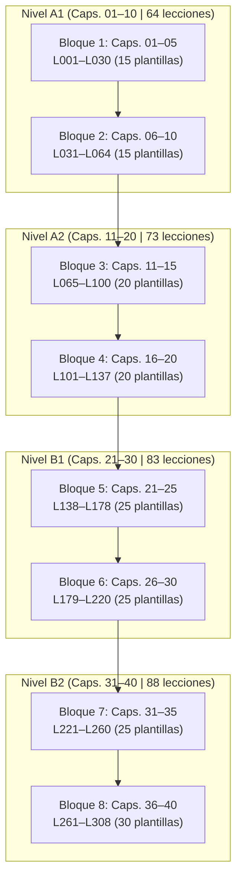

# Auditoría Curricular Integral A1–B2: Curso de Alemán (`de`)

**Fecha de emisión:** 16 de octubre de 2026  
**Especialidad:** Lingüística Aplicada, Diseño Curricular MCER y Desarrollo de Contenidos Paglot  
**Ámbito de aplicación:** Curso completo de alemán (`_herramientas/cursos/de/01.txt` a `40.txt` / `Idiomas/cursos/de/lessons/001.json` a `308.json`)  
**Documentos de referencia inspeccionados:**
- `_herramientas/cursos/de/capitulos.txt`
- `_herramientas/cursos/de/ESTADO.txt`
- `_herramientas/cursos/compilar.py`
- Fuentes de referencia MCER: *Goethe-Zertifikat A1 (Wortliste & Modellsatz)*, *Goethe-Zertifikat A2*, *Goethe-Zertifikat B1*, *Goethe-Zertifikat B2*, descriptores CEFR Companion Volume 2018/2020, planes curriculares universitarios de Graz, Schmalkalden, Basel, Mannheim y BTU Cottbus.

---

## 1. Resumen Ejecutivo y Diagnóstico Global

El curso de alemán consta formalmente de **308 lecciones distribuidas en 40 capítulos**, divididos teóricamente de forma simétrica en los 4 niveles del Marco Común Europeo de Referencia (MCER): 10 capítulos por nivel (A1: 1–10; A2: 11–20; B1: 21–30; B2: 31–40).

Tras una inspección exhaustiva lección por lección, bloque por bloque y ejercicio por ejercicio en el código fuente editable (`_herramientas/cursos/de/*.txt`) y en las lecciones compiladas (`Idiomas/cursos/de/lessons/*.json`), se constata una **fractura pedagógica estructural severa**:

1. **Magnitud de la degradación por plantillas:**
   - **Lecciones sólidas y auténticas:** 133 lecciones (43,2% del curso).
   - **Lecciones plantilla («Punto clave» / corrección automática):** **175 lecciones (56,8% del curso)**.
   - En todos los capítulos del curso (del 01 al 40) existe una inyección masiva de entre 3 y 6 lecciones clónicas por capítulo que no cumplen los estándares mínimos de diseño instruccional interactivo de Paglot.
2. **Distribución de las plantillas por nivel:**
   - **Nivel A1 (Caps. 01–10):** 34 sólidas | **30 plantillas (46,9%)**
   - **Nivel A2 (Caps. 11–20):** 33 sólidas | **40 plantillas (54,8%)**
   - **Nivel B1 (Caps. 21–30):** 33 sólidas | **50 plantillas (60,2%)**
   - **Nivel B2 (Caps. 31–40):** 33 sólidas | **55 plantillas (62,5%)**
3. **Colapso del análisis morfosintáctico (`>`):**
   - Mientras que en el nivel A1 se registran 395 glosas de análisis lingüístico (`>`), en el nivel B2 el análisis cae a solo 110 glosas en todo el nivel (un promedio de apenas 1,25 anotaciones por lección en el tramo más exigente de la lengua alemana).
4. **Paradoja curricular:**
   - Las 175 lecciones plantilla no abordan temas marginales o de relleno; al contrario: **los núcleos gramaticales más determinantes del alemán** (los verbos separables en A1, las *Wechselpräpositionen* y las subordinadas en A2, el *Passiv* y el *Konjunktiv II* en B1, el *Konjunktiv I*, los atributos participiales y la *N-Deklination* en B2) fueron delegados a estas plantillas estériles.

---

## 2. Anatomía de la Lección Plantilla («Punto Clave»)

El patrón automatizado detectado en las 175 lecciones responde exactamente a la siguiente estructura clónica:

1. **Cabecera e Introducción:**
   - Enunciado genérico: `I Afianzamos [tema] con una explicación breve y ejemplos de corrección automática.`
2. **Explicación y Tabla Reducida:**
   - Un único párrafo de explicación `E` que resume una regla en una o dos líneas, acompañado de un único ejemplo aislado: `Ejemplo: Der Weg ist zwar weit, aber sehr schön. = «El camino es largo, pero muy bonito.».`
   - Tabla `B Punto clave | Ejemplo correcto | Significado` con una sola fila que repite el mismo ejemplo.
3. **Ausencia total de inmersión discursiva:**
   - **0 diálogos (`D`):** Ninguna interacción entre interlocutores hablantes nativos.
   - **0 textos de lectura (`T`):** Ausencia de narraciones, avisos, cartas, correos, noticias o fragmentos auténticos.
   - **0 análisis lingüísticos (`>`):** Ninguna descomposición analítica de la estructura de la frase.
   - **0 fichas de vocabulario visible (`W`):** No se introducen fichas de léxico con pronunciación y consejos.
4. **Batería de 6 preguntas clónicas de metagramática (`Q`):**
   En todas y cada una de las 175 lecciones se repiten invariablemente las mismas 6 preguntas cerradas, basadas en el único ejemplo dado:
   - *Pregunta 1:* `¿Qué frase aplica correctamente la regla de [tema]?`
   - *Pregunta 2:* `Lee «[Ejemplo]». ¿Qué significa?`
   - *Pregunta 3:* `¿Qué regla explica «[Ejemplo]»?`
   - *Pregunta 4:* `¿Por qué «[Distractor incorrecto]» no es la forma adecuada para este ejemplo?`
   - *Pregunta 5:* `¿Qué corrección necesita «[Distractor incorrecto]»?`
   - *Pregunta 6:* `Quieres expresar «[Traducción]» en un texto breve. ¿Qué oración elegirías?`

### Consecuencias pedagógicas
- **Efecto fatiga y desmotivación:** El estudiante responde 6 veces sobre la misma oración con opciones de relleno artificiosas.
- **Inexistencia de práctica activa:** No se practican las destrezas de ordenación sintáctica (`ordenar`), huecos contextualizados (`huecos`), discriminación auditiva (`audio`) ni producción escrita guiada (`escribir`).
- **Incompatibilidad con el MCER:** El marco MCER exige que la competencia gramatical esté al servicio de la acción comunicativa y la comprensión lectora en géneros textuales reales.

---

## 3. Diagnóstico Curricular Nivel a Nivel (MCER)

### 3.1. Nivel A1 (Capítulos 01 al 10 | Lecciones 001 a 064)
- **Estado cuantitativo:** 64 lecciones (34 sólidas, 30 plantillas | 46,9% plantillas).
- **Inventario léxico:** 573 palabras únicas catalogadas; 34 diálogos, 15 textos, 395 glosas de análisis `>`.
- **Evaluación curricular según Goethe-Zertifikat Start Deutsch 1:**
  - *Fonética y ortografía:* El capítulo 1 sienta buenas bases en las lecciones 001–003, pero las lecciones 004 (*Sonidos sch y ch*), 005 (*Deletrear nombres*) y 006 (*Preguntas con W*) son plantillas. Es inadmisible que la discriminación fonética entre la *ich-Laut* (/ç/) y la *ach-Laut* (/x/), así como la fonética de *sch* (/ʃ/), se evalúe con 6 preguntas teóricas sin audios ni transcripción interactiva.
  - *Morfología verbal (Präsens):* La lección 010 (*Regelmäßige Verben*) es plantilla. Las terminaciones del presente (`-e`, `-st`, `-t`, `-en`, `-t`, `-en`) y las alternancias vocálicas (`e -> i/ie`, `a -> ä`) requieren diálogos cotidianos.
  - *Sintaxis básica (Satzbau):* Las reglas de posición dos del verbo conjugado (lección 011) y la posición uno en preguntas cerradas *Ja/Nein-Fragen* (lección 012) son plantillas. Deben transformarse en ejercicios de ordenación de palabras (`O`) y diálogos.
  - *Casos (Nominativ y Akkusativ):* El acusativo masculino con el artículo determinado (*den*), indeterminado (*einen*) y negativo (*keinen*) quedó relegado a la lección plantilla 017.
  - *Verbos separables (Trennbare Verben):* Es uno de los mayores escollos del hispanohablante. En la lección 028 (*Trennbare Verben*) se presenta como plantilla; debe tener diálogos extensos sobre la rutina diaria (*aufstehen, anrufen, fernsehen, einkaufen*) con análisis `>` del prefijo desplazado al final de la frase.
  - *Pasado básico (Perfekt y Präteritum de sein/haben):* Aunque las lecciones 057, 058 y 059 son sólidas, las lecciones 061 (*Perfekt mit haben*), 062 (*Perfekt mit sein*) y 063 (*Partizip ohne ge-*) son plantillas que dejan vacíos los participios con prefijos inseparables (*be-, ver-, er-, ent-, zer-*).
  - *Comprensión lectora:* Sólida en las lecciones de lectura de carteles, salidas de tren y la prueba final (064).

### 3.2. Nivel A2 (Capítulos 11 al 20 | Lecciones 065 a 137)
- **Estado cuantitativo:** 73 lecciones (33 sólidas, 40 plantillas | 54,8% plantillas).
- **Inventario léxico:** 504 palabras únicas; 28 diálogos, 14 textos, 269 glosas de análisis `>`.
- **Evaluación curricular según Goethe-Zertifikat A2:**
  - *El caso Dativo (Dativ):* El paso de acusativo a dativo es el núcleo de A2. Sin embargo, las lecciones 068 (*Dativ Plural im Alltag*), 069 (*Akkusativpronomen*) y 070 (*Dativpronomen: mir, dir, ihm, ihr, uns, euch, ihnen, Ihnen*) son plantillas. Falta contraste sistemático entre complementos directo e indirecto.
  - *Preposiciones mixtas (Wechselpräpositionen):* El contraste dinámico/estático (*Wo? + Dativ* vs. *Wohin? + Akkusativ*) con verbos pareados (*liegen/legen, stehen/stellen, sitzen/setzen, hängen*) está en las plantillas 082, 083 y 084. Esto priva al estudiante de ejercitar el cambio de caso en descripciones de habitaciones, mudanzas y mapas urbanos.
  - *Oraciones subordinadas básicas (Kausalsätze y Objektsätze):* Las conjunciones con verbo al final (*weil, dass, wenn, obwohl*) están en las plantillas 089, 090, 091 (*indirekte Fragen mit ob*) y 092 (*obwohl vs. trotzdem*). La *Verbendstellung* (verbo al final) exige abundante entrenamiento con el ejercicio de tipo `O`.
  - *Präteritum de verbos modales y auxiliares:* Las lecciones 104 (*war, hatte*) y 105 (*musste, konnte, durfte, wollte, sollte*) son plantillas.
  - *Oraciones de relativo en Nominativo y Acusativo:* Las lecciones 126 y 127 son plantillas sin textos descriptivos reales.

### 3.3. Nivel B1 (Capítulos 21 al 30 | Lecciones 138 a 220)
- **Estado cuantitativo:** 83 lecciones (33 sólidas, 50 plantillas | 60,2% plantillas).
- **Inventario léxico:** 568 palabras únicas; 29 diálogos, 9 textos, 218 glosas de análisis `>`.
- **Evaluación curricular según Goethe-Zertifikat B1:**
  - *Plusquamperfekt y subordinadas temporales:* La correlación temporal obligatoria (*Vorzeitigkeit*) con *nachdem* (+ Plusquamperfekt en la subordinada y Präteritum en la principal) y *bevor* es tratada en las plantillas 141, 142, 143 y 144. No hay narrativa histórica ni crónicas biográficas suficientes.
  - *Konjunktiv II (Deseos, hipótesis y cortesía irreal):* Las formas de pasado irreal (*hätte/wäre + Partizip II*) y los modales en Konjunktiv II se encuentran en las plantillas 150 a 154. Falta contexto de situaciones comprometidas, quejas y consejos psicológicos.
  - *Vorgangspassiv (Voz pasiva de proceso):* El uso del auxiliar *werden* en presente (*wird repariert*), pretérito (*wurde repariert*), Perfekt (*ist repariert worden*) y con modales (*muss repariert werden*), junto con los complementos agenciales (*von + Dativ* para agentes activos y *durch + Akkusativ* para causas/medios), está atrapado en las plantillas 158, 159, 160 y 161.
  - *Pronominaladverbien y verbos con preposición:* La diferenciación entre preguntas y referencias a cosas (*worauf / darauf, wovon / davon*) frente a personas (*auf wen? / auf ihn, von wem? / von ihm*) es una plantilla clónica en 167 y 168.
  - *Infinitivkonstruktionen (zu + Infinitiv, um...zu, ohne...zu, anstatt...zu):* Lecciones 174 a 178 son plantillas. Se pierde la oportunidad de trabajar motivos de viajes, objetivos profesionales y reglamentos.
  - *Genitiv y preposiciones de genitivo:* Declinación del sustantivo masculino/neutro (`-(e)s`), femenino/plural sin marca, y preposiciones *wegen, trotz, während, anstatt* (lecciones 190 a 193).
  - *Adjektivdeklination (Declinación completa del adjetivo):* La distinción entre declinación débil (tras artículo determinado), mixta (tras indeterminado/posesivo) y fuerte (sin artículo) en los 4 casos está en las plantillas 207, 208, 209 y 210.

### 3.4. Nivel B2 (Capítulos 31 al 40 | Lecciones 221 a 308)
- **Estado cuantitativo:** 88 lecciones (33 sólidas, 55 plantillas | 62,5% plantillas).
- **Inventario léxico:** 557 palabras únicas; 20 diálogos, 13 textos, **solo 110 glosas de análisis `>`**.
- **Evaluación curricular según Goethe-Zertifikat B2:**
  - *Konjunktiv I y estilo indirecto:* Esencial para la comprensión de noticias y prensa escrita en alemán (*Er sagte, er sei unschuldig; sie hätten keine Beweise*). Las formas de sustitución con Konjunktiv II cuando el Konjunktiv I coincide con el indicativo están en las plantillas 224, 225, 226 y 227.
  - *Pasiva de estado (Zustandspassiv) y alternativas a la pasiva:* La distinción funcional entre *Das Geschäft wird um 8 Uhr geschlossen* (proceso) y *Das Geschäft ist schon geschlossen* (estado), así como las estructuras sustitutivas formales (*sich lassen + Infinitiv*, *sein + zu + Infinitiv*, sufijos *-bar / -lich*), están en las plantillas 232, 233, 234, 235 y 236.
  - *Uso epistémico/subjetivo de los verbos modales:* Expresión de grados de certeza (*müssen* = certeza absoluta; *dürfte* = alta probabilidad; *könnte* = posibilidad; *soll* = rumor/atribución; *will* = afirmación no verificada del sujeto). Encapsulado en las plantillas 240 y 241.
  - *Partizipialattribute (Construcciones atributivas ampliadas):* Característica definitoria del alemán formal y académico (*das laut lachende Kind*, *die vor vielen Jahren gegründete Organisation*). Se limitaron a las plantillas 248, 249, 250, 251 y 252.
  - *N-Deklination (Masculinos débiles):* Declinación de sustantivos como *der Kollege, der Kunde, der Student, der Experte, der Nachbar, der Herr, der Mensch, der Name*. Tratada en las plantillas 256 y 257.
  - *Conectores discursivos dobles y complejos:* *je...desto* con doble comparativo y orden sintáctico invertido en la apódosis, *indem* (instrumental), *solange* (temporal restrictivo), *ohne dass* (modal excluyente), *sofern / insofern als* (condicional formal). Todos en plantillas (259, 274, 275, 276, 284, 285).
  - *Nomen-Verb-Verbindungen (Construcciones de verbo funcional):* *zur Verfügung stehen/stellen, eine Entscheidung treffen, in Kauf nehmen, Rücksicht nehmen auf, in Frage kommen*. Fundamental para B2, apenas esbozado sin textos reales de empresa o debate.

---

## 4. Inventario Detallado de Capítulos (01 al 40)

| Cap | Nivel | Título (Alemán / Español) | Rango Lecc. | Total | Sólidas | Plantillas | % Plant. | Estado Curricular |
|:---:|:---:|:---|:---:|:---:|:---:|:---:|:---:|:---|
| **01** | A1 | Hallo! / Saludos y presentaciones | 001–006 | 6 | 3 | 3 | 50.0% | Requiere reescritura de L004 a L006 (fonética `sch/ch`, deletreo, `W-Fragen`). |
| **02** | A1 | Woher kommst du? / Origen, trabajo e idiomas | 007–012 | 6 | 3 | 3 | 50.0% | Requiere reescritura de L010 a L012 (conjugación regular, verbo pos. 2, `Ja/Nein`). |
| **03** | A1 | Zahlen und Familie / Números y familia | 013–018 | 6 | 3 | 3 | 50.0% | Requiere reescritura de L016 a L018 (pronombres, acusativo masc., edad). |
| **04** | A1 | Wohnen und Dinge / La casa y las cosas | 019–024 | 6 | 3 | 3 | 50.0% | Requiere reescritura de L022 a L024 (género, plurales, dativo plural). |
| **05** | A1 | Mein Tag / Mi día | 025–030 | 6 | 3 | 3 | 50.0% | Requiere reescritura de L028 a L030 (verbos separables, hora, frecuencia). |
| **06** | A1 | Essen und Trinken / Comida y bebida | 031–037 | 7 | 4 | 3 | 42.9% | L037 es sólida (Speisekarte). Reescribir L034 a L036 (`gern/mögen`, envases). |
| **07** | A1 | Einkaufen und Kleidung / Compras y ropa | 038–043 | 6 | 3 | 3 | 50.0% | Requiere reescritura de L041 a L043 (`dieser`, comparativo con `als`, predicativo). |
| **08** | A1 | In der Stadt / Por la ciudad | 044–050 | 7 | 4 | 3 | 42.9% | L050 es sólida (Gleis). Reescribir L047 a L049 (modales `können, dürfen`, imperativo). |
| **09** | A1 | Freizeit / Tiempo libre | 051–056 | 6 | 3 | 3 | 50.0% | Requiere reescritura de L054 a L056 (futuro/planes `werden`, invitaciones, fechas). |
| **10** | A1 | Gestern und Reisen / El pasado y los viajes | 057–064 | 8 | 5 | 3 | 37.5% | L057–L060 y L064 son sólidas. Reescribir L061 a L063 (Perfekt `haben/sein`, participios). |
| **11** | A2 | Gesundheit / Cuerpo y salud | 065–071 | 7 | 3 | 4 | 57.1% | Reescribir L068 a L071 (dativo plural, pronombres Akk/Dat, consejos con `sollen`). |
| **12** | A2 | Arbeit und Beruf / Trabajo y profesiones | 072–078 | 7 | 3 | 4 | 57.1% | Reescribir L075 a L078 (verbos prep., preguntas personas, reflexivos, `würde`). |
| **13** | A2 | Wohnen und Umzug / Vivir y mudarse | 079–085 | 7 | 3 | 4 | 57.1% | Reescribir L082 a L085 (*Wechselpräpositionen*, `liegen/legen`, posesivo dativo). |
| **14** | A2 | Gründe und Meinungen / Razones y opiniones | 086–093 | 8 | 4 | 4 | 50.0% | L093 es sólida (Praxis). Reescribir L089 a L092 (`weil`, `dass`, `ob`, `obwohl/trotzdem`). |
| **15** | A2 | Vergleiche / Comparar | 094–100 | 7 | 3 | 4 | 57.1% | Reescribir L097 a L100 (Umlaut comparativo, superlativo `am -sten`, igualdad). |
| **16** | A2 | Früher und heute / Contar el pasado | 101–107 | 7 | 3 | 4 | 57.1% | Reescribir L104 a L107 (Präteritum `war/hatte`, modales, `als` vs. `wenn`). |
| **17** | A2 | Geschenke und Feste / Regalos y fiestas | 108–114 | 7 | 3 | 4 | 57.1% | Reescribir L111 a L114 (doble objeto Dat+Akk, pronombres, `seit/vor` + Dat). |
| **18** | A2 | Pläne und Nachrichten / Planes y mensajes | 115–122 | 8 | 4 | 4 | 50.0% | L122 es sólida (Zimmer). Reescribir L118 a L121 (`um...zu`, `damit`, futuro `werden`). |
| **19** | A2 | Reisen / El viaje | 123–129 | 7 | 3 | 4 | 57.1% | Reescribir L126 a L129 (relativos Nom/Akk, `jemand/niemand`, horarios). |
| **20** | A2 | Zusammenfassung / Repaso general | 130–137 | 8 | 4 | 4 | 50.0% | L137 es sólida (Examen A2). Reescribir L133 a L136 (`man`, `nicht dürfen/müssen`). |
| **21** | B1 | Im Beruf / En el trabajo | 138–146 | 9 | 4 | 5 | 55.6% | L146 es sólida (Mitteilung). Reescribir L141 a L145 (Plusquamperfekt, `nachdem, bevor`). |
| **22** | B1 | Gesund leben / Vivir sano | 147–154 | 8 | 3 | 5 | 62.5% | Reescribir L150 a L154 (Konjunktiv II pasado irreal, modales pasado). |
| **23** | B1 | Wohnen und Umwelt / Vivienda y medio ambiente | 155–162 | 8 | 3 | 5 | 62.5% | Reescribir L158 a L162 (Vorgangspassiv Präsens/Präteritum, con modal, `von/durch`). |
| **24** | B1 | Einkaufen und Dienste / Compras y servicios | 163–170 | 8 | 3 | 5 | 62.5% | Reescribir L166 a L170 (pronominales `worauf/darauf`, reflexivo dativo). |
| **25** | B1 | Reisen und Verkehr / Viajes y transporte | 171–178 | 8 | 3 | 5 | 62.5% | Reescribir L174 a L178 (`zu + Inf`, `um...zu`, `ohne...zu`, `statt...zu`). |
| **26** | B1 | Medien und Kultur / Medios y cultura | 179–186 | 8 | 3 | 5 | 62.5% | Reescribir L182 a L186 (relativos en dativo, con preposición, `was` tras *alles*). |
| **27** | B1 | Gesellschaft / Sociedad | 187–194 | 8 | 3 | 5 | 62.5% | Reescribir L190 a L194 (Genitiv declinación, `wegen, trotz, statt`). |
| **28** | B1 | Lernen und Beziehungen / Estudio y relaciones | 195–203 | 9 | 4 | 5 | 55.6% | L203 es sólida (Wohnraum). Reescribir L198 a L202 (`sodass`, conectores dobles). |
| **29** | B1 | Meinungen / Opiniones | 204–211 | 8 | 3 | 5 | 62.5% | Reescribir L207 a L211 (adjetivo débil, mixto, fuerte, sustantivados). |
| **30** | B1 | Rückblick / Repaso general | 212–220 | 9 | 4 | 5 | 55.6% | L220 es sólida (Examen B1). Reescribir L215 a L219 (Futur II, coherencia epistémica). |
| **31** | B2 | Mobilität / Movilidad | 221–228 | 8 | 3 | 5 | 62.5% | Reescribir L224 a L228 (Konjunktiv I `sei/habe`, regulares, formas sustitutivas). |
| **32** | B2 | Gesundheit im Netz / Salud en internet | 229–236 | 8 | 3 | 5 | 62.5% | Reescribir L232 a L236 (Zustandspassiv, pasiva impersonal, `sich lassen`, `sein zu`). |
| **33** | B2 | Lebensstil / Estilo de vida | 237–244 | 8 | 3 | 5 | 62.5% | Reescribir L240 a L244 (modales epistémicos, nominalización, grupos nominales). |
| **34** | B2 | Reisen und Geschichte / Viajes e historia | 245–252 | 8 | 3 | 5 | 62.5% | Reescribir L248 a L252 (Partizip I y II atributivos, participios ampliados). |
| **35** | B2 | Arbeit und Freizeit / Trabajo y ocio | 253–260 | 8 | 3 | 5 | 62.5% | Reescribir L256 a L260 (N-Deklination, aposiciones, `je...desto` avanzado). |
| **36** | B2 | Kunst und Ästhetik / Arte y estética | 261–270 | 10 | 4 | 6 | 60.0% | L270 es sólida (Studie Verkehr). Reescribir L264 a L269 (Komposita, partículas modales). |
| **37** | B2 | Gesellschaft / Sociedad | 271–279 | 9 | 3 | 6 | 66.7% | Reescribir L274 a L279 (`indem`, `solange`, `ohne dass`, conectores de discurso). |
| **38** | B2 | Kooperation und Konflikte / Cooperación y conflictos | 280–288 | 9 | 3 | 6 | 66.7% | Reescribir L283 a L288 (`hätte...müssen`, condicionales sin *wenn*, concesión). |
| **39** | B2 | Kaufen und Verkaufen / Comprar y vender | 289–298 | 10 | 4 | 6 | 60.0% | L298 es sólida (Bedingungen). Reescribir L292 a L297 (Passiv Perfekt `worden`, contratos). |
| **40** | B2 | Argumentieren / Argumentar | 299–308 | 10 | 4 | 6 | 60.0% | L308 es sólida (Examen B2). Reescribir L302 a L307 (argumentación dialéctica B2). |

---

## 5. Metodología de Desmantelamiento y Reescritura Pedagógica

Para suprimir de raíz las 175 plantillas sin reducir el catálogo de 308 lecciones ni alterar la indexación de la app, se ejecutará una **reescritura profunda en el archivo fuente de cada capítulo (`_herramientas/cursos/de/NN.txt`)**. Cada lección plantilla se transformará en una lección completa siguiendo los estándares de Paglot:

### 5.1. Reglas pedagógicas de transformación
1. **Diálogo interactivo (`D`) o Texto auténtico (`T`):**
   - Toda lección debe incluir una situación discursiva real de al menos 4 a 8 líneas de contenido.
   - En niveles A1–A2: diálogos situacionales en comercios, estaciones, trabajo, consultas médicas y relaciones interpersonales.
   - En niveles B1–B2: textos narrativos, artículos de opinión, informes de consumo, correspondencia formal, correos laborales y debates sociopolíticos.
2. **Análisis morfosintáctico línea a línea obligatorio (`>`):**
   - Cada frase del diálogo o texto debe desglosarse en sus constituyentes analíticos: caso gramatical, concordancia de género, función del conector, posición del verbo, valor aspectual o modal.
3. **Vocabulario activo contextualizado (`W` / `w`):**
   - Se introducirán entre 6 y 15 palabras nuevas por lección con transcripción fonética adaptada para hispanohablantes y consejos de adquisición mnemotécnica o contraste gramatical con el español.
4. **Batería variada de ejercicios (8 a 10 ítems por lección):**
   - Erradicación total de las 6 preguntas clónicas de autoevaluación.
   - Distribución equilibrada de tipos de ejercicio:
     - `Q`: Comprensión lectora o discriminación sintáctica con 3 opciones razonadas y explicadas.
     - `R`: Traducción contextualizada en alemán o español.
     - `H` / `HA`: Relleno de huecos guiado (con audio en `HA`).
     - `A`: Comprensión auditiva pura.
     - `O`: Ordenación de palabras (*Satzklammer*, inversión sujeto-verbo, *Verbendstellung* en subordinadas).
     - `X` / `XM`: Producción escrita objetiva (`X`) o autoevaluada guiada (`XM`).

---

## 6. Plan Operativo de Ejecución (Fase 4: Revisión Lección por Lección)

Para garantizar un control de calidad riguroso y permitir la compilación continua sin regresiones sintácticas, el trabajo de la **Fase 4** se dividirá exactamente en **8 bloques de 5 capítulos cada uno**, abarcando medio nivel MCER por bloque:

### Detalle de los 8 Bloques de Trabajo:

1. **Bloque 1 — Subnivel A1.1 (Capítulos 01 al 05 | Lecciones 001 a 030):**
   - *Alcance:* 30 lecciones (15 sólidas a verificar y pulir, 15 plantillas a reescribir por completo).
   - *Foco lingüístico:* Fonética interactiva (`sch/ch`), deletreo, preguntas `W`, presente regular e irregular, orden de la frase (V2 y V1), acusativo masculino con `haben` y familiares, géneros (`der/die/das`), plurales y verbos separables de rutina diaria.
2. **Bloque 2 — Subnivel A1.2 (Capítulos 06 al 10 | Lecciones 031 a 064):**
   - *Alcance:* 34 lecciones (19 sólidas a verificar, 15 plantillas a reescribir).
   - *Foco lingüístico:* Comida y compras en cafetería, demostrativo `dieser`, comparativo con `als`, modales básicos (`können, dürfen, müssen`), imperativo formal, planes futuros con presente/`werden`, fechas con `am`, y pasado Perfekt sistemático con `haben` y `sein`.
3. **Bloque 3 — Subnivel A2.1 (Capítulos 11 al 15 | Lecciones 065 a 100):**
   - *Alcance:* 36 lecciones (16 sólidas a verificar, 20 plantillas a reescribir).
   - *Foco lingüístico:* Caso Dativo en pronombres y plurales, verbos con régimen preposicional fijo, preguntas personales (`auf wen? / mit wem?`), reflexivos cotidianos, *Wechselpräpositionen* dinámicas y estáticas (`liegen/legen`), posesivos en dativo, y subordinadas causales/completivas (`weil, dass, wenn, obwohl`).
4. **Bloque 4 — Subnivel A2.2 (Capítulos 16 al 20 | Lecciones 101 a 137):**
   - *Alcance:* 37 lecciones (17 sólidas a verificar, 20 plantillas a reescribir).
   - *Foco lingüístico:* Präteritum de verbos modales y auxiliares (`war, hatte, musste, konnte`), conectores temporales (`als` vs. `wenn`), oraciones con doble objeto (Dativo de persona + Acusativo de cosa y orden de pronombres), preposiciones temporales `seit/vor + Dativ`, subordinadas finales `um...zu` vs. `damit`, oraciones de relativo en Nominativ/Akkusativ, pronombre impersonal `man` y contrastes de modalidad (`nicht müssen` vs. `nicht dürfen`).
5. **Bloque 5 — Subnivel B1.1 (Capítulos 21 al 25 | Lecciones 138 a 178):**
   - *Alcance:* 41 lecciones (16 sólidas a verificar, 25 plantillas a reescribir).
   - *Foco lingüístico:* Plusquamperfekt con anterioridad discursiva (`nachdem, bevor`), Konjunktiv II irreal en pasado (`hätte/wäre + Partizip II`), Vorgangspassiv en presente y pretérito con modales y complementos de causa/agente (`von/durch`), pronominales adverbiales (`worauf/darauf`), reflexivos en dativo (`ich wasche mir die Hände`), y construcciones de infinitivo (`zu + Infinitiv`, `um...zu`, `ohne...zu`, `statt...zu`).
6. **Bloque 6 — Subnivel B1.2 (Capítulos 26 al 30 | Lecciones 179 a 220):**
   - *Alcance:* 42 lecciones (17 sólidas a verificar, 25 plantillas a reescribir).
   - *Foco lingüístico:* Oraciones de relativo en Dativo y con preposición (`das Buch, über das...`), pronombres relativos neutros e indefinidos (`alles, was...`), caso Genitivo y sus preposiciones (`wegen, trotz, während`), conectores dobles correlativos (`sowohl...als auch, weder...noch, zwar...aber, einerseits...andererseits`), declinación completa del adjetivo en los 4 casos (débil, fuerte, mixta y adjetivos sustantivados), y el sistema de tiempos futuros e hipótesis (`Futur II, werden als Vermutung`).
7. **Bloque 7 — Subnivel B2.1 (Capítulos 31 al 35 | Lecciones 221 a 260):**
   - *Alcance:* 40 lecciones (15 sólidas a verificar, 25 plantillas a reescribir).
   - *Foco lingüístico:* Estilo indirecto y Konjunktiv I (*sei, habe, werde, gehe*) con formas supletorias en Konjunktiv II; Zustandspassiv (*sein + Partizip II*) frente a Vorgangspassiv; alternativas formales a la pasiva (*sich lassen*, *sein + zu + Infinitiv*, adjetivos en *-bar/-lich*); verbos modales en uso epistémico de conjetura (*müssen, dürften, können*); nominalización y análisis de cadenas nominales complejas; *Partizip I* y *Partizip II* atributivos y participios ampliados; y flexión débil de masculinos (*N-Deklination*).
8. **Bloque 8 — Subnivel B2.2 (Capítulos 36 al 40 | Lecciones 261 a 308):**
   - *Alcance:* 48 lecciones (18 sólidas a verificar, 30 plantillas a reescribir).
   - *Foco lingüístico:* Formación de palabras compuestas (*Komposita* con *Fugen-s*), prefijos verbales inseparables y separables de matiz abstracto, partículas modales del alemán oral culto (*doch, ja, denn, halt, wohl*), conectores subordinantes avanzados (*indem, solange, ohne dass, sofern, als ob*), Konjunktiv II en pasado con doble infinitivo modal (*hätte...anrufen müssen*), condicionales hipotéticas sin nexo (*Hätte ich das gewusst, wäre ich...*), voz pasiva en tiempos compuestos (*ist renoviert worden*), pasiva con dativo/benefactivo (*bekommen/kriegen + Partizip II*), y producción de textos argumentativos, formales y dialécticos para el examen final B2.

---

## 7. Criterios de Aceptación y Validación Técnica Continua

Cada bloque completado en la Fase 4 deberá satisfacer los siguientes criterios estrictos antes de darse por cerrado:
1. **Compilación impecable:** Ejecución de `py -X utf8 _herramientas/cursos/compilar.py de` con salida `0 avisos` y mantenimiento exacto de las 308 lecciones.
2. **Cobertura de vocabulario al 100%:** Ninguna palabra en diálogos o textos puede quedar sin registrar en el bloque `palabras` (fichas `W` o `w`) o en la lista de nombres propios `N`.
3. **Validez morfosintáctica de los análisis (`>`):** Cada segmento analizado debe coincidir exactamente con una subcadena de la frase correspondiente.
4. **Unicidad e idoneidad de ejercicios:** Cada ejercicio debe tener una única opción marcada como correcta, distractores plausibles con explicaciones formativas rigurosas y enunciados pedagógicos no clónicos.
5. **Control de versiones y documentación:** Actualización inmediata de `_herramientas/cursos/de/ESTADO.txt` tras culminar cada bloque.
