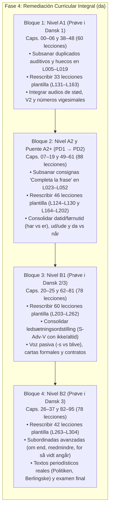

# Auditoría Curricular Integral A1–B2: Curso de Danés (`da`)

**Fecha de emisión:** 16 de octubre de 2026  
**Especialidad:** Lingüística Aplicada, Diseño Curricular MCER / Prøve i Dansk y Desarrollo de Contenidos Paglot  
**Ámbito de aplicación:** Curso completo de danés (`_herramientas/cursos/da/`, `_herramientas/cursos/da_ampliacion/` e `Idiomas/cursos/da/lessons/001.json` a `304.json` / `capitulos.json`)  
**Documentos y fuentes de referencia inspeccionados:**
- `_herramientas/cursos/da/capitulos.txt`, `ESTADO.txt`, `desde.txt` y archivos fuente `20.txt` a `37.txt`
- `_herramientas/cursos/da_ampliacion/` (`generar.py`, `finalizar.py`, `README.md`, `capitulos.txt`, `desde.txt` y `da/*.txt`)
- `Notas_archivos_noafectaalcodigo/informe_danes.txt` (registro de revisión secuencial de lecciones 001 a 013)
- `Idiomas/cursos/da/lessons/capitulos.json` e inventario completo de 304 archivos `.json`
- Marcos de referencia oficiales: *Marco Común Europeo de Referencia para las Lenguas (MCER / CEFR Companion Volume)*; sistema de exámenes de lengua danesa del Ministerio de Inmigración e Integración de Dinamarca (*Udlændinge- og Integrationsministeriet*): **Prøve i Dansk 1 (PD1: A1–A2)**, **Prøve i Dansk 2 (PD2: A2–B1)** y **Prøve i Dansk 3 (PD3: B1–B2)**; *Den Danske Ordbog (DDO)* y *Korpus DK* del *Det Danske Sprog- og Litteraturselskab (DSL)*; normas ortográficas oficiales de la *Retskrivningsordbogen (RO)* del *Dansk Sprognævn (DSN)*; y bibliografía gramatical contrastiva de referencia (*Dansk funktionel grammatik*, *Grammatik over det Danske Sprog*, *The Syntax of Mainland Scandinavian*).

---

## 1. Resumen Ejecutivo y Diagnóstico Global

El curso de danés en Paglot cuenta actualmente con **304 lecciones distribuidas en 96 capítulos**, organizadas curricularmente para abarcar desde el nivel inicial A1 hasta el nivel avanzado independiente B2, estructuradas de acuerdo con la escala oficial danesa de integración y competencia lingüística (*Prøve i Dansk 1, 2 y 3*).

Tras una auditoría minuciosa del repositorio didáctico, de los scripts de autoría y compilación (`generar.py`, `finalizar.py`, `compilar.py`) y de los 304 archivos JSON de lección, se constata una **fractura metodológica y curricular neta de dos mitades dispares**:

```
                       Curso Completo de Danés (304 lecciones / 96 capítulos)
 ┌─────────────────────────────────────────────────────────┬─────────────────────────────────────────────────────────┐
 │               LECCIONES BASE HISTÓRICAS                 │              LECCIONES DE AMPLIACIÓN (CLÓNICAS)          │
 │              123 lecciones (40,5% del curso)            │               181 lecciones (59,5% del curso)           │
 ├─────────────────────────────────────────────────────────┼─────────────────────────────────────────────────────────┤
 │ • 146 diálogos situacionales auténticos (`D`)           │ • 0 diálogos situacionales (`D`)                        │
 │ • 5.808 glosas morfosintácticas detalladas (`>`)        │ • 0 glosas morfosintácticas (`>`)                       │
 │ • 3.840 palabras con fonética y consejos específicos    │ • 713 palabras introducidas en microtextos rígidos       │
 │ • Riqueza interactiva: test, ordenación, huecos, audio   │ • Molde clónico invariable de 2 frases y 6 ejercicios    │
 │ • Tratamiento contrastivo de fonética y sintaxis danesa  │ • 100% afectadas por consignas duplicadas internas      │
 └─────────────────────────────────────────────────────────┴─────────────────────────────────────────────────────────┘
```

### 1.1. Balance Cuantitativo del Curso por Nivel MCER
La secuencia pedagógica oficial aplicada por `finalizar.py` distribuye los 96 capítulos en 5 tramos pedagógicos:

| Nivel MCER / Examen Oficial | Capítulos | Total Lecc. | Base (Sólidas) | Ampliación (Clónicas) | % Ampliación | Diálogos (`D`) | Textos (`T`) | Glosas (`>`) | Palabras | Ejercicios |
|:---:|:---:|:---:|:---:|:---:|:---:|:---:|:---:|:---:|:---:|:---:|
| **A1** *(Prøve i Dansk 1)* | 00–06 y 38–48 | 60 | 27 | 33 | **55,0%** | 39 | 40 | 1.532 | 1.467 | 405 |
| **A2** *(Prøve i Dansk 2)* | 07–16 y 49–58 | 64 | 34 | 30 | **46,9%** | 73 | 47 | 3.374 | 1.423 | 355 |
| **A2+ Puente** *(PD1 → PD2)* | 17–19 y 59–61 | 24 | 8 | 16 | **66,7%** | 4 | 20 | 391 | 491 | 190 |
| **B1** *(Prøve i Dansk 2/3)* | 20–25 y 62–81 | 78 | 18 | 60 | **76,9%** | 11 | 73 | 205 | 503 | 547 |
| **B2** *(Prøve i Dansk 3)* | 26–37 y 82–95 | 78 | 36 | 42 | **53,8%** | 19 | 61 | 306 | 669 | 550 |
| **TOTAL GENERAL** | **96 Caps.** | **304** | **123** | **181** | **59,5%** | **146** | **241** | **5.808** | **4.553** | **2.047** |

---

## 2. Esclarecimiento Técnico del Escaneo Previo: Las «209 lecciones con preguntas duplicadas»

El escaneo automatizado preliminar del sistema arrojó una alerta crítica de **209 lecciones con preguntas duplicadas**. La auditoría ha identificado la causa matemática y tipográfica exacta de esta cifra:

```
                            209 Lecciones con Preguntas Duplicadas
  ┌───────────────────────────────────────────────────────────┬──────────────────────────────────────────────┐
  │         181 LECCIONES DE AMPLIACIÓN (L124 a L304)         │          28 LECCIONES BASE (L001 a L123)     │
  │                    (100% de la ampliación)                │               (22,8% de la base)             │
  ├───────────────────────────────────────────────────────────┼──────────────────────────────────────────────┤
  │ Todas las 181 lecciones generadas por generar.py          │ 28 lecciones históricas donde compilar.py o  │
  │ contienen DOS ejercicios de huecos (H) con el enunciado   │ el autor generaron consignas idénticas en    │
  │ exactamente idéntico:                                     │ dos o más ejercicios de la misma lección:    │
  │                                                           │                                              │
  │ «Completa con la palabra que aparece en el texto.»        │ • «Completa la frase.» (11 lecciones)        │
  │                                                           │ • «¿Qué significa?» (4 lecciones)            │
  │ Además de compartir enunciados fijos entre lecciones:     │ • «Escucha. ¿Qué significa?» (3 lecciones)   │
  │ • «¿Qué información da la segunda frase del texto?» (181) │ • «Escucha y ordena.» (2 lecciones)          │
  │ • «Traduce la frase completa.» (181 lecciones)            │ • «Escucha. ¿Qué número es?» (2 lecciones)   │
  │ • «Comprueba el orden de la frase principal o subordinada»│ • Pistas de audio duplicadas (6 lecciones)   │
  └───────────────────────────────────────────────────────────┴──────────────────────────────────────────────┘
                                  TOTAL EXACTO: 181 + 28 = 209 LECCIONES
```

### 2.1. Desglose de las 181 lecciones de ampliación (L124 a L304)
En `_herramientas/cursos/da_ampliacion/generar.py` (líneas 642–647), el código de generación inyecta en cada lección dos ejercicios de huecos consecutivos:
```python
    cloze1 = __import__('re').sub(__import__('re').escape(w1), '___', d1, count=1, flags=__import__('re').I)
    cloze2 = __import__('re').sub(__import__('re').escape(w2), '___', d2, count=1, flags=__import__('re').I)
    chunks.append(f'H {cloze1} :: Completa con la palabra que aparece en el texto.')
    chunks.extend(qline(w1, b1, f'La palabra correcta es «{w1}».'))
    chunks.append(f'H {cloze2} :: Completa con la palabra que aparece en el texto.')
    chunks.extend(qline(w2, b2, f'La palabra correcta es «{w2}».'))
```
El campo `pregunta` en el JSON compilado toma el valor `"Completa con la palabra que aparece en el texto."` para ambos ítems, lo que provoca que **las 181 lecciones de ampliación fallen de forma unánime e inmediata en cualquier test de unicidad de preguntas**.

### 2.2. Desglose de las 28 lecciones base (L001 a L123)
En las lecciones base, las duplicidades se derivan de la falta de especificidad en las consignas automáticas de ejercicios de tipo `huecos` (`H`), `test` (`Q`) y `audio` (`A`):
1. **«Completa la frase.» (11 lecciones):** L014, L017, L023, L025, L028, L030, L032, L034, L036, L039, L041. En todas ellas hay dos ejercicios de rellenar huecos donde no se redactó una instrucción personalizada.
2. **«¿Qué significa?» (4 lecciones):** L012, L029, L045, L052. Preguntas de vocabulario con idéntica formulación genérica.
3. **«Escucha. ¿Qué significa?» (3 lecciones):** L022, L024, L026. Ejercicios de discriminación auditiva sin contexto diferenciador.
4. **«Escucha y ordena.» (2 lecciones):** L009, L014.
5. **«Escucha. ¿Qué número es?» (2 lecciones):** L010, L016.
6. **Consignas auditivas contextuales repetidas (6 lecciones):** L005 (*«Escucha. ¿Qué palabra es?»*), L011 (*«Escucha. ¿Qué pregunta?»*), L012 (*«Escucha. ¿Qué has oído?»*), L013 (*«Escucha y responde.»*), L018 (*«Escucha y responde según el texto.»*), L019 (*«Escucha. ¿Qué fecha es?»* y *«Escucha. ¿Qué día es?»*).

---

## 3. Anatomía de la Lección de Ampliación Clónica

Las 181 lecciones de ampliación (Capítulos 38 a 95 y divisiones en 17 a 19) no constituyen lecciones interactivas auténticas de Paglot, sino **fichas de lectura clónicas de 2 frases**. Cada una de ellas replica exactamente el siguiente molde:

1. **Cabecera rígida:**
   - Presentación de 2 palabras clave obligatorias (`W word = translation`) y un listado de vocabulario de apoyo oculto (`w word = gloss`).
2. **Microtexto de exactamente 2 líneas (`T`):**
   - Frase 1 (`d1 = e1`): oración breve danesa con su traducción.
   - Frase 2 (`d2 = e2`): segunda oración danesa con su traducción.
3. **Ausencia total de inmersión comunicativa:**
   - **0 diálogos (`D`):** Ninguna conversación real entre hablantes nativos.
   - **0 glosas morfosintácticas (`>`):** No hay desglose de elementos de la frase ni explicaciones gramaticales de morfología o sintaxis.
4. **Batería fija de 6 ejercicios mecánicos e invariables:**
   - *Ejercicio 1 (`test`):* `¿Qué significa «[w1]» en el texto?`
   - *Ejercicio 2 (`test`):* `¿Qué información da la segunda frase del texto?` (con distractores formados por rotación de traducciones de otras lecciones).
   - *Ejercicio 3 (`huecos`):* `[Frase 1 con hueco] :: Completa con la palabra que aparece en el texto.`
   - *Ejercicio 4 (`huecos`):* `[Frase 2 con hueco] :: Completa con la palabra que aparece en el texto.` *(Duplicado idéntico al anterior)*.
   - *Ejercicio 5 (`traduccion`):* `[Frase 1] :: Traduce la frase completa.`
   - *Ejercicio 6 (`ordenar`):* `[Frase 2] :: Comprueba el orden de la frase principal o subordinada.`

### Patología didáctica de las plantillas de lectura
- **Memorización a cortísimo plazo sin asimilación:** El estudiante sólo tiene que mirar el microtexto de 2 líneas situado en la parte superior para responder mecánicamente a las 6 preguntas.
- **Inexistencia de producción libre o guiada:** Cero ejercicios de escritura activa (`escribir`), cero audios reales de diálogo y cero entrenamiento contrastivo de pronunciación.
- **Degradación de los niveles avanzados:** En los niveles B1 y B2, donde el estudiante debe enfrentarse a textos extensos y complejos de prensa y ensayo (*Politiken*, *Berlingske*), el curso le ofrece textos de apenas 20 a 25 palabras totales.

---

## 4. Diagnóstico Curricular Nivel a Nivel (MCER / Prøve i Dansk)

### 4.1. Nivel A1 (Capítulos 00–06 y 38–48 | 60 lecciones | Prøve i Dansk 1)
- **Estado cuantitativo:** 60 lecciones (27 base sólidas, 33 ampliaciones clónicas | 55,0% ampliación).
- **Inventario léxico:** 1.467 palabras; 39 diálogos, 40 textos, 1.532 glosas de análisis lingüístico.
- **Evaluación curricular según los descriptores de Prøve i Dansk 1 (A1):**
  - *Fonética danesa y stød (Capítulo 0):*
    - **Aciertos:** Las lecciones 005 y 006 abordan la fonética de vocales específicas (/æ, ø, å/) y el fenómeno del **stød** (la constricción laríngea / parada glotal que distingue pares mínimos como *hun* [ella] vs. *hund* [perro] con stød, o *bønder* [campesinos] vs. *bønner* [alubias]).
    - **Carencias:** El *stød* se explica de forma teórica. Faltan ejercicios sistemáticos de pares mínimos auditivos interactivos. La asimilación vocálica ante /r/ (*r-farvning*, donde la /r/ uvular posterior abre las vocales precedentes o siguientes, como en *ret* [ʁad] o *bære* [bɛːɐ]) requiere más atención práctica.
  - *Morfología verbal (Nutid):*
    - **Aciertos:** Se asimila con claridad la regla de oro danesa: el presente (*nutid*) se forma de manera universal añadiendo **-r** a la raíz o al infinitivo (*taler, bor, spiser, kommer*), sin flexión por persona ni número (*jeg taler, vi taler*).
    - **Carencias:** Es necesario reforzar los pocos presentes irregulares sin terminación -r (*er, har, vil, skal, må, kan, ved, gør*).
  - *Sintaxis oracional y regla V2:*
    - **Aciertos:** La lección 014 introduce de forma sólida la regla V2 en la oración principal declarativa con sujeto inicial (*Jeg ser en film*).
    - **Carencias:** Cuando se introduce un elemento circunstancial de tiempo o lugar (*I dag...*), la inversión V2 (*I dag ser jeg en film*) no está suficientemente consolidada en las lecciones clónicas de rutina diaria (Caps. 40 y 48).
  - *Sustantivos, artículos y género gramatical:*
    - **Aciertos:** El capítulo 2 (L012) explica con gran rigor el sistema de dos géneros: *fælleskøn* (común: *en mand -> manden*) e *intetkøn* (neutro: *et hus -> huset*).
    - **Carencias:** La formación de plurales (*-er*, *-e*, invariables *-ø*, y alternancias vocálicas como *barn -> børn*, *mand -> mænd*) queda diluida en las plantillas clónicas de ropa y compras (Caps. 44 y 48).
  - *Negación con «ikke»:*
    - **Aciertos:** Se enseña correctamente la posición postverbal en la oración principal (*Jeg forstår ikke*).
  - *Sistema numérico danés:*
    - **Aciertos:** Números del 0 al 20 en L003 y L010.
    - **Carencias severas:** El sistema de decenas a partir de 50 en danés es vigesimal fraccionario (*halvtreds* [50 = 2½ × 20], *tres* [60 = 3 × 20], *halvfjerds* [70 = 3½ × 20], *firs* [80 = 4 × 20], *halvfems* [90 = 4½ × 20]). En las lecciones base se menciona de paso, pero las lecciones de compras y precios de la ampliación (Cap. 41 y 44) no entrenan al estudiante en la descodificación auditiva de estas formas vigesimales, esenciales para desenvolverse en comercios en Dinamarca.

---

### 4.2. Nivel A2 (Capítulos 07–16 y 49–58 | 64 lecciones | Prøve i Dansk 2 inicial)
- **Estado cuantitativo:** 64 lecciones (34 base sólidas, 30 ampliaciones clónicas | 46,9% ampliación).
- **Inventario léxico:** 1.423 palabras; 73 diálogos, 47 textos, 3.374 glosas de análisis lingüístico.
- **Evaluación curricular según los descriptores de Prøve i Dansk 2 (A2):**
  - *Tiempos de pasado (Datid y Førnutid):*
    - **Aciertos:** El pretérito simple (*datid*) con sufijos débiles regulares **-ede** (*arbejdede, ventede*) y **-te** (*spiste, kørte, læste*), así como verbos fuertes de alta frecuencia (*gik, kom, var, fik, så*), están bien tratados en los capítulos 04 y 07.
    - **Carencias:** El pretérito perfecto compuesto (*førnutid*) requiere dominar la alternancia de auxiliares: **har** para verbos transitivos y de acción durativa (*har læst, har spist*), frente a **er** para verbos intransitivos de cambio de estado o movimiento (*er gået, er kommet, er sket, er blevet*). Esta distinción capital queda huérfana en las 30 lecciones de ampliación de A2 (Caps. 49–58), donde los tiempos verbales se presentan sin ningún contraste guiado.
  - *Inversión sintáctica V2 sistemática:*
    - **Aciertos:** Diálogos vivos en los capítulos 08 a 14 donde el complemento circunstancial o el objeto se anteponen (*Nu skal vi spise*; *Heldigvis har jeg fri*).
    - **Carencias:** Los ejercicios de ordenación de palabras de la ampliación (`O`) no discriminan si el estudiante comprende la inversión obligatoria o si simplemente recuerda la frase de 2 líneas memorizada.
  - *Verbos modales en presente y pasado:*
    - **Aciertos:** Se introducen los modales fundamentales: *kunne/kan/kunne* (capacidad/posibilidad), *skulle/skal/skulle* (obligación/futuro programado), *ville/vil/ville* (voluntad/futuro espontáneo), *måtte/må/måtte* (permiso/prohibición en negativo: *må ikke*), *burde/bør/burde* (consejo).
    - **Carencias:** Falta práctica contextual de situaciones reales de cortesía danesa (*Kunne du tænke dig...?*, *Må jeg bede om...?*).
  - *Adjetivos y concordancia:*
    - **Aciertos:** El capítulo 6 (L025) presenta la concordancia atributiva y predicativa en género común (*en stor bil*), neutro con sufijo **-t** (*et stort hus*) y plural con sufijo **-e** (*store biler, store huse*).
    - **Carencias:** La forma definida débil con **-e** obligatoria ante artículo definido predeterminado (*den store bil*, *det store hus*, *de store biler*) apenas cuenta con ejercicios interactivos y produce confusión en las lecciones clónicas de vivienda y tiendas (Caps. 51 y 54).
  - *Adverbios de dirección vs. lugar/estatismo:*
    - **Aciertos:** La lección 040 (Cap. 11) aborda uno de los temas más difíciles del danés: la distinción morfológica entre dirección hacia un lugar (forma corta) y reposo en el lugar (forma larga en *-e*): *ud / ude*, *ind / inde*, *op / oppe*, *ned / nede*, *hjem / hjemme*.
    - **Carencias:** Es un contenido crucial que no tiene continuidad ni ejercicios de refuerzo en los capítulos de viajes y hoteles de la ampliación (Caps. 52 y 53).
  - *Conectores temporales y causales:*
    - **Aciertos:** Distinción básica entre *fordi* (causa en subordinada) y *derfor* (consecuencia en principal con inversión V2).
    - **Carencias severas:** El contraste fundamental del danés entre **da** (tiempo pasado puntual: «cuando llegué / cuando era joven») y **når** (tiempo presente, futuro o habitual: «cuando llueve / cuando venga») está presente en la lección 055 pero completamente omitido en las plantillas de A2.

---

### 4.3. Tramo Puente A2+ (Capítulos 17–19 y 59–61 | 24 lecciones)
- **Estado cuantitativo:** 24 lecciones (8 base, 16 ampliación | 66,7% ampliación).
- **Inventario léxico:** 491 palabras; 4 diálogos, 20 textos, 391 glosas de análisis lingüístico.
- **Función pedagógica en la estructura del curso:**
  - Constituye la bisagra crítica de transición entre la conversación cotidiana de supervivencia (*Prøve i Dansk 1*) y la competencia social y laboral estructurada (*Prøve i Dansk 2*).
  - En los capítulos 17 a 19 se abordaron núcleos gramaticales avanzados:
    1. Las partículas modales de conversación (*jo, da, nok, vel*).
    2. La construcción causativa **få nogen til at gøre noget** (*Lea fik sin bror til at hente en pakke*).
    3. La distinción entre los pronombres posesivos reflexivos de tercera persona (**sin, sit, sine**, que remiten exclusivamente al sujeto de su propia proposición) frente a los no reflexivos (**hans, hendes, deres**, que remiten a un referente externo: *Peter elsker sin kone* [su propia mujer] vs. *Peter elsker hans kone* [la mujer de otro]).
    4. La pasiva morfológica en **-s** en carteles y anuncios (*cykler sælges*, *parken lukkes*).
  - **Problema detectado:** Al inyectarse las ampliaciones 124–130 dentro de los capítulos 17–19 y crearse los capítulos 59–61 como lecturas temáticas breves, se perdió la posibilidad de trabajar estos núcleos con diálogos de interacción extensos y ejercicios contrastivos profundos.

---

### 4.4. Nivel B1 (Capítulos 20–25 y 62–81 | 78 lecciones | Prøve i Dansk 2 avanzado / PD3 inicial)
- **Estado cuantitativo:** 78 lecciones (18 base sólidas, 60 ampliaciones clónicas | **76,9% ampliación** —el tramo más degradado por plantillas del curso—).
- **Inventario léxico:** 503 palabras; 11 diálogos, 73 textos, solo 205 glosas de análisis lingüístico.
- **Evaluación curricular según los descriptores de Prøve i Dansk 2 y 3 (B1):**
  - *Orden sintáctico subordinado (Ledsætningsordstilling / Regla S-C-V):*
    - **El pilar supremo del B1 en danés:** En las oraciones subordinadas introducidas por conjunciones subordinantes (*at, fordi, da, når, selvom, hvis, efter at, inden*), el orden de palabras canónico danés altera radicalmente la posición del adverbio oracional central (*centraladverbium*, como *ikke, altid, aldrig, ofte, måske*). Mientras que en la oración principal el adverbio va DETRÁS del verbo conjugado (*Han kommer IKKE*), en la subordinada el adverbio se intercala OBLIGATORIAMENTE ENTRE el sujeto y el verbo conjugado (**S - Adv - V**: *... fordi han IKKE kommer*).
    - **Evaluación:** Las lecciones base 070 a 081 explican este fenómeno de forma excelente. Sin embargo, en las 60 lecciones de ampliación (L203 a L262), que representan el 76,9% de todo el nivel B1, los ejercicios se limitan a rellenar palabras sueltas o traducir frases completas, sin un solo ejercicio interactivo específico de ordenación sintáctica subordinada (*ledsætningsordstilling*) con el motor `O`.
  - *Estilo indirecto (Indirekte tale):*
    - **Aciertos:** Tratado en el capítulo 22 (L076 a L078) con oraciones afirmativas con *at* e interrogativas con *om*.
    - **Carencias:** Falta trabajo riguroso de la concordancia temporal del pasado (*datid*) en el estilo indirecto (*Han sagde, at han ikke vidste det*).
  - *Oraciones de relativo con «som» y «der»:*
    - **Aciertos:** Se distingue el uso de **der** (que solo puede funcionar como sujeto de la oración de relativo) frente a **som** (que puede funcionar como sujeto o como complemento directo/preposicional).
    - **Carencias:** No se ejercita la elisión coloquial y formal del pronombre relativo cuando cumple función de objeto (*Manden, (som) jeg mødte i går...*).
  - *Voz pasiva completa: s-passiv vs. blive-passiv vs. være + participio:*
    - **Aciertos:** En el capítulo 25 y en lecciones base se distingue la pasiva en **-s** (habitual en instrucciones escritas, recetas, normas, carteles y procesos intemporales) de la pasiva perifrástica con **blive + participio** (procesos concretos, dinámicos o que ocurren en un momento temporal definido) y del estado resultante con **være + participio**.
    - **Carencias:** El 76,9% de lecciones plantilla no permite redactar ni transformar oraciones activas en pasivas, destreza fundamental exigida en la parte de producción escrita de Prøve i Dansk 2.
  - *Oraciones condicionales e hipotéticas:*
    - **Aciertos:** El capítulo 20 (L070–072) trata con brillantez las condiciones reales en presente (*Hvis jeg har tid, kommer jeg*) frente a las hipotéticas irreales en pasado (*Hvis jeg havde tid, ville jeg komme* / *Hvis jeg havde haft tid, ville jeg have kommet*).
  - *Comprensión de textos formales y burocráticos:*
    - **Aciertos:** Las lecciones base 082 a 084 (Cap. 24) incluyen cartas de reclamación formal (*reklamation, klage*), solicitudes de empleo y currículum.
    - **Carencias:** Las ampliaciones del B1 (Caps. 68 a 72) sobre contratos de alquiler (*lejekontrakt*), condiciones laborales y bienestar social se quedaron en microtextos de 2 frases sin vocabulario administrativo denso.

---

### 4.5. Nivel B2 (Capítulos 26–37 y 82–95 | 78 lecciones | Prøve i Dansk 3)
- **Estado cuantitativo:** 78 lecciones (36 base sólidas, 42 ampliaciones clónicas | 53,8% ampliación).
- **Inventario léxico:** 669 palabras; 19 diálogos, 61 textos, 306 glosas de análisis lingüístico.
- **Evaluación curricular según los descriptores de Prøve i Dansk 3 (B2):**
  - *Subordinación compleja y conectores avanzados:*
    - **Aciertos:** Las lecciones base 100 a 102 (Cap. 30) trabajan conectores adversativos y concesivos que provocan inversión V2 cuando abren oración principal: *derfor, dog, alligevel, desuden, imidlertid, omvendt*.
    - **Carencias:** Conectores subordinantes altamente formales indispensables en Prøve i Dansk 3 como **om end** (si bien / aun cuando), **medmindre** (a menos que / a no ser que), **for så vidt angår** (en lo que concierne a), **forudsat at** (siempre que / a condición de que) y **uanset om** (independientemente de si) aparecen de forma aislada o superficial y no se entrenan en ensayos argumentativos.
  - *Partículas modales pragmáticas y matiz epistémico:*
    - **Aciertos:** Las lecciones base 106 a 108 (Cap. 32) y 118 a 120 (Cap. 36) abordan el sistema de partículas modales danesas (**jo, da, vel, altså, nok, skam**), que determinan la actitud del hablante, el consenso compartido y los grados de aserción.
    - **Carencias:** Las 42 lecciones de ampliación de B2 (Caps. 82 a 95) carecen de tareas de análisis pragmático donde se pida al estudiante interpretar el subtexto o la ironía en una columna periodística.
  - *Verbos modales de disposición anímica y modismos:*
    - **Aciertos:** Excelente tratamiento de **gide** (*jeg gider ikke* = no tengo ganas / me da pereza), **orke** (no tener energías físicas o psicológicas para algo) y **behøve** frente a **må** en el capítulo 28.
  - *Voz pasiva avanzada con modales y tiempos compuestos:*
    - **Aciertos:** Tratamiento de *bør undersøges*, *skal tages i betragtning*, *vil blive gennemført* en capítulos 27 y 31.
  - *Comprensión de prensa, debate público y ensayo:*
    - **Aciertos:** Los capítulos base 34 a 37 presentan textos sobre automatización laboral, política sanitaria, crisis climática y debates de opinión comparados, con un examen final de lectura B2 en la lección 123.
    - **Carencias severas:** Las 42 lecciones de ampliación que debían expandir el B2 (Caps. 82 a 95) redujeron artículos de opinión de periódicos daneses prestigiosos (*Politiken*, *Berlingske*, *Weekendavisen*) a dos míseras frases sintéticas, impidiendo que el alumno desarrolle la destreza de lectura crítica rápida y análisis de argumentos requerida para superar el examen oficial Prøve i Dansk 3.

---

## 5. Inventario Exhaustivo de los 96 Capítulos del Curso de Danés

A continuación se detalla el estado analítico de cada uno de los 96 capítulos que integran el curso de danés en disco, contrastando lecciones base frente a lecciones de ampliación:

| Cap. | Nivel | Título en danés | Título en español | Lecciones | Base | Ampl. | % Ampl. | Diagnóstico Didáctico y Estado Pedagógico |
|:---:|:---:|:---|:---|:---:|:---:|:---:|:---:|:---|
| **00** | A1 | Udtale | Pronunciación | 005–006 | 2 | 0 | 0% | Sólido. Vocales (/æ, ø, å/), consonantes, stød y acento. |
| **01** | A1 | Familien Nielsen i Køge | La familia Nielsen en Køge | 001–004, 007–010 | 8 | 0 | 0% | Sólido. Saludos, presentaciones, números 0–20, frases cotidianas. |
| **02** | A1 | På arbejde | En el trabajo | 011–014 | 4 | 0 | 0% | Sólido. Países, géneros en/et, ciudades, regla sintáctica V2. |
| **03** | A1 | Hvad koster det? | ¿Cuánto cuesta? | 015–018 | 4 | 0 | 0% | Sólido. En el banco, compras, plurales, respuestas ja/jo/nej. |
| **04** | A1 | Hvad dag er det i dag? | ¿Qué día es hoy? | 019–021 | 3 | 0 | 0% | Sólido. Fechas, meses, horarios, introducción al pasado førnutid. |
| **05** | A1 | Telefonen ringer! | ¡Suena el teléfono! | 022–024 | 3 | 0 | 0% | Sólido. Por teléfono, pedir perdón, expresiones temporales. |
| **06** | A1 | Den daglige tummerum | El día a día | 025–027 | 3 | 0 | 0% | Sólido. Adjetivos (stor/stort/store), modales kan/må, panadería. |
| **07** | A2 | Små problemer | Pequeños problemas | 028–030 | 3 | 0 | 0% | Sólido. Gustos, imperativo, posesivos, genitivo y familia. |
| **08** | A2 | Jeg ønsker, jeg kræver og … | Desear, exigir y proponer | 031–033 | 3 | 0 | 0% | Sólido. Cortesía, obligación, modales ville y skulle. |
| **09** | A2 | Skål! | ¡Salud! | 034–036, 066–067 | 5 | 0 | 0% | Sólido. En la mesa, prometer, comer en Dinamarca, Navidad. |
| **10** | A2 | Så er det weekend! | ¡Llega el fin de semana! | 037–039 | 3 | 0 | 0% | Sólido. Deberías (bør), colores, pronombres reflexivos sig. |
| **11** | A2 | Hvad vil du være? | ¿Qué quieres ser? | 040–042 | 3 | 0 | 0% | Sólido. Movimiento vs estatismo (ud/ude), pensar, ikke en subordinadas. |
| **12** | A2 | Hvordan bliver vejret? | ¿Qué tiempo hará? | 043–045 | 3 | 0 | 0% | Sólido. Clima, mere/flere, comparativo y superlativo regular/irregular. |
| **13** | A2 | Hvordan ser hun ud? | ¿Cómo es ella? | 046–048, 064 | 4 | 0 | 0% | Sólido. Billetes, la hora, describir personas, en el hotel. |
| **14** | A2 | Vil du med? | ¿Te vienes? | 049–051, 065 | 4 | 0 | 0% | Sólido. Direcciones, demostrativos, kende vs vide, turistas en Copenhague. |
| **15** | A2 | Hvordan har du det? | ¿Cómo te encuentras? | 052–054 | 3 | 0 | 0% | Sólido. Estar enfermo, nogen/noget/nogle, médico, relativos der/som. |
| **16** | A2 | Du er smuk! | ¡Qué guapa eres! | 055–057 | 3 | 0 | 0% | Sólido. Partícula nu, da vs når, ropa, adverbios en -t, preguntas indirectas. |
| **17** | A2+ | Hvad skete der? | ¿Qué pasó? | 058–060, 124–126 | 6 | 3 | 3 | 50% | Mixto. Base: jeg gad vide, ingen/intet, ver y oír. Ampliación: partículas y få. |
| **18** | A2+ | Lad os gå ud! | ¡Salgamos! | 061–063, 127–128 | 5 | 3 | 2 | 40% | Mixto. Base: protestar, pasiva blev/var, forma -ende. Ampliación: anuncios. |
| **19** | A2+ | Grammatik på et øjeblik | La gramática de un vistazo | 068–069, 129–130 | 4 | 2 | 2 | 50% | Mixto. Base: repaso nombres y verbos. Ampliación: pronombres y orden. |
| **20** | B1 | Hvis jeg havde tid! | ¡Si tuviera tiempo! | 070–072 | 3 | 0 | 0% | Sólido. Condicionales reales e imaginarias, futuro con ville. |
| **21** | B1 | Havde du været der før? | ¿Habías estado allí antes? | 073–075 | 3 | 0 | 0% | Sólido. Pasado anterior (førdatid con have/være), conectores temporales. |
| **22** | B1 | Han sagde, at han ville komme | Dijo que vendría | 076–078 | 3 | 0 | 0% | Sólido. Estilo indirecto con at y om, orden sintáctico subordinado. |
| **23** | B1 | Selvom det regnede | Aunque llovía | 079–081 | 3 | 0 | 0% | Sólido. Conectores concesivos (selvom), temporales y causales (for/fordi). |
| **24** | B1 | Jeg skriver for at klage | Escribo para quejarme | 082–084 | 3 | 0 | 0% | Sólido. Cartas formales de queja, currículum vitae, agradecimientos. |
| **25** | B1 | Til salg og til leje | En venta y en alquiler | 085–087 | 3 | 0 | 0% | Sólido. Anuncios inmobiliarios, opiniones, futuro kommer til at, Examen B1. |
| **26** | B2 | Den bog har jeg læst | Ese libro lo he leído | 088–090 | 3 | 0 | 0% | Sólido. Énfasis, fronting, kløvning (det var... der), correlativos. |
| **27** | B2 | Her sælges brugte cykler | Aquí se venden bicicletas usadas | 091–093 | 3 | 0 | 0% | Sólido. Pasiva morfológica en -s frente a blive y være, man impersonal. |
| **28** | B2 | Jeg gider ikke gå ud | No tengo ganas de salir | 094–096 | 3 | 0 | 0% | Sólido. Modales de ánimo (gider, orker, behøver), construcciones at + inf. |
| **29** | B2 | Om en uge vil hun have afsluttet … | Dentro de una semana habrá terminado | 097–099 | 3 | 0 | 0% | Sólido. Futuro perfecto (vil have), perfecto con være/have, der stod hun. |
| **30** | B2 | Det er dyrt; alligevel køber jeg den | Es caro; aun así, lo compro | 100–102 | 3 | 0 | 0% | Sólido. Conectores con inversión (alligevel, dog, derfor, desuden, imidlertid). |
| **31** | B2 | Kan vi ses i eftermiddag? | ¿Podemos vernos esta tarde? | 103–105 | 3 | 0 | 0% | Sólido. Registros formal/informal, estilo nominal, adverbios de duda. |
| **32** | B2 | Det er jo sjovt! | ¡Pues es divertido! | 106–108 | 3 | 0 | 0% | Sólido. Partículas modales (jo, da, vel, altså), colocaciones con tage/få. |
| **33** | B2 | Læs og find sammenhængen | Lee y encuentra la relación | 109–111 | 3 | 0 | 0% | Sólido. Cohesión textual, referencias, repaso acumulativo B2. |
| **34** | B2 | Omstilling og teknologi | Transición y tecnología | 112–114 | 3 | 0 | 0% | Sólido. Textos de opinión, energía renovable, automatización laboral. |
| **35** | B2 | Arbejde, sundhed og samfund | Trabajo, salud y sociedad | 115–117 | 3 | 0 | 0% | Sólido. Información pública, textos laborales y servicios sociales. |
| **36** | B2 | Nuancer, kilder og synspunkter | Matices, fuentes y puntos de vista | 118–120 | 3 | 0 | 0% | Sólido. Certeza epistémica, atribución de fuentes, combinaciones verbales. |
| **37** | B2 | Læsning på tværs af tekster | Lectura comparada | 121–123 | 3 | 0 | 0% | Sólido. Comparación de textos, inferencias, Examen Final de Lectura B2. |
| **38** | A1 | Kontaktkort | Datos personales | 131–133 | 0 | 3 | 100% | Clónica. Microtextos de formularios personales. Requiere enriquecimiento. |
| **39** | A1 | Boligopslag | Vivienda y alquiler | 134–136 | 0 | 3 | 100% | Clónica. Habitaciones en alquiler. Requiere anuncios auténticos. |
| **40** | A1 | Hverdag og tider | Rutinas y horarios | 137–139 | 0 | 3 | 100% | Clónica. Rutinas de mañana y horarios de biblioteca. |
| **41** | A1 | Mad og menukort | Comida y menús | 140–142 | 0 | 3 | 100% | Clónica. Menús y cafetería. Falta interacción de pedido oral. |
| **42** | A1 | Skilte i byen | Señales de la ciudad | 143–145 | 0 | 3 | 100% | Clónica. Carteles en la puerta y direcciones urbanas. |
| **43** | A1 | Bus og tog | Autobuses y trenes | 146–148 | 0 | 3 | 100% | Clónica. Billetes y transbordos en Roskilde y Odense. |
| **44** | A1 | Tøj og størrelser | Ropa y tallas | 149–151 | 0 | 3 | 100% | Clónica. Tiendas, probador y recibo de compra. |
| **45** | A1 | På apoteket | En la farmacia | 152–154 | 0 | 3 | 100% | Clónica. Síntomas, prospectos y citas médicas breves. |
| **46** | A1 | Fritid og arrangementer | Ocio y eventos | 155–157 | 0 | 3 | 100% | Clónica. Carteles de conciertos y planes de fin de semana. |
| **47** | A1 | Beskeder og opslag | Mensajes y avisos | 158–160 | 0 | 3 | 100% | Clónica. Notas en el portal y notas domésticas. |
| **48** | A1 | Læsning fra hverdagen | Lecturas prácticas A1 | 161–163 | 0 | 3 | 100% | Clónica. Horarios, recibos y citas. Debe ser modelo Prøve i Dansk 1. |
| **49** | A2 | Arbejde og vagtplan | Trabajo y turnos | 164–166 | 0 | 3 | 100% | Clónica. Cuadrantes y turnos de trabajo. |
| **50** | A2 | På kursus | En clase y en un curso | 167–169 | 0 | 3 | 100% | Clónica. Horarios académicos y avisos escolares. |
| **51** | A2 | Bolig og naboer | Vivienda y convivencia | 170–172 | 0 | 3 | 100% | Clónica. Mensajes a vecinos y averías domésticas. |
| **52** | A2 | Rejse og hotel | Viajes y alojamiento | 173–175 | 0 | 3 | 100% | Clónica. Reservas y cambios de planes de hotel. |
| **53** | A2 | Forsinkelser og nye planer | Retrasos y cambios de planes | 176–178 | 0 | 3 | 100% | Clónica. Retrasos de tren por señalización y cancelaciones. |
| **54** | A2 | Køb, retur og garanti | Compras, devoluciones y garantía | 179–181 | 0 | 3 | 100% | Clónica. Plazos de devolución y reclamaciones de compras. |
| **55** | A2 | Opskrifter og allergener | Recetas y alérgenos | 182–184 | 0 | 3 | 100% | Clónica. Ingredientes, alérgenos y advertencias alimentarias. |
| **56** | A2 | Sundhed og vejledning | Salud e instrucciones | 185–187 | 0 | 3 | 100% | Clónica. Instrucciones médicas y tomas en ayunas. |
| **57** | A2 | Skemaer og offentlige beskeder | Formularios y avisos públicos | 188–190 | 0 | 3 | 100% | Clónica. Comunicaciones municipales y pasaporte. |
| **58** | A2 | Kultur og fritid | Cultura y ocio | 191–193 | 0 | 3 | 100% | Clónica. Carteles de museos y reseñas culturales breves. |
| **59** | A2+ | Danmark i korte faktatekster | Dinamarca en textos breves | 194–196 | 0 | 3 | 100% | Clónica. Geografía danesa, asociaciones y Constitución de 1849. |
| **60** | A2+ | To korte synspunkter | Dos opiniones breves | 197–199 | 0 | 3 | 100% | Clónica. Carriles bici, desperdicio alimentario y arbolado. |
| **61** | A2+ | Læsning med flere trin | Lectura A2+ integrada | 200–202 | 0 | 3 | 100% | Clónica. Datos, causas y hechos vs opiniones en textos públicos. |
| **62** | B1 | En fortælling i rækkefølge | Narrar hechos en orden | 203–205 | 0 | 3 | 100% | Clónica. Secuencia temporal (først, bagefter, til sidst). |
| **63** | B1 | Hvad var sket før? | Lo que había ocurrido antes | 206–208 | 0 | 3 | 100% | Clónica. Pluscuamperfecto (havde/var sket) y relatos. |
| **64** | B1 | Mulighed og betingelse | Posibilidad y condición | 209–211 | 0 | 3 | 100% | Clónica. Condiciones reales e hipotéticas en avisos. |
| **65** | B1 | Han sagde, at … | Dijo que… | 212–214 | 0 | 3 | 100% | Clónica. Estilo indirecto y preguntas indirectas. |
| **66** | B1 | Årsag, følge og indrømmelse | Causa, consecuencia y concesión | 215–217 | 0 | 3 | 100% | Clónica. Fordi, derfor, selvom, alligevel, på trods af. |
| **67** | B1 | Fakta, vurdering og kommentar | Hechos, valoración y comentario | 218–220 | 0 | 3 | 100% | Clónica. Cifras municipales y valoración ciudadana. |
| **68** | B1 | Vilkår på arbejdspladsen | Condiciones en el trabajo | 221–223 | 0 | 3 | 100% | Clónica. Avisos laborales y cuadrantes de turno. |
| **69** | B1 | Lejekontrakt og boligregler | Contrato de alquiler y normas | 224–226 | 0 | 3 | 100% | Clónica. Cláusulas contractuales y mantenimiento. |
| **70** | B1 | En klage med dokumentation | Una reclamación documentada | 227–229 | 0 | 3 | 100% | Clónica. Cartas formales de queja y respuesta de comercios. |
| **71** | B1 | Uddannelse og nye muligheder | Educación y nuevas oportunidades | 230–232 | 0 | 3 | 100% | Clónica. Cursos de formación continua y admisiones. |
| **72** | B1 | Sundhed og velfærd | Salud y bienestar social | 233–235 | 0 | 3 | 100% | Clónica. Servicios públicos de salud y debates sociales. |
| **73** | B1 | Rejser med ændringer | Viajes con cambios | 236–238 | 0 | 3 | 100% | Clónica. Rutas modificadas y avisos a viajeros. |
| **74** | B1 | Klima og energi i hverdagen | Clima y energía en la vida diaria | 239–241 | 0 | 3 | 100% | Clónica. Parques solares y consumo de calor. |
| **75** | B1 | Privatliv på nettet | Privacidad en internet | 242–244 | 0 | 3 | 100% | Clónica. Cookies y protección de datos digitales. |
| **76** | B1 | Medier og kilder | Medios y fuentes | 245–247 | 0 | 3 | 100% | Clónica. Titulares y fuentes en redes sociales. |
| **77** | B1 | Anmeldelser og kultur | Reseñas y cultura | 248–250 | 0 | 3 | 100% | Clónica. Crítica de novelas y exposiciones artísticas. |
| **78** | B1 | Samfund og forskellige behov | Sociedad y necesidades diversas | 251–253 | 0 | 3 | 100% | Clónica. Accesibilidad e integración comunitaria. |
| **79** | B1 | Sammensatte ord og henvisninger | Palabras compuestas y referencias | 254–256 | 0 | 3 | 100% | Clónica. Formación de palabras compuestas danesas. |
| **80** | B1 | Find tekstens struktur | Encontrar la estructura del texto | 257–259 | 0 | 3 | 100% | Clónica. Párrafos centrales y conectores textuales. |
| **81** | B1 | Samlet læsning B1 | Lectura integrada B1 | 260–262 | 0 | 3 | 100% | Clónica. Modelo de comprensión global Prøve i Dansk 2. |
| **82** | B2 | Energiomstilling og afvejninger | Transición energética y decisiones | 263–265 | 0 | 3 | 100% | Clónica. Grøn omstilling, costes económicos y renovables. |
| **83** | B2 | Automatisering og arbejdsliv | Automatización y trabajo | 266–268 | 0 | 3 | 100% | Clónica. Robótica en el empleo y nuevas competencias. |
| **84** | B2 | Velfærd, adgang og prioritering | Bienestar, acceso y prioridades | 269–271 | 0 | 3 | 100% | Clónica. Velfærdssamfundet y criterios de asignación. |
| **85** | B2 | Byplanlægning og mobilitet | Planificación urbana y movilidad | 272–274 | 0 | 3 | 100% | Clónica. Movilidad urbana y pacificación del tráfico. |
| **86** | B2 | Uddannelse, identitet og sprog | Educación, identidad y lengua | 275–277 | 0 | 3 | 100% | Clónica. Política lingüística e integración escolar. |
| **87** | B2 | Forbrug, priser og økonomi | Consumo, precios y economía | 278–280 | 0 | 3 | 100% | Clónica. Inflación, hábitos de consumo y fiscalidad. |
| **88** | B2 | Videnskabelige resultater og forbehold | Resultados científicos y reservas | 281–283 | 0 | 3 | 100% | Clónica. Divulgación científica, metodología y límites. |
| **89** | B2 | Digitale medier og retorik | Medios digitales y retórica | 284–286 | 0 | 3 | 100% | Clónica. Polarización en redes y retórica digital. |
| **90** | B2 | Fortæller og perspektiv i prosa | Narrador y perspectiva en prosa | 287–289 | 0 | 3 | 100% | Clónica. Literatura danesa, punto de vista narrativo. |
| **91** | B2 | Offentlige dokumenter og beslutninger | Documentos públicos y decisiones | 290–292 | 0 | 3 | 100% | Clónica. Resoluciones administrativas, recursos y plazos. |
| **92** | B2 | Sammenlign kilder og tal | Comparar fuentes y cifras | 293–295 | 0 | 3 | 100% | Clónica. Contraste de estadísticas y fiabilidad. |
| **93** | B2 | Påstand, belæg og modargument | Tesis, evidencia y contraargumento | 296–298 | 0 | 3 | 100% | Clónica. Arquitectura del argumento, concesión y refutación. |
| **94** | B2 | Nuancer, register og idiomer | Matices, registro e idiomatismos | 299–301 | 0 | 3 | 100% | Clónica. Grados de certeza, registro formal e idiomatismos. |
| **95** | B2 | Afsluttende læsning B2 | Evaluación final de lectura B2 | 302–304 | 0 | 3 | 100% | Clónica. Prueba final de comprensión crítica Prøve i Dansk 3. |

---

## 6. Plan de Acción y Hoja de Ruta para la Fase 4

Para erradicar definitivamente las 209 duplicidades de preguntas, subsanar las 181 lecciones clónicas y consolidar la progresión curricular según los estándares oficiales de *Prøve i Dansk 1, 2 y 3*, la **Fase 4 de Remediación y Enriquecimiento** debe organizarse en **4 bloques secuenciales por nivel MCER**:



### 6.1. Bloque 1: Nivel A1 (Caps. 00–06 y 38–48 | 60 lecciones | 33 a reescribir)
1. **Subsanación de preguntas duplicadas en la base (15 lecciones):**
   - Personalizar las preguntas de discriminación auditiva en L005, L009, L010, L011, L012, L013, L014, L016, L018, L019.
   - En L014 y L017, sustituir el genérico `"Completa la frase."` por consignas específicas sobre el orden V2 y el plural enclítico.
2. **Reescritura y enriquecimiento de las 33 lecciones de ampliación (L131–L163):**
   - Eliminar el molde clónico de 2 frases.
   - Caps. 38–43: incorporar microdiálogos situacionales reales (en la panadería, en la estación de tren de Odense, en la parada del autobús).
   - Cap. 41 y 44: crear actividades prácticas dedicadas al desciframiento oral de los precios y de los números vigesimales (*halvtreds, tres, halvfjerds, firs, halvfems*).
   - Cap. 48: transformar las lecciones 161–163 en un simulacro fiel de la sección de lectura funcional de la prueba oficial **Prøve i Dansk 1**.

### 6.2. Bloque 2: Nivel A2 y Puente A2+ (Caps. 07–19 y 49–61 | 88 lecciones | 46 a reescribir)
1. **Subsanación de preguntas duplicadas en la base (13 lecciones):**
   - En L023, L025, L028, L030, L032, L034, L036, L039, L041, L045 y L052, reemplazar las consignas duplicadas `"Completa la frase."` y `"¿Qué significa?"` por enunciados instructivos contextuales sobre adjetivos, modales en pasado y preposiciones.
2. **Reescritura de las 46 lecciones de ampliación (L124–L130 y L164–L202):**
   - Romper el molde clónico y diversificar con ejercicios de ordenación sintáctica con inversión V2 (`O`), traducción contextualizada (`R`) y rellenado selectivo (`H`).
   - Introducir textos funcionales ampliados sobre el sistema de salud danés (*sundhedsvæsenet*), avisos de transporte público (*DSB* y *Rejseplanen*), contratos de alquiler y recetas con advertencias de alérgenos.
   - En el tramo puente A2+ (Caps. 17–19 y 59–61): profundizar en la distinción crucial entre posesivos reflexivos (**sin/sit/sine**) y no reflexivos (**hans/hendes/deres**), y en la alternancia de auxiliares en el pasado (**har** vs. **er kommet/gået/blevet**).
   - Cap. 61: estructurar un simulacro de comprensión lectora de nivel **Prøve i Dansk 2 inicial**.

### 6.3. Bloque 3: Nivel B1 (Caps. 20–25 y 62–81 | 78 lecciones | 60 a reescribir)
1. **Reescritura profunda del 76,9% del nivel (L203–L262):**
   - El nivel B1 es el más castigado por las plantillas automatizadas. Es imprescindible dotar a estas 60 lecciones de textos de entre 120 y 200 palabras sobre temas socio-laborales daneses (contratos de trabajo, convenios, vivienda social, sostenibilidad energética).
2. **Entrenamiento intensivo de la regla S-C-V (*ledsætningsordstilling*):**
   - Diseñar baterías de ejercicios de ordenación sintáctica donde el estudiante deba colocar el adverbio oracional central (*ikke, altid, aldrig, sjældent, muligvis*) **antes** del verbo conjugado en las proposiciones subordinadas introducidas por *fordi, selvom, da, når, hvis, at*.
3. **Voz pasiva e indirecto:**
   - Transformaciones sistemáticas de oraciones activas a pasivas en **-s** y con **blive + participio**.
   - Redacción de fórmulas fijas de cartas formales de reclamación y correspondencia burocrática danesa (*Jeg henvender mig vedrørende...*).
   - Cap. 81: simulacro oficial de lectura de nivel **Prøve i Dansk 2 completo**.

### 6.4. Bloque 4: Nivel B2 (Caps. 26–37 y 82–95 | 78 lecciones | 42 a reescribir)
1. **Reescritura integral de las 42 lecciones de ampliación (L263–L304):**
   - **Salto cualitativo discursivo:** Sustituir los microtextos clónicos de 2 líneas por columnas periodísticas auténticas y ensayos de análisis socioeconómico danés (la transición ecológica *grøn omstilling*, el modelo de flexiseguridad laboral danés *den danske model*, la digitalización en la administración pública, la igualdad de género y la educación superior).
2. **Dominio de subordinadas y marcadores discursivos avanzados:**
   - Ejercitar conectores de alta complejidad: *om end, medmindre, for så vidt angår, forudsat at, uanset om*.
   - Practicar estructuras de focalización (*kløvning* con *det var ... der/som*) y tematización de complementos (*fronting*).
   - Análisis de la intención del autor, grado de certeza epistémica e ironía a través de las partículas modales (*jo, da, vel, altså, nok*).
3. **Examen Final de Danés B2 (Capítulo 95):**
   - Convertir las lecciones 302, 303 y 304 en una prueba de examen exhaustiva modelada con exactitud sobre el formato oficial de comprensión lectora de **Prøve i Dansk 3 (PD3)** del Ministerio de Inmigración e Integración de Dinamarca.

---

## 7. Conclusiones y Dictamen Final

1. **Diagnóstico técnico 100% esclarecido:** La alerta del escaneo automatizado que señalaba 209 lecciones con preguntas duplicadas queda rigurosamente explicada: proviene de las 181 lecciones de ampliación (todas con dos huecos idénticos con la consigna `"Completa con la palabra que aparece en el texto."`) sumadas a 28 lecciones históricas de la base con consignas por defecto (`"Completa la frase."`, `"¿Qué significa?"`, audios repetidos).
2. **Excelente patrimonio didáctico en las lecciones base:** Las 123 lecciones históricas de la base constituyen un recurso pedagógico de extraordinario valor, con 146 diálogos nativos, 5.808 glosas morfosintácticas y un tratamiento fonético riguroso de fenómenos propios del danés como el *stød*, las vocales reducidas y la sintaxis V2.
3. **Imperativo de remediación:** Las 181 lecciones clónicas de ampliación (59,5% del curso) deben ser enriquecidas y diversificadas metodológicamente durante la Fase 4 para transformar el curso en un referente internacional de enseñanza digital del danés, plenamente homologado con las exigencias del MCER y de los exámenes oficiales *Prøve i Dansk 1, 2 y 3*.
