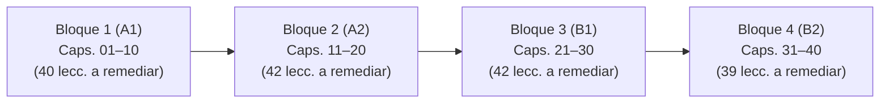

# Auditoría Curricular Integral A1–B2: Curso de Italiano (`it`)

**Fecha de emisión:** 16 de octubre de 2026  
**Especialidad:** Lingüística Aplicada, Diseño Curricular MCER y Desarrollo de Contenidos Paglot  
**Ámbito de aplicación:** Curso completo de italiano (`_herramientas/cursos/it/01.txt` a `126.txt` / `Idiomas/cursos/it/lessons/001.json` a `300.json`)  
**Documentos y fuentes de referencia inspeccionados:**
- `_herramientas/cursos/it/capitulos.txt`
- `_herramientas/cursos/it/ESTADO.txt`
- `_herramientas/cursos/compilar.py`
- `Idiomas/cursos/it/lessons/capitulos.json` e inventario completo de 300 archivos `.json`
- Marcos de referencia oficiales: *Linee Guida CILS (Università per Stranieri di Siena)*, *Sillabo CELI (Università per Stranieri di Perugia)*, *Certificazione PLIDA (Società Dante Alighieri)*, *Profilo della Lingua Italiana (Livelli A1, A2, B1, B2 - Spinelli & Parizzi / Unistrapg)*, descriptores complementarios del MCER (Consejo de Europa 2018/2020) y monografías lingüísticas de la *Enciclopedia dell'Italiano Treccani*.

---

## 1. Resumen Ejecutivo y Diagnóstico Global

El curso de italiano consta actualmente de **300 lecciones distribuidas en 40 capítulos**, cubriendo teóricamente la progresión de los niveles A1, A2, B1 y B2 (10 capítulos por nivel).

Tras una inspección técnica, curricular y cuantitativa lección por lección, bloque por bloque y ejercicio por ejercicio, tanto en los 132 archivos fuente (`_herramientas/cursos/it/*.txt`) como en las 300 lecciones compiladas en JSON (`Idiomas/cursos/it/lessons/*.json`), se constata un diagnóstico contundente:

### 1.1. Balance Cuantitativo del Curso
- **Lecciones sólidas y auténticas:** **137 lecciones (45,7% del curso)**. Son las lecciones originales ubicadas en los archivos `01.txt` a `40.txt` (y extensiones `23z`–`30zz`). Cuentan con diálogos vivos (`D`), textos contextualizados (`T`), 1.187 anotaciones morfosintácticas (`>`), fichas completas de vocabulario y variedad equilibrada de tipologías de ejercicios (`test`, `traduccion`, `huecos`, `ordenar`, `escribir`).
- **Lecciones plantilla clónicas (generadas artificialmente):** **163 lecciones (54,3% del curso)**. Añadidas durante la ampliación del 15 de octubre de 2026 para elevar el curso de 137 a 300 lecciones.
  * **117 lecciones de gramática plantilla** (archivos `41.txt` a `80.txt`, lecciones compiladas 138 a 254).
  * **46 lecciones de lectura plantilla** (archivos `81.txt` a `126.txt`, lecciones compiladas 255 a 300).

```
Total Curso: 300 Lecciones
┌───────────────────────────────┬───────────────────────────────┐
│     Sólidas / Base: 137       │       Plantillas: 163         │
│           (45,7%)             │           (54,3%)             │
└───────────────────────────────┴───────────────────────────────┘
                                │  Gramática: 117  │ Lectura: 46│
                                │     (39,0%)      │   (15,3%)  │
```

### 1.2. Distribución de la Degradación por Nivel MCER
| Nivel | Capítulos | Total Lecc. | Base (Sólidas) | Plantillas Gram. | Plantillas Lect. | Total Plantillas | % Plantillas | Palabras Únicas | Glosas (`>`) |
|:---:|:---:|:---:|:---:|:---:|:---:|:---:|:---:|:---:|:---:|
| **A1** | Caps. 01–10 | 71 | 31 | 32 | 8 | **40** | **56,3%** | 683 | 378 |
| **A2** | Caps. 11–20 | 74 | 32 | 32 | 10 | **42** | **56,8%** | 567 | 295 |
| **B1** | Caps. 21–30 | 78 | 36 | 32 | 10 | **42** | **53,8%** | 579 | 267 |
| **B2** | Caps. 31–40 | 77 | 38 | 21 | 18 | **39** | **50,6%** | 691 | 247 |
| **TOTAL** | **01–40** | **300** | **137** | **117** | **46** | **163** | **54,3%** | **2.049** | **1.187** |

---

## 2. Esclarecimiento Técnico del Escaneo Previo: Las «147 lecciones con preguntas duplicadas»

El informe del escáner previo alertaba de **147 lecciones con preguntas duplicadas**. La auditoría forense del código y de los datos JSON revela con exactitud milimétrica el origen de dicha métrica:

```
147 Lecciones con Preguntas Duplicadas
├── 117 Lecciones: Plantillas de gramática (archivos 41-80) con 2 huecos "Completa con la forma adecuada."
├──  28 Lecciones: Lecciones base donde compilar.py asignó el texto por defecto "Completa la frase."
├──   1 Lección: Lección base con texto por defecto repetido "¿Qué significa?"
└──   1 Lección: CLONACIÓN LITERAL de ejercicio (Lección 115, Capítulo 35): "¿Qué significa «sarei stato»?"
```

### Desglose analítico:
1. **117 lecciones de gramática plantilla (archivos `41.txt` a `80.txt` | lecciones JSON 138 a 254):**
   Cada una de estas 117 lecciones contiene invariablemente **dos ejercicios de huecos (`H`)** con la misma consigna exacta escrita en la fuente:
   `H [Frase con ___] :: Completa con la forma adecuada.`
   Al poseer dos actividades con el mismo campo `pregunta`, el analizador automatizado detecta una colisión de enunciados dentro de la misma lección (117 lecciones afectadas).
2. **28 lecciones base (archivos `01.txt` a `40.txt`):**
   Lecciones que contenían más de un ejercicio `H` sin texto de pregunta explícito tras `::`. Por especificación de `compilar.py` (línea 199: `q or "Completa la frase."`), ambas recibieron la cadena idéntica `"Completa la frase."`.
3. **1 lección base:**
   Duplicó la consigna por defecto `"¿Qué significa?"` generada automáticamente por `compilar.py` (línea 190) para el tipo `R`.
4. **1 duplicación literal idéntica (error crítico de contenido):**
   En la **Lección 115** (`Idiomas/cursos/it/lessons/115.json`, compilada desde `_herramientas/cursos/it/35.txt`), correspondiente al Capítulo 35 (B2: *Se fossi stato più attento*), el ejercicio `it115-1` y el ejercicio `it115-7` son **100% idénticos**:
   ```json
   // it115-1 e it115-7 (CLON EXACTO):
   {
     "tipo": "test",
     "pregunta": "¿Qué significa «sarei stato»?",
     "opciones": [
       { "texto": "habría sido (yo)", "explicacion": "Condicional passato de «essere».", "correcta": true },
       { "texto": "soy", "explicacion": "Eso es presente." },
       { "texto": "sería", "explicacion": "Eso es condicional presente." }
     ]
   }
   ```
   El estudiante responde exactamente la misma pregunta al inicio y al final de la lección con las mismas alternativas y el mismo feedback.

---

## 3. Anatomía de las 163 Lecciones Plantilla

### 3.1. Las 117 Lecciones de Gramática Plantilla («Idea clave» / `41.txt` a `80.txt`)
Las 117 lecciones añadidas de gramática responden a un molde artificial automatizado:
1. **Ausencia discursiva:**
   - **0 diálogos (`D`)**: Ninguna interacción natural entre hablantes nativos.
   - **0 textos (`T`)**: Ningún género textual real.
   - **0 glosas morfosintácticas (`>`)**: Ningún análisis de constituyentes.
   - **Vocabulario oculto (`w`)**: Solo incorporan las oraciones completas como fichas ocultas para burlar el compilador, sin enriquecer el cuaderno léxico del alumno.
2. **Estructura fija en 6 ejercicios metalingüísticos:**
   - *Ejercicio 1 (`Q`):* `¿Qué frase reproduce la forma que aparece en el primer ejemplo?` (Test memorístico del ejemplo 1).
   - *Ejercicio 2 (`H`):* `[Ejemplo 1 con ___] :: Completa con la forma adecuada.`
   - *Ejercicio 3 (`R`):* `[Ejemplo 1] :: ¿Qué significa?`
   - *Ejercicio 4 (`O`):* `[Ejemplo 2] :: [Traducción] :: Ordena la frase.`
   - *Ejercicio 5 (`Q`):* `¿Qué frase reproduce la forma del segundo ejemplo?` (Test memorístico del ejemplo 2).
   - *Ejercicio 6 (`H`):* `[Ejemplo 2 con ___] :: Completa con la forma adecuada.`
3. **Feedback clónico y nulo valor didáctico:**
   - Distractores erróneos acompañados siempre de: `No reproduce la forma del ejemplo.`, `Cambia el sentido del ejemplo.`, `No es la forma que aparece en el ejemplo.`.
   - No hay explicación contrastiva gramatical (por qué es erróneo el modo, el auxiliar o la concordancia).

### 3.2. Las 46 Lecciones de Lectura Plantilla (`81.txt` a `126.txt`)
Las 46 lecciones de comprensión lectora presentan otra degradación sistemática:
1. **Unilateralidad de formato:** Un único texto corto en un bloque `E` y 6 preguntas cerradas `Q`. No hay ejercicios de ordenación discursiva, rellenado de resúmenes, respuesta construida ni emparejamiento.
2. **Retroalimentación automatizada idéntica:**
   En las 46 lecciones (276 ejercicios en total):
   - Cada respuesta correcta tiene el feedback: `+ buena :: El texto lo indica o permite deducirlo.`
   - Cada respuesta incorrecta tiene el feedback: `- mala :: El texto no afirma eso.`
3. **Descompensación y aglomeración en B2:**
   Mientras que en A1 solo se agregaron 8 lecturas y en A2 y B1 se agregaron 10 por nivel, en el nivel B2 se inyectaron **18 lecturas clónicas**. Lo más grave es que no se distribuyeron homogéneamente:
   - **Capítulos 31 al 38:** 0 lecturas añadidas (los capítulos tienen solo 5 o 6 lecciones).
   - **Capítulo 39:** ¡9 lecturas añadidas! (el capítulo salta de 7 a 16 lecciones).
   - **Capítulo 40:** ¡9 lecturas añadidas! (el capítulo salta de 6 a 15 lecciones).
   Esto provoca que los capítulos 39 y 40 se conviertan en vertederos masivos de lecturas monótonas con feedback idéntico.

---

## 4. Anomalía Estructural en el Sistema de Archivos y Numeración

La ampliación se realizó creando archivos numerados por lotes en vez de integrar las lecciones dentro de sus respectivos capítulos:
- `01.txt` a `40.txt`: 137 lecciones base -> compiladas como **001 a 137**.
- `41.txt` a `80.txt`: 117 lecciones de gramática plantilla -> compiladas como **138 a 254**.
- `81.txt` a `126.txt`: 46 lecciones de lectura plantilla -> compiladas como **255 a 300**.

### Impacto en la Experiencia de Aprendizaje:
`compilar.py` numera las lecciones de forma lineal según el orden de los archivos. Al compilar:
- El Capítulo 1 contiene las lecciones 001, 002 y 003; luego se interrumpe y sus siguientes lecciones son la **138, 139, 140 y 141**.
- Un alumno que complete la lección 137 (examen final de B2, el final del curso original) pasa automáticamente en la siguiente lección (138) a la fonética elemental de A1 (*C o ci? Leer «c», «ci» y «ch»*).
- Al llegar a la 254 (discurso indirecto avanzado en B2), la lección 255 lo devuelve nuevamente a A1 (*L'orario di Giulia*).
- Aunque la pantalla `Idiomas/js/vistas/lecciones.js` agrupa visualmente por el atributo `"capitulo"`, dentro de la tarjeta del Capítulo 1 el usuario visualiza los identificadores disjuntos: `001`, `002`, `003`, `138`, `139`, `140`, `141`.
- **Imperativo de reestructuración:** Para la Fase 4, las fuentes deben consolidarse por capítulo (`01.txt` a `40.txt`), de modo que cada capítulo albergue todas sus lecciones consecutivas (p. ej., Cap. 1: 001 a 007; Cap. 2: 008 a 015...).

---

## 5. Diagnóstico Curricular Nivel a Nivel (MCER)

A continuación se audita la solidez pedagógica del curso nivel por nivel, evaluando gramática, vocabulario y comprensión lectora bajo los criterios de los exámenes de certificación de italiano (CILS, CELI, PLIDA) y el *Profilo della Lingua Italiana*.

### 5.1. Nivel A1 (Capítulos 01 al 10 | 71 lecciones: 31 sólidas, 40 plantillas | 56,3% plantillas)
- **Evaluación curricular según CILS A1 / CELI Impatto / PLIDA A1:**
  - *Fonética y ortografía (Cap. 01):* Las lecciones sólidas 001–003 enseñan saludos y fórmulas de cortesía. Sin embargo, las reglas fonológicas clave del italiano (la articulación velar vs. palatal de *c* y *g*: `c/ci/ch`, `g/gi/gh`; las grafías específicas `gn` /ɲ/, `gli` /ʎ/, `sc(i)` /ʃ/; las consonantes dobles fonológicamente distintivas como *fato* vs. *fatto*, *note* vs. *notte*; y los acentos ortográficos diferenciadores como *è/e*, *dà/da*, *sì/si*) fueron delegadas a las plantillas L138, L139, L140 y L141. En un curso interactivo, la discriminación fonética requiere diálogos orales, parejas mínimas y ejercicios de discriminación acústica.
  - *Morfología verbal regular e irregular en Presente (Cap. 02):* El presente de indicativo de *essere* y *avere*, así como los modelos regulares de las tres conjugaciones (`-are`: *parlare*, `-ere`: *prendere*, `-ire`: *dormire*) y el crucial grupo incoativo con infijo `-isc-` (*capire, preferire, finire, pulire*), están confinados a las plantillas L142, L143, L144 y L145. Esto priva al estudiante de interiorizar la alternancia de personas en diálogos cotidianos.
  - *Sintagma nominal: Artículos, Género y Número (Cap. 03 y 04):* El sistema de artículos italianos —especialmente el uso de *lo/gli* ante *s impura*, *z*, *gn*, *ps* y vocal (*l'*), y la distinción de *un/uno/una/un'*— es uno de los mayores focos de error para hispanohablantes. Están en las plantillas L146 y L147. Los plurales irregulares frecuentes (*uomo/uomini, uovo/uova, mano/mani*) y la concordancia adjetival regular e irregular (*bello, buono*) cayeron en L148 y L149.
  - *Estructuras de posesión y existencia (Cap. 03 y 04):* El uso del posesivo con sustantivos de parentesco en singular (*mio padre*, sin artículo, frente a *il mio papà*, *la mia cara madre*, *i miei fratelli*) se trata en la plantilla L150. *C'è / ci sono* y la negación con *non* están en L151 y L152.
  - *Preposiciones simples y articuladas (Cap. 05):* La contracción de preposiciones con artículos (*a + il = al*, *in + la = nella*, *da + lo = dallo*...), piedra angular del italiano elemental, está relegada a la plantilla L154.
  - *Expresión de gustos y cantidades (Cap. 06 y 07):* La alternancia *mi piace* (singular / infinitivo) vs. *mi piacciono* (plural), así como la expresión de cantidades en compras (*un chilo di, mezzo chilo di, un litro di, un etto di*), están en L157 y L158.
  - *Passato prossimo básico (Cap. 10):* Las lecciones 028 y 029 explican correctamente el pasado compuesto con *avere* y *essere* (concordancia en género y número del participio con el sujeto en *essere*). Sin embargo, los marcadores temporales (*ieri, la settimana scorsa, due giorni fa, già, ancora*) y la secuencia temporal (*prima, poi, dopo*) quedaron en las plantillas L168 y L169.
  - *Comprensión lectora:* Las 8 lecturas de A1 (L255 a L262: horarios, compras, recibos, billetes de tren, notas breves) abordan géneros textuales auténticos muy adecuados para A1, pero su explotación pedagógica está totalmente arruinada por las preguntas clónicas y el feedback repetitivo.

### 5.2. Nivel A2 (Capítulos 11 al 20 | 74 lecciones: 32 sólidas, 42 plantillas | 56,8% plantillas)
- **Evaluación curricular según CILS A2 / CELI 1 / PLIDA A2:**
  - *Oposición Passato Prossimo vs. Imperfetto (Cap. 11 y 12):* Es la mayor dificultad de A2. Distinguir entre acciones concluidas y puntuales (*passato prossimo*) frente a acciones habituales, descriptivas o de duración en el pasado (*imperfetto*), así como la coordinación temporal con *mentre* (dos acciones continuas simultáneas) y *quando* (acción puntual que interrumpe una acción en curso), se derivó a las plantillas L174, L175 y L177.
  - *Uso temporal de «da» con presente (Cap. 12):* Expresar acciones que comenzaron en el pasado y continúan vigentes (*Vivo a Roma da due anni* = «Vivo en Roma desde hace dos años / Llevo dos años viviendo en Roma») es un calco erróneo frecuente entre estudiantes. Está en la plantilla L176.
  - *Sistema pronominal átono directo e indirecto (Cap. 13):* La distinción entre objeto directo (*lo, la, li, le*) e indirecto (*mi, ti, gli, le, ci, vi, loro*), su posición proclítica o enclítica con perífrasis de infinitivo (*lo posso fare* / *posso farlo*), y la **obligada concordancia de género y número del participio pasado** con los pronombres directos de 3ª persona (*L'ho vista*, *Li ho comprati*) están degradadas a plantillas en L171, L178, L179 y L180.
  - *Grados del adjetivo y comparación (Cap. 14):* Formación del superlativo absoluto sintético en *-issimo/a/i/e*, el comparativo de cualidad (*più... che*) frente a sustantivos (*più... di*), y los indefinidos (*ogni, qualche, alcuni, troppo, tutto*) están en las plantillas L181, L182 y L183.
  - *Futuro semplice y conjetural (Cap. 15):* La conjugación del futuro regular, las raíces con síncopa (*andare -> andrò*, *dovere -> dovrò*, *vedere -> vedrò*) y con asimilación (*venire -> verrò*, *volere -> vorrò*, *rimanere -> rimarrò*), y el uso epistémico o de conjetura presente (*Che ore sono? - Saranno le tre*) se confinaron en las plantillas L184, L185, L186 y L187.
  - *Modo Imperativo (Cap. 16):* El imperativo directo informal (*tu, noi, voi*) con su irregularidad en la 1ª conjugación (*tu parla* vs. presente *tu parli*), el imperativo negativo (*non parlare!* con infinitivo para *tu*) y el imperativo formal de cortesía (*Lei parli! Lei prenda! Lei senta!*) se delegaron a las plantillas L188 a L191.
  - *Perífrasis progresiva y gerundio (Cap. 17):* Formación regular de gerundios (`-ando`, `-endo`), irregulares (*facendo, dicendo, bevendo*) y su combinación con *stare* y pronombres clíticos (*sto mangiandolo / lo sto mangiando*) están en las plantillas L192, L193, L194 y L199.
  - *Construcciones condicionales reales (Cap. 19 y 20):* El periodo hipotético de la realidad (*se + presente/futuro indicativo -> presente/futuro*) y el uso de conectores *prima di + infinitivo* se tratan en L200 y L201 como plantillas.

### 5.3. Nivel B1 (Capítulos 21 al 30 | 78 lecciones: 36 sólidas, 42 plantillas | 53,8% plantillas)
- **Evaluación curricular según CILS B1 (Cittadinanza/Standard) / CELI 2 / PLIDA B1:**
  - *Trapassato Prossimo y ordenación temporal (Cap. 21):* Expresión de anterioridad respecto a un punto de referencia pasado (*Quando sono arrivato, il treno era già partito*). Las lecciones plantilla L202 a L205 aíslan este tiempo verbal sin textos narrativos o crónicas donde practicar la correlación temporal.
  - *Condizionale Presente e Passato (Cap. 22):* El condicional presente para expresar deseos (*vorrei*), consejos (*dovresti riposare*) y cortesía (*potrebbe aiutarmi?*), junto con el condicional pasado para el "futuro del pasado" (*Ha detto che sarebbe venuto*) y deseos no realizados en el pasado (*Avrei voluto viaggiare*), quedaron encasillados en las plantillas L206, L207 y L208.
  - *Congiuntivo Presente (Cap. 23):* Es el núcleo gramatical definitorio del nivel B1. La morfología regular (`-are`: *-i, -i, -i, -iamo, -iate, -ino*; `-ere/-ire`: *-a, -a, -a, -iamo, -iate, -ano*) e irregular (*sia, abbia, vada, faccia, possa, sappia, debba, voglia*), así como las matrices que rigen subjuntivo (opinión: *credo che, penso che*; voluntad/deseo: *voglio che, spero che*; necesidad/impersonalidad: *è necessario che, bisogna che*; duda: *dubito che*) frente a certeza (indicativo: *so che, è sicuro che*), y la regla del sujeto correferente que obliga al infinitivo (*Penso di avere ragione* vs. *Penso che tu abbia ragione*), fueron entregadas a las plantillas L209, L210, L211 y L212.
  - *Periodo Ipotetico tipo I (realidad) y tipo II (posibilidad) (Cap. 24):* El contraste sistemático entre la condición real (*Se piove, non esco*) y la hipotética de presente/futuro con congiuntivo imperfetto y condicional presente (*Se avessi soldi, comprerei una macchina*) está en las plantillas L213, L214 y L215.
  - *Discorso Indiretto en presente y pasado (Cap. 25):* Las transformaciones pronominales, deícticas y temporales al transmitir enunciados ajenos, junto con las interrogativas indirectas (*Mi ha chiesto se...*) y órdenes con infinitivo (*Mi ha detto di aspettare*), están en las plantillas L216 a L219.
  - *Pronombres combinados y partículas «ci» y «ne» (Cap. 27):* La unión de dativo + acusativo (*me lo, te la, glielo, gliela, ce li, ve le*), el valor partitivo y temático de *ne* (*Ne voglio due*, *Ne abbiamo parlato*), los valores locativos y preposicionales de *ci* (*Ci vado*, *Ci penso*), y la triple concordancia del participio pasado con pronombres combinados (*Glieli ho dati*, *Ne ho comprate tre*) son el punto de mayor exigencia morfosintáctica de B1. Se encuentran en las plantillas L223 a L226.
  - *Forma pasiva elemental y «si» passivante (Cap. 28):* Distinguir entre *si* impersonal (*In Italia si mangia bene*) y *si* pasivante con concordancia de plural (*In Italia si mangiano molti spaghetti*) está en las plantillas L227, L228 y L229.

### 5.4. Nivel B2 (Capítulos 31 al 40 | 77 lecciones: 38 sólidas, 39 plantillas | 50,6% plantillas)
- **Evaluación curricular según CILS B2 / CELI 3 / PLIDA B2:**
  - *Voz Pasiva Completa y matices auxiliares (Cap. 31):* La pasiva formal con *essere* en todos los tiempos, el uso del auxiliar *venire* para acciones activas no concluidas en tiempos simples (*Il palazzo viene restaurato*), el uso de *andare + participio* para expresar obligatoriedad o pérdida (*Questo documento va compilato*, *Il libro è andato perduto*), y las pasivas con verbos modales (*deve essere fatto*), fueron degradadas a plantillas en L234, L235 y L236.
  - *Passato Remoto (Cap. 32):* Imprescindible para la competencia lectora de nivel B2 (novelas, relatos históricos, biografías y artículos periodísticos). La conjugación regular y las formas con alternancia en 1ª y 3ª singular y 3ª plural (*nacque / nacquero, scrisse / scrissero, fece / fecero, disse / dissero*) están en L237 y L238 como plantillas.
  - *Construcciones implícitas con Infinitivo y Gerundio (Cap. 33):* El infinitivo compuesto con *dopo* (*dopo aver mangiato, dopo essere arrivati*), la omisión de acción con *senza + infinitivo*, y los valores de causa, modo y concesión del gerundio (*Pur sapendo la verità...*), en las plantillas L239 y L240.
  - *Congiuntivo Passato, Trapassato y Concordanza dei Tempi (Cap. 34):* El dominio absoluto de la concordancia temporal del subjuntivo respecto al verbo principal (contemporaneidad, anterioridad y posterioridad en esfera del presente y de la historia), así como las oraciones de relativo restrictivas con valor hipotético (*Cerco un impiegato che conosca il tedesco*), están encapsuladas en las plantillas L241, L242 y L243.
  - *Periodo Ipotetico de 3º grado (Irrealidad en el pasado) y Mixto (Cap. 35):* Condición no realizada en el pasado con congiuntivo trapassato y condizionale passato (*Se tu mi avessi ascoltato, non ti saresti trovato nei guai*), periodos mixtos (condición en pasado con resultado en el presente: *Se avessi studiato medicina, oggi sarei medico*) y oraciones comparativas irreales con *come se* (+ congiuntivo imperfetto/trapassato). Tratados en L244 y L245, además del grave error de clonación literal en la lección 115.
  - *Relativos complejos y conectores subordinantes de alta gama (Cap. 36 y 37):* El relativo posesivo *il cui / la cui / i cui / le cui*, los relativos dobles (*chi, ciò che, quanto*), y las conjunciones subordinadas que exigen subjuntivo por valor semántico (*benché, sebbene, quantunque, affinché, purché, a patto che, a meno che non, senza che, prima che*), están atrapados en las plantillas L246 a L249.
  - *Verbos pronominales avanzados (Cap. 38):* *Farcela, cavarsela, andarsene, prendersela, fregarsene, rendersi conto di*. Encerrados en L250 y L251.
  - *Futuro Anteriore (Cap. 40):* Valores de anterioridad en el futuro (*Quando avrò terminato il lavoro, ti chiamerò*) y valor epistémico de conjetura en el pasado (*A che ora è arrivato Marco? - Non so, sarà arrivato verso le otto*), en L253.
  - *Hipertrofia de lecturas en Caps. 39 y 40:* 18 lecturas clónicas (L283 a L300) amontonadas al final del curso sin integración pedagógica orgánica con la gramática ni ejercicios de comprensión profunda o análisis de opinión y prensa italiana.

---

## 6. Inventario Exhaustivo Capítulo por Capítulo (01 al 40)

A continuación se detalla el estado estructural de cada uno de los 40 capítulos del curso:

| Cap | Nivel | Título (Italiano / Español) | Rango Lecc. JSON | Total Lecc. | Lecciones Base (Sólidas) | Lecciones Plantilla (Gram.) | Lecciones Plantilla (Lect.) | % Plantillas | Diagnóstico Curricular Específico |
|:---:|:---:|:---|:---:|:---:|:---:|:---:|:---:|:---:|:---|
| **01** | A1 | Ciao! / Saludos y presentaciones | 001–003, 138–141 | 7 | 3 (001–003) | 4 (138–141) | 0 | 57,1% | Requiere reescribir 138 a 141 (fonética `c/ch`, `g/gh`, `gn/gli`, dobles/acentos) con audio y diálogos. |
| **02** | A1 | Di dove sei? / Origen, trabajo e idiomas | 004–006, 142–145 | 7 | 3 (004–006) | 4 (142–145) | 0 | 57,1% | Requiere reescribir 142 a 145 (essere/avere, conjugaciones `-are`, `-ere`, `-ire` e infijo `-isc-`). |
| **03** | A1 | I numeri e la famiglia / Números y familia | 007–009, 146–149 | 7 | 3 (007–009) | 4 (146–149) | 0 | 57,1% | Requiere reescribir 146 a 149 (artículos definidos/indefinidos, elisión, plurales y concordancia). |
| **04** | A1 | La casa e gli oggetti / La casa y las cosas | 010–012, 150–153 | 7 | 3 (010–012) | 4 (150–153) | 0 | 57,1% | Requiere reescribir 150 a 153 (posesivos con familia, negación, c'è/ci sono, preposiciones de lugar). |
| **05** | A1 | La mia giornata / Mi día | 013–015, 154–156, 255 | 7 | 3 (013–015) | 3 (154–156) | 1 (255) | 57,1% | Reescribir 154 a 156 (prep. articuladas, horarios, frecuencia) y enriquecer lectura 255. |
| **06** | A1 | A tavola! / Comida y bebida | 016–018, 157–159, 256 | 7 | 3 (016–018) | 3 (157–159) | 1 (256) | 57,1% | Reescribir 157 a 159 (cantidades, piacere singular/plural, partes del cuerpo) y lectura 256. |
| **07** | A1 | Lo shopping / Compras y ropa | 019–021, 160–162, 257 | 7 | 3 (019–021) | 3 (160–162) | 1 (257) | 57,1% | Reescribir 160 a 162 (precios altos, demostrativos questo/quello, fechas) y lectura 257. |
| **08** | A1 | In città / Por la ciudad | 022–024, 163–165, 258 | 7 | 3 (022–024) | 3 (163–165) | 1 (258) | 57,1% | Reescribir 163 a 165 (adverbios de lugar, profesiones/estudios, tiempo atmosférico) y lectura 258. |
| **09** | A1 | Il tempo libero / Tiempo libre | 025–027, 166–167, 259–260 | 7 | 3 (025–027) | 2 (166–167) | 2 (259–260) | 57,1% | Reescribir 166 y 167 (preferencias, órdenes en ciudad) y reestructurar lecturas 259 y 260. |
| **10** | A1 | Ieri e domani / El pasado y los viajes | 028–031, 168–169, 261–262 | 8 | 4 (028–031) | 2 (168–169) | 2 (261–262) | 50,0% | L031 es el examen de A1. Reescribir 168 y 169 (marcadores temporales y secuencias) y lecturas 261-262. |
| **11** | A2 | Ho parlato, sono partita / Passato prossimo | 032–034, 170–173, 263 | 8 | 3 (032–034) | 4 (170–173) | 1 (263) | 62,5% | Reescribir 170 a 173 (selección avere/essere, concordancia con pronombres directos) y lectura 263. |
| **12** | A2 | Quando ero piccolo / Imperfetto y duración | 035–038, 174–177, 264 | 9 | 4 (035–038) | 4 (174–177) | 1 (264) | 55,6% | Reescribir 174 a 177 (formas del imperfetto, oposición imperfetto/passato prossimo, «da» temporal) y L264. |
| **13** | A2 | Lo conosco bene / Los pronombres | 039–041, 178–180, 265 | 7 | 3 (039–041) | 3 (178–180) | 1 (265) | 57,1% | Reescribir 178 a 180 (pronombres directos, indirectos, posición con verbos modales) y lectura 265. |
| **14** | A2 | Che bello! / Comparar y exclamar | 042–044, 181–183, 266 | 7 | 3 (042–044) | 3 (181–183) | 1 (266) | 57,1% | Reescribir 181 a 183 (superlativo absoluto *-issimo*, stesso/quale, indefinidos) y lectura 266. |
| **15** | A2 | Vado a teatro / Planes, fechas e invitaciones | 045–047, 184–187, 267 | 8 | 3 (045–047) | 4 (184–187) | 1 (267) | 62,5% | Reescribir 184 a 187 (futuro regular, raíces irregulares, futuro de conjetura) y lectura 267. |
| **16** | A2 | Non mi sento bene / Cuerpo, consejos y farmacia | 048–050, 188–191, 268 | 8 | 3 (048–050) | 4 (188–191) | 1 (268) | 62,5% | Reescribir 188 a 191 (imperativo afirmativo/negativo de tú, nós/vosotros y cortesía Lei) y lectura 268. |
| **17** | A2 | Faccio il giornalista / Trabajo, lugares y normas | 051–053, 192–194, 269 | 7 | 3 (051–053) | 3 (192–194) | 1 (269) | 57,1% | Reescribir 192 a 194 (gerundio regular/irregular, stare + gerundio) y lectura 269. |
| **18** | A2 | Vorrei prenotare un volo / Viajar y reservar | 054–056, 195–196, 270 | 6 | 3 (054–056) | 2 (195–196) | 1 (270) | 50,0% | Reescribir 195 y 196 (preposiciones de destino y propósito/límite: per, da, fino a) y lectura 270. |
| **19** | A2 | Le previsioni / Tiempo, condiciones y opiniones | 057–059, 197–199, 271 | 7 | 3 (057–059) | 3 (197–199) | 1 (271) | 57,1% | Reescribir 197 a 199 (adverbios de cantidad, già/ancora/appena, pronombres con gerundio) y L271. |
| **20** | A2 | Mi ha detto che è stanco / Relato y repaso A2 | 060–063, 200–201, 272 | 7 | 4 (060–063) | 2 (200–201) | 1 (272) | 42,9% | L063 es examen final A2. Reescribir 200 y 201 (condición real y conectores) y lectura integradora 272. |
| **21** | B1 | Avevo già mangiato / Lo que había pasado | 064–066, 202–205, 273 | 8 | 3 (064–066) | 4 (202–205) | 1 (273) | 62,5% | Reescribir 202 a 205 (trapassato prossimo, anterioridad y marcadores narrativos) y lectura 273. |
| **22** | B1 | Vorrei tanto / Condicional presente y pasado | 067–069, 206–208, 274 | 7 | 3 (067–069) | 3 (206–208) | 1 (274) | 57,1% | Reescribir 206 a 208 (condizionale presente/passato, deseos y consejos) y lectura 274. |
| **23** | B1 | Penso che sia facile / Congiuntivo presente | 070–073, 209–212, 275 | 9 | 4 (070–073) | 4 (209–212) | 1 (275) | 55,6% | Reescribir 209 a 212 (formas subjuntivo, opinión/deseo, indicativo vs subjuntivo, infinitivo vs che). |
| **24** | B1 | Se studi, impari / Periodo ipotetico I y II | 074–076, 213–215, 276 | 7 | 3 (074–076) | 3 (213–215) | 1 (276) | 57,1% | Reescribir 213 a 215 (hipótesis real e improbable, congiuntivo imperfetto con condicional) y lectura 276. |
| **25** | B1 | Mi ha detto che era stanco / Discurso indirecto | 077–079, 216–219, 277 | 8 | 3 (077–079) | 4 (216–219) | 1 (277) | 62,5% | Reescribir 216 a 219 (ajustes temporales y de personas, preguntas indirectas, órdenes) y lectura 277. |
| **26** | B1 | Il posto più bello del mondo / Superlativos y cui | 080–083, 220–222, 278 | 8 | 4 (080–083) | 3 (220–222) | 1 (278) | 50,0% | Reescribir 220 a 222 (relativo «che», «cui» con preposición y «dove») y lectura narrativa 278. |
| **27** | B1 | Glielo do domani / Pronombres combinados | 084–087, 223–226, 279 | 9 | 4 (084–087) | 4 (223–226) | 1 (279) | 55,6% | Reescribir 223 a 226 (pronomi combinati, partitivo «ne», «ci» locativo/temático, concordancias) y L279. |
| **28** | B1 | In città si vive bene / Impersonales y gerundio | 088–090, 227–229, 280 | 7 | 3 (088–090) | 3 (227–229) | 1 (280) | 57,1% | Reescribir 227 a 229 («si» impersonal, «si» pasivante con plural, impersonales y modales) y lectura 280. |
| **29** | B1 | Visto che piove / Conectores del discurso | 091–094, 230–231, 281 | 7 | 4 (091–094) | 2 (230–231) | 1 (281) | 42,9% | Reescribir 230 y 231 (causa, finalidad, concesión, contraste discursivo) y lectura con excepciones 281. |
| **30** | B1 | Il colloquio / Trabajo formal y repaso B1 | 095–099, 232–233, 282 | 8 | 5 (095–099) | 2 (232–233) | 1 (282) | 37,5% | L099 es examen final B1. Reescribir 232 y 233 (marcadores e inferencia contextual) y lectura práctica 282. |
| **31** | B2 | Il quadro è stato dipinto / Forma pasiva | 100–103, 234–236 | 7 | 4 (100–103) | 3 (234–236) | 0 | 42,9% | Reescribir 234 a 236 (pasiva tiempos compuestos, matices venire/andare, si pasivante con modales). |
| **32** | B2 | Nacque a Roma / Passato remoto histórico | 104–106, 237–238 | 5 | 3 (104–106) | 2 (237–238) | 0 | 40,0% | Reescribir 237 y 238 (passato remoto regular e irregular en biografías y relatos históricos). |
| **33** | B2 | Dopo aver capito / Infinitivo y gerundio | 107–110, 239–240 | 6 | 4 (107–110) | 2 (239–240) | 0 | 33,3% | Reescribir 239 y 240 (infinitivo compuesto anterioridad, gerundio causal/modal, senza + inf). |
| **34** | B2 | Credo che abbia capito / Subjuntivo pasado/trap. | 111–113, 241–243 | 6 | 3 (111–113) | 3 (241–243) | 0 | 50,0% | Reescribir 241 a 243 (congiuntivo passato/trapassato, concordanza dei tempi, relativas subjuntivo). |
| **35** | B2 | Se avessi tempo / Periodo ipotetico III e irreal | 114–116, 244–245 | 5 | 3 (114–116) | 2 (244–245) | 0 | 40,0% | Corregir duplicado en L115. Reescribir 244 y 245 (periodo ipotetico irreal pasado, mixto, «come se»). |
| **36** | B2 | Il cui libro è famoso / Relativos y referencias | 117–120, 246–247 | 6 | 4 (117–120) | 2 (246–247) | 0 | 33,3% | Reescribir 246 y 247 («il cui» y concordancia, dobles relativos «chi», «ciò che», «quanto»). |
| **37** | B2 | Anche se piove, esco / Concesión y finalidad B2 | 121–124, 248–249 | 6 | 4 (121–124) | 2 (248–249) | 0 | 33,3% | Reescribir 248 y 249 (affinché, benché, purché, prima che, a meno che non) con textos reales. |
| **38** | B2 | Ce la faccio / Verbos pronominales avanzados | 125–127, 250–251 | 5 | 3 (125–127) | 2 (250–251) | 0 | 40,0% | Reescribir 250 y 251 (farcela, cavarsela, andarsene, nominalizaciones complejas). |
| **39** | B2 | Ma dai, non ci credo / Reaccionar y leer textos | 128–133, 252, 283–291 | 16 | 6 (128–133) | 1 (252) | 9 (283–291) | 62,5% | Hipertrofia de 9 lecturas clónicas (283 a 291). Redistribuir lecturas a los caps 31–38 y reescribir 252. |
| **40** | B2 | Mi permetta, dottore / Formal, futuro ant. y examen | 134–137, 253–254, 292–300 | 15 | 4 (134–137) | 2 (253–254) | 9 (292–300) | 73,3% | L137 es examen final B2. Hipertrofia de 9 lecturas (292 a 300). Redistribuir lecturas y reescribir 253-254. |

---

## 7. Plan de Acción y Hoja de Ruta para la Fase 4

Para devolver al curso de italiano la excelencia didáctica requerida por el estándar Paglot y el MCER, la **Fase 4 de Remediación y Reescritura** debe organizarse en **4 bloques de trabajo secuenciales** (un bloque por nivel MCER):



### 7.1. Bloque 1: Nivel A1 (Capítulos 01 al 10 | 71 lecciones | 40 a remediar)
1. **Unificación arquitectónica de archivos:** Consolidar las lecciones en archivos únicos por capítulo (`01.txt` a `10.txt`), eliminando la dispersión entre `41.txt`–`50.txt` y `81.txt`–`88.txt`.
2. **Reescritura de fonética y ortografía (Cap. 01):** Transformar L138–L141 en lecciones interactivas con discriminación acústica, audios nativos y pares mínimos (`chilo / cielo`, `ghiro / giro`, `legno`, `figlio`).
3. **Reescritura del presente y clases verbales (Cap. 02):** Reemplazar L142–L145 por diálogos contextualizados de presentación personal con alternancia de personas y el patrón incoativo en `-isc-`.
4. **Artículos y sintagma nominal (Cap. 03 y 04):** Convertir L146–L149 en ejercicios de concordancia contextualizada y actividades de ordenación de sintagmas nominales.
5. **Reescritura de lecturas (Caps. 05 al 10):** Dotar a las lecturas 255 a 262 de preguntas variadas de inferencia, cronología y vocabulario, eliminando los distractores de plantilla.

### 7.2. Bloque 2: Nivel A2 (Capítulos 11 al 20 | 74 lecciones | 42 a remediar)
1. **Consolidación en archivos fuente:** Integrar `51.txt`–`60.txt` y `89.txt`–`98.txt` dentro de `11.txt` a `20.txt`.
2. **Reescritura del sistema passato prossimo / imperfetto (Caps. 11 y 12):** Crear relatos breves y diálogos donde el alumno discrimine dinámicamente entre fondo (*imperfetto*) y acción puntual (*passato prossimo*), superando las plantillas L170–L177.
3. **Sistema pronominal átono y concordancia (Cap. 13):** Dotar a L178–L180 de ejercicios prácticos de sustitución pronominal y concordancia estricta del participio con clíticos de 3ª persona.
4. **Futuro, imperativo y gerundio (Caps. 15, 16 y 17):** Desarrollar situaciones comunicativas reales (hacer planes, dar instrucciones en la cocina/farmacia y describir procesos en curso).

### 7.3. Bloque 3: Nivel B1 (Capítulos 21 al 30 | 78 lecciones | 42 a remediar)
1. **Consolidación en archivos fuente:** Integrar `61.txt`–`70.txt` y `99.txt`–`108.txt` dentro de `21.txt` a `30.txt`.
2. **El núcleo del congiuntivo presente e imperfetto (Caps. 23 y 24):** Convertir L209–L215 en diálogos argumentativos de debate, expresión de dudas y formulación de hipótesis cotidianas (*periodo ipotetico* de 1º y 2º grado).
3. **Pronombres combinados y partículas «ci» / «ne» (Cap. 27):** Reemplazar L223–L226 por interacciones dinámicas de compra, cocina y referencias espaciales/temáticas con análisis morfosintáctico (`>`).
4. **Voz pasiva elemental y discurso indirecto (Caps. 25 y 28):** Ejercitar el *si passivante* frente al *si impersonale* y la transposición temporal del discurso ajeno con ejercicios de ordenación discursiva.

### 7.4. Bloque 4: Nivel B2 (Capítulos 31 al 40 | 77 lecciones | 39 a remediar)
1. **Consolidación y redistribución estructural:** 
   - Integrar `71.txt`–`80.txt` y `109.txt`–`126.txt` en `31.txt` a `40.txt`.
   - **Descongestionar los Capítulos 39 y 40:** Las 18 lecturas acumuladas artificialmente en los dos últimos capítulos deben distribuirse a razón de 1–2 lecturas por capítulo a lo largo de los capítulos 31 al 40 (p. ej., lecturas históricas para el Cap. 32 de *passato remoto*, lecturas jurídicas/técnicas para el Cap. 31 de voz pasiva, etc.).
2. **Corrección inmediata del fallo de clonación:** Eliminar el ejercicio duplicado `it115-7` en la lección 115 y sustituirlo por una actividad genuina de condicional compuesto / periodo irreal.
3. **Gramática avanzada de alta fidelidad:** Reemplazar las plantillas L234–L254 por debates de prensa italiana, artículos de opinión y textos de registro formal (*passato remoto*, *concordanza dei tempi*, conectores complejos como *affinché*, *benché*, *purché*, verbos pronominales y *futuro anteriore*).
4. **Enriquecimiento del feedback lector:** Sustituir en todas las lecturas el feedback invariable (*«El texto no afirma eso»*) por explicaciones filológicas que contrasten la evidencia textual, la inferencia válida y la distorsión interpretativa.

---

## 8. Conclusión

El curso de italiano de Paglot posee una base original excelente (137 lecciones bien estructuradas, con diálogos vivos y un aparato analítico de 1.187 glosas morfosintácticas). Sin embargo, la posterior ampliación a 300 lecciones introdujo una **fractura metodológica severa (163 lecciones plantilla clónicas, 54,3% del total)** y generó una distorsión estructural en el orden de los archivos y en la numeración interna, provocando asimismo las 147 alertas de consignas duplicadas.

La ejecución del plan de remediación en 4 bloques durante la Fase 4 permitirá eliminar por completo las plantillas mecánicas, unificar la estructura de archivos, enriquecer el feedback pedagógico y consolidar un curso de italiano de máximo rigor curricular y pleno cumplimiento del MCER (A1–B2).
