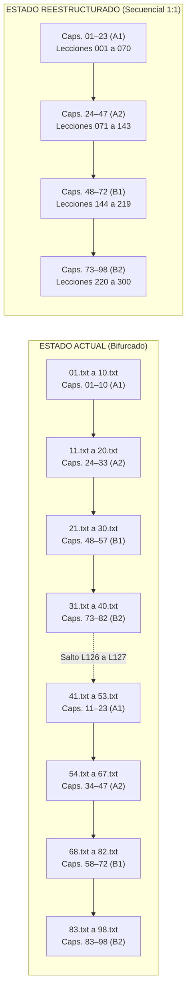
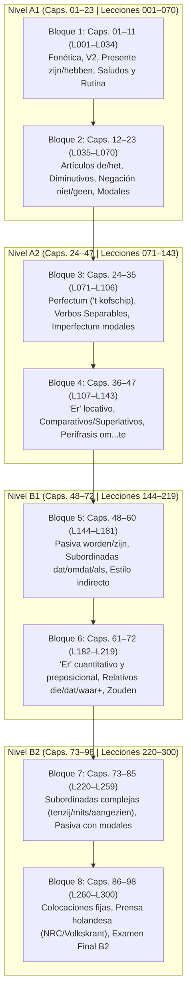

# Auditoría Curricular Integral A1–B2: Curso de Neerlandés (`nl`)

**Fecha de emisión:** 16 de octubre de 2026  
**Especialidad:** Lingüística Aplicada, Diseño Curricular MCER y Desarrollo de Contenidos Paglot  
**Ámbito de aplicación:** Curso completo de neerlandés (`_herramientas/cursos/nl/01.txt` a `98.txt` / `Idiomas/cursos/nl/lessons/001.json` a `300.json`)  
**Documentos de referencia e insumos inspeccionados:**
- `_herramientas/cursos/nl/capitulos.txt`
- `_herramientas/cursos/compilar.py`
- `AUDITORIA_Y_PLAN_AMPLIACION_NL.md` (informe preliminar del 14 de octubre de 2026)
- Estándares y descriptores curriculares: *Nederlandse Taalunie (Leerlijnen & ERK-Nederlands)*, *Certificaat Nederlands als Vreemde Taal (CNaVT)* —perfiles *Maatschappelijk Informeel (INFO/A2)*, *Maatschappelijk Professioneel (PROF/B1)* y *Educatief Startbekwaam (STRT/B2)*—, *Inburgeringsexamen (DUO)* y descriptores del MCER (*Companion Volume*).

---

## 1. Resumen Ejecutivo y Diagnóstico Global

El curso de neerlandés consta de **300 lecciones distribuidas en 98 capítulos**, abarcando teóricamente los niveles A1, A2, B1 y B2 del MCER:
- **A1:** 70 lecciones (Capítulos 01 al 23).
- **A2:** 73 lecciones (Capítulos 24 al 47).
- **B1:** 76 lecciones (Capítulos 48 al 72).
- **B2:** 81 lecciones (Capítulos 73 al 98).

Tras una inspección técnica, estructural y lingüística minuciosa en los 98 archivos fuente (`_herramientas/cursos/nl/*.txt`) y en las 300 lecciones compiladas (`Idiomas/cursos/nl/lessons/*.json`), se formulan las siguientes conclusiones diagnósticas capitales:

### 1.1. Hallazgo positivo: Ausencia de «Plantillas Clónicas»
A diferencia de lo sucedido en otros cursos de la plataforma (como alemán, portugués o italiano, donde entre el 50% y el 60% de las lecciones fueron inyectadas mediante robots con plantillas vacías tipo «Punto clave» y baterías de preguntas idénticas), **el curso de neerlandés NO presenta lecciones plantilla automatizadas**:
- **0 lecciones con la plantilla «Punto clave»** o de preguntas clónicas metagramaticales.
- **225 diálogos situacionales y 75 textos de lectura extensos**, todos con redacción original y específica.
- En los 75 textos de lectura independientes (`T`), **el 100% de las frases son únicas (375 frases distintas)**; no existe reciclaje espurio de párrafos.
- Las 4 erratas graves de concordancia en ejercicios de huecos señaladas en el informe preliminar `AUDITORIA_Y_PLAN_AMPLIACION_NL.md` (en las lecciones 103, 113, 120 y 122) **fueron debidamente corregidas** en la base de datos.
- Se introdujeron **174 tareas de autoevaluación guiada de producción escrita (`XM`)** en el tramo de ampliación.

### 1.2. Anomalía Estructural Crítica: La «Fractura de Compilación» (Bifurcación del Curso)
Se ha detectado un **fallo estructural severo en el empaquetado de archivos fuente** que rompe por completo la progresión pedagógica del estudiante en la aplicación:
- La carpeta `_herramientas/cursos/nl/` contiene los archivos originales `01.txt` a `40.txt` (que abarcan los 40 capítulos primitivos: 1-10 [A1], 24-33 [A2], 48-57 [B1], 73-82 [B2]).
- Los 58 capítulos de ampliación fueron añadidos como archivos `41.txt` a `98.txt` al final de la carpeta, a pesar de que su numeración curricular en `capitulos.txt` corresponde a capítulos intercalados (Caps. 11-23 para A1; 34-47 para A2; 58-72 para B1; 83-98 para B2).
- Como el compilador `compilar.py` procesa los archivos en estricto orden alfanumérico del nombre de archivo (`01.txt`, `02.txt` ... `98.txt`), las lecciones compiladas en `Idiomas/cursos/nl/lessons/` se ordenan de la siguiente manera:
  * **Lecciones 001 a 031:** Nivel A1 original (Capítulos 1 a 10).
  * **Lecciones 032 a 062:** Nivel A2 original (Capítulos 24 a 33).
  * **Lecciones 063 a 093:** Nivel B1 original (Capítulos 48 a 57).
  * **Lecciones 094 a 126:** Nivel B2 original (Capítulos 73 a 82, culminando en el Examen Final B2).
  * **Lecciones 127 a 165:** ¡Regreso repentino al Nivel A1! (Ampliación A1, Capítulos 11 a 23: vocales, deletreo, de/het).
  * **Lecciones 166 a 207:** Ampliación A2 (Capítulos 34 a 47).
  * **Lecciones 208 a 252:** Ampliación B1 (Capítulos 58 a 72).
  * **Lecciones 253 a 300:** Ampliación B2 (Capítulos 83 a 98).
- **Impacto directo en el usuario:** Un estudiante que progresa linealmente pasa el examen final B2 en la lección 126 y, al pulsar «Siguiente lección», es arrojado a la lección 127 a estudiar la diferencia entre vocales cortas y largas de A1.

### 1.3. Carencia Absoluta de Análisis Morfosintáctico (`>`)
En las 300 lecciones del curso de neerlandés hay **cero (0) glosas de análisis lingüístico (`>`)**.
En la pedagogía interactiva de Paglot, la etiqueta `>` permite descomponer frases auténticas explicando la función sintáctica de cada componente (núcleo verbal V2, prefijo separable desplazado, orden SOV en subordinadas, uso de la partícula *er*, inversión sujeto-verbo). Su ausencia total deja al usuario sin andamiaje analítico en los puntos más complejos de la lengua holandesa.

### 1.4. Déficit Crítico de Vocabulario Formal: 1477 Avisos de Compilación
Al compilar con `py -X utf8 _herramientas/cursos/compilar.py nl`, el compilador arroja **1477 avisos (`AVISO: sin ficha`)**:
- Mientras que las lecciones originales (1 a 126) catalogaban una media de 12.3 palabras por lección, **las 174 lecciones de ampliación solo catalogaron una media de 3.5 palabras por lección** mediante fichas `W`.
- Dado que los diálogos y textos emplean oraciones naturales y complejas, más de 1400 palabras quedan sin ficha formal en la aplicación, lo que priva al estudiante de su traducción individual, pronunciación aislada y registro en el cuaderno de repaso (SRS).

---

## 2. Radiografía Cuantitativa del Curso

| Nivel MCER | Capítulos Curriculares | Total Lecciones | Diálogos (`D`) | Textos Lectura (`T`) | Glosas Análisis (`>`) | Palabras Ficha (`W`) | Tareas Escritas (`X`/`XM`) | Avisos Compilación |
| :--- | :--- | :---: | :---: | :---: | :---: | :---: | :---: | :---: |
| **A1** | Caps. 01–23 | **70** | 59 | 11 | 0 | 578 | 109 | 246 |
| **A2** | Caps. 24–47 | **73** | 55 | 18 | 0 | 563 | 115 | 312 |
| **B1** | Caps. 48–72 | **76** | 55 | 21 | 0 | 637 | 121 | 425 |
| **B2** | Caps. 73–98 | **81** | 56 | 25 | 0 | 373 | 129 | 494 |
| **TOTAL** | **98 Capítulos** | **300** | **225** | **75** | **0** | **1837** | **474** | **1477** |

---

## 3. Diagnóstico Curricular Nivel a Nivel (MCER / CNaVT / Inburgering)

### 3.1. Nivel A1: Acceso y Plataforma Básica (Capítulos 01 al 23 | 70 lecciones)
**Marco de referencia:** CNaVT A1 / Inburgering A1-A2 (Taal Examen KNM & Lezen).
- **Puntos Fuertes:**
  - Tratamiento fonético introducido en el Capítulo 11: distinción de vocales breves y largas (*man* / *maan*, *bom* / *boom*), diptongos y tríos consonánticos difíciles (*g*, *ch*, *sch* en *Schiphol*, *school*), y deletreo de nombres y direcciones.
  - Oposición de artículos determinados (*de* para masculinos/femeninos y plurales; *het* para neutros singulares y diminutivos) en el Capítulo 13.
  - Diferenciación explícita de la negación: *niet* (verbos, adjetivos, sustantivos determinados) frente a *geen* (sustantivos indeterminados o incontables) en el Capítulo 14.
  - Léxico funcional bien seleccionado para trámites cotidianos neerlandeses: citas en el médico (*huisarts*), transporte público (*OV-chipkaart*, trenes de la *NS*), supermercados (*Albert Heijn*, compras y devoluciones).
- **Lagunas y Carencias Curriculares:**
  1. **Inversión sintáctica (Inversie / V2):** Aunque el orden sujeto-verbo-objeto está presente, el principio fundacional del neerlandés por el cual un complemento circunstancial al inicio de la frase fuerza la inversión obligatoria del sujeto (*Morgen ga ik naar Amsterdam*, y nunca *\*Morgen ik ga...*) no cuenta con ejercicios específicos de ordenación oracional (`O`) ni explicaciones contrastivas suficientes.
  2. **Los Diminutivos Neerlandeses (`-je`, `-tje`, `-pje`, `-kje`, `-etje`):** En los Países Bajos y Flandes, el diminutivo no es un recurso estilístico menor, sino una institución lingüística diaria (*kopje koffie*, *biertje*, *broodje*, *huisje*). Además, todos los diminutivos adoptan invariablemente el artículo *het*. Este rasgo está disperso y sin regla formal explicada.
  3. **Verbos modales en Presente:** La estructura de dos verbos donde el modal ocupa la posición V2 y envía el infinitivo pleno al final absoluto de la frase principal (*Ik wil een broodje kaas kopen*) requiere una unidad de fijación sistemática.

### 3.2. Nivel A2: Plataforma y Supervivencia Autónoma (Capítulos 24 al 47 | 73 lecciones)
**Marco de referencia:** CNaVT Profiel Maatschappelijk Informeel (INFO) / Inburgering B1 transition.
- **Puntos Fuertes:**
  - El sistema del pasado está estructurado mediante el contraste entre el *Perfectum* (con *hebben* y *zijn*) y el *Imperfectum* descriptivo de *hebben* (*had/hadden*) y *zijn* (*was/waren*).
  - Presencia de situaciones prácticas de vida en Holanda: averías domésticas (*er is iets kapot*), normas de comunidad de vecinos, recetas de cocina, lectura de facturas y billetes de tren.
  - Conectores de secuencia cronológica (*eerst, daarna, vervolgens, ten slotte*).
- **Lagunas y Carencias Curriculares:**
  1. **La regla mnemotécnica de 't kofschip / 't fokschaap:** Es la regla sagrada de la ortografía y fonología neerlandesa para determinar si el participio pasado regular y el imperfecto terminan en `-t` o en `-d` (según la consonante final de la raíz verbal: *t, k, f, s, ch, p*). En el curso actual se menciona que terminan en `-d` o `-t`, pero no se enseña la regla de 't kofschip ni se ejercita la discriminación entre *gekookt* (raíz *kook* termina en *k* -> `-t`) y *gehoord* (raíz *hoor* termina en *r* -> `-d`).
  2. **Imperfectum de los verbos modales:** *kon/konden* (poder), *moest/moesten* (deber), *wilde/wilden* (querer), *mocht/mochten* (tener permiso). Estas formas son de uso cotidiano constante en el pasado en lugar del perfecto, pero carecen de una unidad específica de conjugación y uso.
  3. **La partícula 'er' (Usos esenciales A2):** Solo se presenta el uso existencial (*er is / er zijn*). Falta el uso de *er* como pronombre locativo que sustituye a una indicación de lugar previamente mencionada (*Woon je al lang in Utrecht? – Ja, ik woon er al drie jaar*).
  4. **Comparativos, superlativos y correlaciones:** El sufijo `-er` y `-st` (*groot - groter - grootst*), las irregularidades (*goed - beter - best*, *veel - meer - meest*, *weinig - minder - minst*) y las construcciones *even... als* (tan... como) frente a *...dan* (más... que).
  5. **La perífrasis de infinitivo `om... te`:** Indispensable en A2 para expresar propósito o complementación adjetival (*Het is belangrijk om op tijd te komen*).

### 3.3. Nivel B1: Umbral y Expresión Independiente (Capítulos 48 al 72 | 76 lecciones)
**Marco de referencia:** CNaVT Profiel Maatschappelijk Professioneel (PROF) / Staatsexamen NT2 Programma I.
- **Puntos Fuertes:**
  - Gran variedad de temas de debate cívico y laboral: solicitudes en el ayuntamiento (*gemeente*), entrevistas de trabajo, medioambiente y gestión de residuos, cultura y reseñas cinematográficas.
  - Introducción consistente de oraciones subordinadas causales y concesivas (*omdat, doordat, hoewel, tenzij*).
  - Incorporación de 45 tareas de redacción y autoevaluación guiada (`XM`).
- **Lagunas y Carencias Curriculares:**
  1. **Voz Pasiva (Lijdende vorm):** Es uno de los núcleos irrenunciables de B1. El neerlandés diferencia nítidamente la pasiva de proceso con el auxiliar *worden* (*De brief wordt geschreven* / en pasado: *De brief werd geschreven*) frente a la pasiva de resultado/estado con el auxiliar *zijn* (*De brief is geschreven*). Además, el agente se introduce obligatoriamente con *door* (no con *van*). El curso utiliza frases pasivas sueltas pero no ofrece una explicación sistemática ni ejercicios de transformación activo-pasivo.
  2. **Usos avanzados de la partícula 'er':**
     - *Er* cuantitativo con *van*: obligatorio cuando se indica una cantidad sin repetir el sustantivo (*Heb je broers? – Ja, ik heb er twee*).
     - *Er* preposicional (pronombre adverbial preposicional): cuando una preposición rige una cosa, se transforma en *er + preposición* (*ernaar, erover, ermee, erop, ervan*). Ejemplo: *Ik denk aan de vakantie* -> *Ik denk eraan*. Es el escollo morfosintáctico más recurrente de los hispanohablantes en B1 y está prácticamente omitido como lección teórica.
  3. **Subordinadas completivas con `dat` y estilo indirecto (*indirecte rede*):** La alteración del orden sintáctico (envío de todos los verbos al final de la subordinada) al reportar declaraciones (*Zij vertelt dat ze gisteren een nieuwe baan heeft gevonden*).
  4. **Pronombres relativos (*betrekkelijke voornaamwoorden*):** La regla que exige usar *die* para sustantivos de género común (*de*) y plurales, frente a *dat* para sustantivos neutros (*het*), así como las formas relativas preposicionales para cosas (*de stoel waarop ik zit*, frente a *de man met wie ik spreek*).
  5. **El condicional con `zouden` + infinitivo:** Su uso para expresar cortesía profesional, hipótesis o deseos irrealizables en presente (*Ik zou graag een afspraak willen verzetten*).

### 3.4. Nivel B2: Eficacia y Dominio Operativo (Capítulos 73 al 98 | 81 lecciones)
**Marco de referencia:** CNaVT Profiel Educatief Startbekwaam (STRT) / Staatsexamen NT2 Programma II.
- **Puntos Fuertes:**
  - Enfoque pragmático en argumentación formal, estructura de ensayos, negociación de compromisos vecinales y redacción de propuestas institucionales.
  - Presencia de 25 textos de lectura extensos de alta calidad léxica y sintáctica.
  - Énfasis en la cortesía formal (*u* vs. *je*), reservas (*voorbehoud*) y matización (*nuancering*).
- **Lagunas y Carencias Curriculares:**
  1. **Conectores y subordinación compleja de registro académico:** Carencia de unidades dedicadas a conectores formales de alta frecuencia en la prensa y la universidad: *tenzij* (a menos que), *mits* (a condición de que), *aangezien* (puesto que), *naarmate* (a medida que + correlación), *alvorens* (antes de que), *desalniettemin* (no obstante).
  2. **Voz pasiva con modales en tiempos compuestos:** Estructuras complejas de orden verbal múltiple al final de la frase (*Dit probleem had moeten worden opgelost*, *Er moet rekening worden gehouden met...*).
  3. **Colocaciones y regímenes preposicionales fijos (*vaste verbindingen*):** En el nivel B2, la fluidez no depende de gramática básica sino de colocaciones idiomáticas exactas (*zich richten op, bestand zijn tegen, in aanmerking komen voor, twijfelen aan, de voorkeur geven aan*). Se requieren ejercicios específicos de huecos preposicionales.
  4. **Textos de prensa y fuentes de opinión de Países Bajos y Flandes:** Los textos deben contextualizarse explícitamente en el registro periodístico de cabeceras de prestigio (*NRC Handelsblad, De Volkskrant, Trouw, De Standaard, De Tijd*), reflejando debates contemporáneos (la transición energética, la crisis de la vivienda *woningnood*, la digitalización de la administración pública).
  5. **Examen final B2 integrado:** Los capítulos 82 y 98 actúan como cierres, pero carecen de una batería diagnóstica completa y equilibrada que someta a prueba la comprensión lectora compleja, la ordenación sintáctica de períodos largos y la traducción inversa de alta precisión.

---

## 4. Análisis de la Arquitectura de Ejercicios y Restricciones Técnicas

El prompt de auditoría establece una premisa operativa fundamental para la app Paglot:
> *(sin evaluar destrezas orales ni escritura abierta por limitaciones técnicas de la app).*

Esta restricción técnica delimita estrictamente la estrategia pedagógica:
1. **La producción oral y la expresión escrita libre no pueden ser evaluadas de forma automatizada y fiable** por el motor actual de la app (las tareas `XM` proporcionan un modelo y criterios, pero el alumno se autocalifica sin control del sistema).
2. Por tanto, **el 100% de la carga evaluativa y de fijación recae en los ejercicios objetivos interactivos de Paglot**:
   - `test` (elección múltiple con distractores lingüísticamente motivados y explicaciones pedagógicas exhaustivas).
   - `traduccion` (`R` / `A` contextualizada bidireccional).
   - `huecos` (`H` / `HA`: precisión léxica y morfológica de alta exigencia).
   - `ordenar` (`O`: orden sintáctico V2, inversión sujeto-verbo y *werkwoordelijke eindronde* en subordinadas).
   - `escribir` (`X`: traducción exacta guiada con teclado en pantalla).
3. **Implicación para el curso de neerlandés:**
   - En la Fase 4 es imperativo **aumentar drásticamente los ejercicios de ordenación (`O`) y de huecos gramaticales (`H`)**, compensando la falta de evaluación oral con una práctica intensiva del orden oracional holandés, que es el obstáculo capital para los hispanohablantes.

---

## 5. El Problema de la Fractura de Compilación y Plan de Solución Estructural (Paso 0)

Para resolver de raíz la bifurcación descrita en el apartado 1.2, se ejecutará una reestructuración de los archivos fuente en `_herramientas/cursos/nl/`:

### Protocolo de Normalización de Archivos Fuente:
1. Renombrar y secuenciar los 98 archivos fuente para que **el nombre del archivo coincida exactamente con el número de capítulo**:
   - Capítulos 01 al 23 (A1): archivos `01.txt` a `23.txt`.
   - Capítulos 24 al 47 (A2): archivos `24.txt` a `47.txt`.
   - Capítulos 48 al 72 (B1): archivos `48.txt` a `72.txt`.
   - Capítulos 73 al 98 (B2): archivos `73.txt` a `98.txt`.
2. Recompilar el curso completo con `compilar.py nl`. De este modo:
   - Las lecciones `001.json` a `070.json` serán estrictamente el nivel A1.
   - Las lecciones `071.json` a `143.json` serán estrictamente el nivel A2.
   - Las lecciones `144.json` a `219.json` serán estrictamente el nivel B1.
   - Las lecciones `220.json` a `300.json` serán estrictamente el nivel B2.
3. El botón «Siguiente lección» en la app llevará al alumno con absoluta coherencia pedagógica desde la primera lección de A1 hasta el examen final de B2, eliminando el retroceso cíclico.

---

## 6. Plan Operativo de Ejecución (Fase 4: Remediación Curricular y Edición)

La ejecución de la **Fase 4** se dividirá en **8 bloques temáticos y pedagógicos homogéneos** (2 bloques por nivel MCER):

### Detalle de los 8 Bloques de Trabajo:

#### Bloque 1 — Subnivel A1.1: Fundamentos, Fonética e Inversión V2 (Caps. 01 al 11 | Lecciones 001 a 034)
- **Alcance:** 34 lecciones.
- **Intervención pedagógica:**
  - Normalización de la fonética interactiva holandesa: pares mínimos de vocales (*man/maan*, *vis/vies*), diptongos (*ui*, *ij/ei*, *oe*, *eu*, *ou/au*) y consonantes iniciales y combinadas (*g*, *ch*, *sch*, *ng*).
  - Enseñanza rigurosa del orden oracional básico V2 y entrenamiento interactivo intensivo mediante ejercicios `O` de la **Inversión sujeto-verbo (Inversie)** tras complementos iniciales de tiempo o lugar (*Vandaag ga ik...*).
  - Conjugación completa del presente de verbos de alta frecuencia: *zijn*, *hebben*, *gaan*, *komen*, *maken*, *wonen*, *werken*.
  - Incorporación de las primeras glosas de análisis morfosintáctico (`>`).
  - Catalogación de vocabulario huérfano con fichas `W` para subsanar los avisos de compilación de este tramo.

#### Bloque 2 — Subnivel A1.2: Morfosintaxis Nominal, Negación y Vida Diaria (Caps. 12 al 23 | Lecciones 035 a 070)
- **Alcance:** 36 lecciones.
- **Intervención pedagógica:**
  - Sistema de artículos: reglas de asignación y patrones de *de* frente a *het*.
  - Tratamiento explícito de los **diminutivos (-je, -tje, -pje, -etje, -kje)** y su condición invariable de sustantivos neutros (*het*).
  - Reglas y contraste de la negación: *niet* (posición respecto a verbos, adjetivos y complementos preposicionales) frente a *geen* (con sustantivos indeterminados).
  - Verbos modales en presente (*kunnen, moeten, willen, mogen*) y el desplazamiento del infinitivo al final de la oración principal.
  - Examen final A1 reforzado con comprensión lectora de horarios, billetes de transporte y carteles comerciales.

#### Bloque 3 — Subnivel A2.1: Pasado Perfectum e Imperfectum (Caps. 24 al 35 | Lecciones 071 a 106)
- **Alcance:** 36 lecciones.
- **Intervención pedagógica:**
  - Formación del *Perfectum*: selección del auxiliar (*hebben* para acciones transitivas; *zijn* para verbos de movimiento, cambio de estado y verbos léxicos clave como *zijn, worden, beginnen, blijven*).
  - Enseñanza y práctica sistemática de la regla mnemotécnica de **'t kofschip / 't fokschaap** para las terminaciones regulares en `-t` y `-d`.
  - Lista estructurada de participios fuertes e irregulares de alta frecuencia (*hebben -> gehad*, *doen -> gedaan*, *zien -> gezien*, *kopen -> gekocht*, *schrijven -> geschreven*).
  - Los verbos separables (*scheidbare werkwoorden*) en presente y pretérito perfecto (*opstaan -> Ik sta vroeg op / Ik ben vroeg opgestaan*).
  - *Imperfectum* descriptivo de *zijn* (*was/waren*), *hebben* (*had/hadden*) y de los verbos modales (*kon, moest, wilde, mocht*).

#### Bloque 4 — Subnivel A2.2: Sintaxis de Ampliación y Situaciones Cotidianas (Caps. 36 al 47 | Lecciones 107 a 143)
- **Alcance:** 37 lecciones.
- **Intervención pedagógica:**
  - Introducción al uso de la partícula **'er'** como pronombre locativo (*Woon je in Rotterdam? – Ja, ik woon er sinds vorig jaar*).
  - Grados del adjetivo: comparativo con `-er ... dan` y superlativo con `het ...-st`. Formas irregulares (*goed/beter/best*, *veel/meer/meest*, *weinig/minder/minst*).
  - Perífrasis de infinitivo con **`om ... te`** para expresar propósito o tras adjetivos calificativos (*Het is moeilijk om Nederlands te spreken*).
  - Conectores causales y de consecuencia con orden oracional contrastado: *omdat* (envía el verbo al final) frente a *daarom* (oración principal con inversión V2).
  - Examen final A2 con lectura de contratos de alquiler, nóminas y correos electrónicos de confirmación de servicios.

#### Bloque 5 — Subnivel B1.1: La Voz Pasiva y la Subordinación SOV (Caps. 48 al 60 | Lecciones 144 a 181)
- **Alcance:** 38 lecciones.
- **Intervención pedagógica:**
  - La voz pasiva de proceso (*worden + participio*) en presente (*wordt gemaakt*) e imperfecto (*werd gemaakt*), y el complemento agencial con *door*.
  - Contraste con la pasiva de estado/resultado con *zijn* (*is gemaakt / was gemaakt*).
  - Oraciones subordinadas completivas con **`dat`** y transposición al estilo indirecto (*indirecte rede*), afianzando el bloque verbal al final de la subordinada (*werkwoordelijke eindronde*).
  - Oraciones temporales y causales avanzadas: *toen* (pasado puntual) frente a *wanneer/als* (presente, futuro o pasado habitual); *doordat* (causa involuntaria) frente a *omdat* (motivo o razón).
  - Tareas escritas guiadas orientadas a reclamaciones formales y gestión de incidencias.

#### Bloque 6 — Subnivel B1.2: El Universo de 'Er', Relativos y Condicional (Caps. 61 al 72 | Lecciones 182 a 219)
- **Alcance:** 38 lecciones.
- **Intervención pedagógica:**
  - Desglose didáctico completo y exhaustivo de los dos usos más complejos de **'er'**:
    1. *Er* cuantitativo con *van* (*Hoeveel boeken heb je gelezen? – Ik heb er drie gelezen*).
    2. *Er* preposicional (*ernaar, erover, ermee, erop, ervan*): sustitución obligatoria de cosas regidas por preposición.
  - Oraciones de relativo: distinción entre el pronombre relativo *die* (sustantivos *de* y plurales) y *dat* (sustantivos *het*). Relativos preposicionales para cosas (*waarin, waarop, waarmee*) frente a personas (*met wie, aan wie*).
  - Expresión de hipótesis y cortesía con el condicional **`zouden` + infinitivo** (*Zou u mij kunnen helpen?* / *Als ik meer tijd had, zou ik meer reizen*).
  - Examen final B1 alineado con el perfil *Maatschappelijk Professioneel (PROF)* del CNaVT.

#### Bloque 7 — Subnivel B2.1: Subordinación Compleja y Modalidad Pasiva (Caps. 73 al 85 | Lecciones 220 a 259)
- **Alcance:** 40 lecciones.
- **Intervención pedagógica:**
  - Conectores subordinantes formales de registro culto: *tenzij* (a menos que), *mits* (siempre y cuando), *aangezien* (puesto que), *naarmate* (a medida que), *alvorens* (antes de que).
  - Pasiva avanzada con verbos modales y tiempos compuestos (*moet worden uitgevoerd*, *zou moeten worden aangepast*, *had kunnen worden voorkomen*).
  - Recursos de atenuación y matización (*nuancering*): uso de adverbios de probabilidad y reserva (*wellicht, allicht, vermoedelijk, enigszins, weliswaar*).
  - Comprensión lectora de informes técnicos, debates sobre políticas energéticas y balances económicos.

#### Bloque 8 — Subnivel B2.2: Colocaciones Fijas, Prensa Escrita y Examen Final B2 (Caps. 86 al 98 | Lecciones 260 a 300)
- **Alcance:** 41 lecciones.
- **Intervención pedagógica:**
  - Colocaciones fijas y regímenes preposicionales académicos y profesionales (*rekening houden met, van mening zijn, tot stand komen, zich richten op, in aanmerking komen voor, de nadruk leggen op*).
  - Variación lingüística y registro formal: diferencias léxicas y de uso entre el neerlandés de los Países Bajos (*Noord-Nederlands*) y el neerlandés de Flandes (*Zuid-Nederlands / Belgisch-Nederlands*).
  - Textos de lectura procedentes de la prensa holandesa y flamenca de referencia (*NRC Handelsblad, De Volkskrant, De Standaard, Trouw*).
  - Batería de examen final integrado B2 (Capítulos 82 y 98): pruebas diagnósticas exigentes de comprensión lectora crítica, discriminación semántica fina y ordenación de períodos oracionales complejos.
  - Depuración completa de los últimos avisos de compilación (`0 avisos`).

---

## 7. Criterios de Aceptación y Validación Técnica Continua

Cada uno de los 8 bloques de la Fase 4 deberá cumplir de forma imperativa los siguientes requisitos técnicos antes de darse por completado:
1. **Compilación Limpia:** Ejecución de `py -X utf8 _herramientas/cursos/compilar.py nl` que reduzca progresivamente los 1477 avisos hasta alcanzar **0 avisos** de compilación al finalizar el Bloque 8.
2. **Preservación Cuantitativa:** Mantenimiento exacto del inventario total de **300 lecciones y 98 capítulos**.
3. **Integridad Léxica:** Toda palabra que aparezca en diálogos, textos o ejercicios debe estar catalogada con su respectiva ficha de vocabulario (`W` o `w`) o registrada en la lista de nombres propios `N`.
4. **Análisis Lingüístico (`>`):** Incorporación de al menos 3 a 5 glosas de descomposición morfosintáctica por lección para asegurar el andamiaje interactivo de Paglot.
5. **Alineamiento de Ejercicios:** Garantizar que no haya ejercicios de opción múltiple ambiguos, con explicaciones formativas rigurosas en los distractores que refuercen la regla gramatical subyacente.
