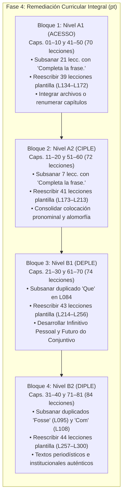

# Auditoría Curricular Integral A1–B2: Curso de Portugués (`pt`)

**Fecha de emisión:** 16 de octubre de 2026  
**Especialidad:** Lingüística Aplicada, Diseño Curricular MCER / CAPLE y Desarrollo de Contenidos Paglot  
**Ámbito de aplicación:** Curso completo de portugués europeo (`_herramientas/cursos/pt/01.txt` a `81.txt` / `Idiomas/cursos/pt/lessons/001.json` a `300.json`)  
**Documentos y fuentes de referencia inspeccionados:**
- `_herramientas/cursos/pt/capitulos.txt`
- `_herramientas/cursos/pt/ESTADO.txt`
- `_herramientas/cursos/compilar.py`
- `Idiomas/cursos/pt/lessons/capitulos.json` e inventario completo de 300 archivos `.json`
- Marcos de referencia oficiales: *Quadro Europeu Comum de Referência para as Línguas (QECR / Consejo de Europa)*, sistema de certificación oficial de portugués como lengua extranjera **CAPLE** (Universidade de Lisboa / Camões, I.P.): *ACESSO (A1)*, *CIPLE (A2)*, *DEPLE (B1)*, *DIPLE (B2)*; *Referencial Camões PLE*, *Programas de Português Língua Estrangeira (NOVA FCSH Lisboa)* y *Novo Acordo Ortográfico da Língua Portuguesa (AO90)*.

---

## 1. Resumen Ejecutivo y Diagnóstico Global

El curso de portugués de Paglot consta actualmente de **300 lecciones distribuidas en 81 capítulos**, cubriendo nominalmente los niveles A1, A2, B1 y B2.

Tras una auditoría minuciosa del código fuente, los archivos de especificación didáctica (`_herramientas/cursos/pt/*.txt`) y los 300 archivos compilados (`Idiomas/cursos/pt/lessons/*.json`), se concluye que el curso presenta una **fractura metodológica y estructural de gran envergadura**, que divide el contenido exactamente en dos mitades:

### 1.1. Balance Cuantitativo del Curso
- **Lecciones sólidas y auténticas (Base):** **133 lecciones (44,3% del curso)**. Corresponden a los capítulos originales 01 al 40 (archivos `01.txt` a `40.txt`, compilados como `001.json` a `133.json`). Poseen un diseño didáctico excelente: 119 diálogos comunicativos contextualizados (`D`), 700 glosas morfosintácticas (`>`), variedad rica de ejercicios (`test`, `traduccion`, `huecos`, `ordenar`, `escribir`) y un tratamiento contrastivo riguroso del portugués europeo frente al español.
- **Lecciones plantilla clónicas (Ampliación):** **167 lecciones (55,7% del curso)**. Corresponden a los capítulos 41 al 81 (archivos `41.txt` a `81.txt`, compilados como `134.json` a `300.json`), añadidos el 15 de octubre de 2026. Todas ellas responden a un único molde automatizado de "lectura breve de 3 frases" con 7 ejercicios invariables, carentes de diálogos, sin glosas explicativas y con distractores generados mecánicamente por rotación de frases.

```
Total Curso de Portugués: 300 Lecciones
┌───────────────────────────────┬───────────────────────────────┐
│     Sólidas / Base: 133       │       Plantillas: 167         │
│           (44,3%)             │           (55,7%)             │
└───────────────────────────────┴───────────────────────────────┘
                                │  Lecturas Clónicas de 3 frases│
                                │         (55,7% total)         │
```

### 1.2. Distribución de Lecciones y Recursos por Nivel MCER
| Nivel MCER / CAPLE | Capítulos | Total Lecc. | Base (Sólidas) | Plantillas Clónicas | % Plantillas | Palabras Visibles | Palabras Ocultas (`w`) | Glosas (`>`) | Diálogos (`D`) |
|:---:|:---:|:---:|:---:|:---:|:---:|:---:|:---:|:---:|:---:|
| **A1** *(ACESSO)* | Caps. 01–10 y 41–50 | 70 | 31 | 39 | **55,7%** | 700 | 159 | 295 | 34 |
| **A2** *(CIPLE)* | Caps. 11–20 y 51–60 | 72 | 31 | 41 | **56,9%** | 434 | 232 | 161 | 31 |
| **B1** *(DEPLE)* | Caps. 21–30 y 61–70 | 74 | 31 | 43 | **58,1%** | 385 | 270 | 124 | 30 |
| **B2** *(DIPLE)* | Caps. 31–40 y 71–81 | 84 | 40 | 44 | **52,4%** | 377 | 478 | 120 | 30 |
| **TOTAL** | **81 Capítulos** | **300** | **133** | **167** | **55,7%** | **1.896** | **1.139** | **700** | **125** |

---

## 2. Esclarecimiento Técnico del Escaneo Previo: Las «198 lecciones con preguntas duplicadas»

El escaneo automatizado previo detectó **198 lecciones con preguntas duplicadas** en el curso de portugués. La auditoría lingüística y técnica ha localizado la causa matemática y tipográfica exacta de este fenómeno:

```
198 Lecciones con Preguntas Duplicadas
├── 167 Lecciones: 100% de las lecciones de ampliación (L134 a L300)
│                  Tienen 2 ejercicios de traducción con enunciado idéntico:
│                  "Elige la traducción más fiel."
├──  28 Lecciones: Lecciones base (L002 a L038) donde compilar.py asignó
│                  la consigna por defecto duplicada: "Completa la frase."
└──   3 Lecciones: Lecciones base con pistas sintácticas que compilar.py
                   convirtió en preguntas idénticas dentro de la misma lección:
                   - L084 (Cap. 28): 2 huecos con pregunta "Que"
                   - L095 (Cap. 31): 2 huecos con pregunta "Fosse"
                   - L108 (Cap. 34): 2 huecos con pregunta "Com"
```

### 2.1. Las 167 lecciones de ampliación (L134 a L300): colisión sistemática de enunciados
En las 167 lecciones añadidas en la ampliación, los ejercicios 6 y 7 son invariablemente del tipo `traduccion` (`R` en el archivo fuente `.txt`). En la especificación fuente, el autor escribió:
```text
R [Frase 1] :: Elige la traducción más fiel.
+ [Traducción 1] :: Mantiene la información de la frase.
- [Traducción 2] :: Cambia la información principal.
- [Traducción 3] :: Cambia la información principal.

R [Frase 2] :: Elige la traducción más fiel.
+ [Traducción 2] :: Mantiene la información de la frase.
- [Traducción 1] :: Cambia la información principal.
- [Traducción 3] :: Cambia la información principal.
```
Al poseer dos actividades con el mismo atributo `"pregunta": "Elige la traducción más fiel."`, el analizador de integridad detecta una duplicidad flagrante dentro de la misma unidad didáctica en **las 167 lecciones de ampliación sin excepción**.

### 2.2. Las 28 lecciones base: fallback por defecto de `compilar.py`
En las lecciones base originales (archivos `01.txt` a `40.txt`), cuando un ejercicio de rellenar huecos (`H`) no incluye texto explícito tras el delimitador `::`, el compilador aplica el valor por defecto:
```python
# compilar.py, línea 199:
ejercicio('huecos', pregunta=q or 'Completa la frase.', frase=f)
```
Cuando una lección base incluye dos ejercicios `H` sin enunciado individualizado, ambos reciben la cadena `"Completa la frase."`, sumando 28 lecciones con enunciados duplicados (lecciones 2, 4, 7, 8, 11, 13, 14, 15, 17, 18, 19, 21, 22, 23, 24, 25, 26, 27, 28, 29, 30, 32, 33, 34, 35, 36, 37, 38).

### 2.3. Las 3 lecciones base con etiquetas como enunciado
En las lecciones 84, 95 y 108, el redactor colocó una etiqueta gramatical o palabra clave tras `::` creyendo que funcionaría como categoría o pista visual:
- **Lección 84 (Capítulo 28 - Relativos):**
  - `H O jardim ___ tens é grande. :: Que`
  - `H As casas ___ vês são bonitas. :: Que`
  - *Resultado compilado:* Ambas reciben `"pregunta": "Que"`.
- **Lección 95 (Capítulo 31 - Imperfeito do conjuntivo):**
  - `H Se eu ___ tu, descansava. :: Fosse`
  - `H Quem me dera que ___ verão. :: Fosse`
  - *Resultado compilado:* Ambas reciben `"pregunta": "Fosse"`.
- **Lección 108 (Capítulo 34 - Regência verbal preposicional):**
  - `H Dei ___ a chave. :: Com`
  - `H Fico ___ o carro. :: Com`
  - *Resultado compilado:* Ambas reciben `"pregunta": "Com"`.

---

## 3. Anatomía Forense de las 167 Lecciones Plantilla

Las 167 lecciones añadidas representan el **55,7% del curso** y siguen un patrón mecánico idéntico en todos los niveles (desde A1 hasta B2). Esta estructura evidencia graves carencias didácticas y metodológicas:

### 3.1. Esquema Rígido e Invariable de 7 Ejercicios
Cada una de las 167 lecciones consta invariablemente de la misma secuencia de bloques:
1. `explicacion`: Una breve pista de dos líneas bajo el título *"Clave de esta lectura"*.
2. `texto`: Un microtexto didáctico compuesto de **exactamente 3 frases**.
3. **Ejercicio 1 (`test`):** Pregunta global de propósito (*"¿Para qué se escribió el texto?"*).
4. **Ejercicio 2 (`test`):** Pregunta literal sobre la primera frase (*"¿Qué afirma exactamente la primera frase?"*). Las opciones son la traducción al español de la frase 1 (correcta), de la frase 2 (distractor) y de la frase 3 (distractor).
5. **Ejercicio 3 (`test`):** Pregunta de vocabulario en contexto (*"En este contexto, ¿qué significa «...»?"*).
6. **Ejercicio 4 (`test`):** Pregunta de tipología textual (*"¿Qué tipo de texto estás leyendo?"*).
7. **Ejercicio 5 (`huecos`):** Relleno de una palabra aislada extraída de la segunda frase (*"Completa con la palabra que encaja."*).
8. **Ejercicio 6 (`traduccion`):** Traducción de la frase 1 (*"Elige la traducción más fiel."*). Opciones: frase 1 en español (correcta), frase 2 (distractor), frase 3 (distractor).
9. **Ejercicio 7 (`traduccion`):** Traducción de la frase 2 (*"Elige la traducción más fiel."*). Opciones: frase 2 en español (correcta), frase 1 (distractor), frase 3 (distractor).

### 3.2. Vicios Pedagógicos Críticos de la Plantilla
1. **Redundancia y Tautología Evaluativa:**
   En cada lección, **el Ejercicio 2 y el Ejercicio 6 evalúan exactamente lo mismo con idénticas opciones**.
   - En el Ej. 2 el alumno elige entre la traducción de la frase 1, 2 o 3 para responder qué dice la primera frase.
   - En el Ej. 6 vuelve a elegir entre la traducción de la frase 1, 2 o 3 para traducir la primera frase.
   El alumno resuelve la misma tarea dos veces en un intervalo de dos minutos.
2. **Distractores Mecánicos por Rotación Permutativa:**
   No existe análisis filológico de errores comunes ni distractores plausibles. En los ejercicios 2, 6 y 7 los distractores son simplemente las traducciones literales de las otras dos frases del texto, acompañados del feedback automático: `Cambia la información principal.` o `Esa información aparece en otra frase.`.
3. **Microtextos Insuficientes para B1 y B2:**
   En los niveles B1 y B2, donde el MCER y los exámenes CAPLE (DEPLE y DIPLE) exigen la comprensión de textos extensos, crónicas, editoriales, artículos de opinión y regulaciones públicas, los textos de las 167 lecciones mantienen una longitud media raquítica:
   - **A1:** ~25 palabras (3 frases).
   - **A2:** ~39 palabras (3 frases).
   - **B1:** ~43 palabras (3 frases).
   - **B2:** ~52 palabras (3 frases).
   Evaluar un nivel B2 con un fragmento de 52 palabras desvirtúa por completo los descriptores de lectura crítica, distinción entre hecho e interpretación y jerarquización de ideas.
4. **Vocabulario Oculto y Evasión del Cuaderno de Léxico:**
   Para evitar que el compilador protestara por palabras sin ficha, el generador inyectó 1.139 fichas léxicas marcadas con `w` (fichas ocultas) con la glosa genérica: `En contexto: [Traducción española de la frase completa]`. Estas palabras **no se muestran en la lista de vocabulario de la lección ni se incorporan al cuaderno de repaso del estudiante**, privándolo de adquirir formalmente el léxico avanzado de B1 y B2.

---

## 4. Anomalía Estructural en el Sistema de Archivos, Capítulos y Numeración

A diferencia de otros cursos de la plataforma donde la ampliación se integró en los capítulos existentes, en el curso de portugués la ampliación se ejecutó creando **41 nuevos capítulos artificiales (Capítulos 41 al 81)** en archivos independientes (`41.txt` a `81.txt`).

Esta decisión técnica provocó una severa disfunción en la navegación pedagógica:

### 4.1. Disyunción entre el Archivo de Capítulos y el Compilador
En `_herramientas/cursos/pt/capitulos.txt`, los capítulos fueron ordenados por nivel:
- Caps. 01–10: A1 Base
- Caps. 41–50: A1 Ampliación ("A1 · ...")
- Caps. 11–20: A2 Base
- Caps. 51–60: A2 Ampliación ("A2 · ...")
- Caps. 21–30: B1 Base
- Caps. 61–70: B1 Ampliación ("B1 · ...")
- Caps. 31–40: B2 Base
- Caps. 71–81: B2 Ampliación ("B2 · ...")

Sin embargo, el script de compilación `compilar.py` numera las lecciones de manera estrictamente secuencial según el orden numérico de los archivos en disco (`01.txt` a `81.txt`):
- `01.txt` a `40.txt` -> Lecciones **001 a 133** (Caps. 01 al 40).
- `41.txt` a `81.txt` -> Lecciones **134 a 300** (Caps. 41 al 81).

### 4.2. Impacto Catastrófico en la Experiencia del Usuario
1. **Ruptura de la Progresión Lineal:**
   Si un usuario avanza por identificador de lección (001, 002, 003...):
   - Realiza todo el curso base (A1, A2, B1 y B2) desde la L001 hasta la L133 (donde aprueba el examen final de B2).
   - Inmediatamente después de culminar B2, la **Lección 134** lo transporta bruscamente al Capítulo 41 de A1 elemental (*Nome, apelido e morada*), obligándolo a responder formularios de inscripción y deletreo básico.
2. **Saltos Caóticos en la Vista de Capítulos:**
   Si el usuario avanza navegando por la vista de capítulos en la app (`vistas/lecciones.js`):
   - Al terminar el Capítulo 10 de A1 (lecciones 028 a 031), pasa al Capítulo 41 de A1 (lecciones **134 a 137**).
   - Continúa por los capítulos 41 a 50 (lecciones **134 a 172**).
   - Al completar el Capítulo 50 (L172), el siguiente capítulo visible en la pantalla es el Capítulo 11 de A2... ¡cuyas lecciones son la **032, 033 y 034**!
   - El identificador numérico retrocede 140 números de golpe (de 172 a 032), provocando confusión total en el registro de progreso y en el historial del alumno.
3. **Imperativo de Reestructuración:**
   Para la Fase 4 es imprescindible unificar los contenidos dentro de **40 capítulos integrados** (10 por nivel MCER) o renumerar las fuentes y capítulos con coherencia pedagógica consecutiva.

---

## 5. Diagnóstico Curricular Nivel a Nivel (MCER / CAPLE)

Se audita la solidez pedagógica del curso en los tres componentes evaluables en la app (Gramática, Vocabulario y Comprensión Lectora), contrastándolos con los exámenes oficiales de portugués lengua extranjera (CAPLE) y el MCER.

---

### 5.1. Nivel A1 — Inicial / Acceso (Caps. 01–10 y 41–50 | 70 lecciones: 31 sólidas, 39 plantillas)
**Referente Oficial:** *ACESSO (CAPLE)* / *QECR A1 (Conselho da Europa)*.

#### A. Gramática y Morfosintaxis
- **Puntos Fuertes (Lecciones Base 001–031):**
  - Fonética del portugués europeo: Las vocales reducidas o mudas átonas (*menino* /m(e)-NI-nu/, *excelente* /(i)sh-s(e)-LEN-t(e)/), consonantes sibilantes en final de sílaba (/ʃ/ y /ʒ/) y las nasales básicas (*bom, sim, não* /nãw̃/).
  - Tratamiento social en Portugal: Rigor al distinguir el trato informal de confianza (*tu*), el trato formal respetuoso (*o senhor / a senhora* con 3ª persona) y la aclaración sociolingüística sobre *você* (que en Portugal continental no es un tratamiento neutro de cortesía, a diferencia de Brasil).
  - Contracciones preposicionales fundamentales: *de + o = do*, *em + o = no*, *em + um = num*, *a + o = ao*.
  - Morfología verbal de Presente de Indicativo: Regulares en *-ar*, *-er*, *-ir*, y los pilares irregulares *ser*, *estar*, *ter*, *ir*, *fazer*, *querer*, *poder*.
  - Perífrasis de presente continuo en Portugal: Se enseña de forma ejemplar la estructura genuina del portugués europeo **«estar a + infinitivo»** (*Estou a comer*), advirtiendo contra el uso exclusivo del gerundio brasileño (*estou comendo*).
  - Oposición *ser* vs. *estar* vs. *ficar*: Clarificación indispensable en portugués donde *ficar* asume la localización permanente de edificios y lugares (*Onde fica o hotel?*).
  - Colocación de pronombres reflexivos en presente: Posición enclítica por defecto (*chamo-me, levanto-me*) y atracción proclítica con negación (*não me levanto*).
- **Carencias y Lagunas a Remediar:**
  - *Contracciones con la preposición «por»:* No se formaliza con suficiente claridad la contracción de *por + o/a/os/as = pelo, pela, pelos, pelas*, esencial desde A1.
  - *Pronombres demostrativos invariables:* La oposición entre *isto* (cerca del que habla), *isso* (cerca del interlocutor) y *aquilo* (lejos de ambos) requiere mayor contraste sistemático frente a las formas variables (*este, esse, aquele*).
  - *Pretérito perfeito simples en el Cap. 10:* Solo se tocan formas de 1ª y 3ª singular en las lecciones 028–029. Debe consolidarse el paradigma completo de regulares antes del salto a A2.

#### B. Vocabulario y Comprensión Lectora
- Las lecciones base cubren con solvencia los campos léxicos esenciales: saludos, familia, profesiones, casa, horas, días de la semana, números 0–100, alimentos y bebidas del café portugués (*bica, galão, meia de leite, tosta mista*).
- Las 39 lecciones de lectura añadida (Caps. 41–50) tocan temas adecuados para A1 (fichas de datos, horarios de trenes de CP, menús sencillos, direcciones postales y anuncios de farmacia), pero su formato enlatado de 3 frases y preguntas idénticas ("¿Para qué se escribió el texto?", "Elige la traducción más fiel") debe transformarse en tareas funcionales con billetes auténticos, carteles e indicaciones de transporte público.

---

### 5.2. Nivel A2 — Elemental / Plataforma (Caps. 11–20 y 51–60 | 72 lecciones: 31 sólidas, 41 plantillas)
**Referente Oficial:** *CIPLE — Certificado Inicial de Português Língua Estrangeira (CAPLE A2)*.

#### A. Gramática y Morfosintaxis
- **Puntos Fuertes (Lecciones Base 032–062):**
  - Morfología del *Pretérito Perfeito Simples (PPS)*: Cobertura sólida de verbos irregulares clave (*dei, disse, vim, vi, pus, pude, quis, soube, trouxe, li*).
  - Contraste *Pretérito Perfeito Simples* vs. *Pretérito Imperfeito*: Correcta distinción entre acciones puntuales concluidas y descripciones, contextos y hábitos pasados con *costumava + infinitivo* y *estava a + infinitivo*.
  - Sistema de pronombres personales átonos de complemento directo (*o, a, os, as*) e indirecto (*me, te, lhe, nos, lhes*).
  - Alomorfía pronominal con verbos: Se introduce la regla fonosintáctica de los clíticos tras terminación verbal en *-r, -s, -z* (*encontrar + o = encontrá-lo*, *diz + o = di-lo*) y tras terminación nasal (*viram + o = viram-no*).
  - Modo Imperativo: Formación del imperativo afirmativo formal (base del presente de conjuntivo) e informal (*tu*, supresión de la *-s* del presente: *fala, come*), y la regla estricta de prohibición con *não + conjuntivo* (*Não fales! Não se preocupe!*).
  - Conectores temporales y causales: *quando, enquanto, há... anos, desde, porque, mas, por isso*.
- **Carencias y Lagunas a Remediar:**
  - *Reglas de colocación pronominal (Próclise vs. Ênclise):* Aunque se muestra en ejemplos, falta una sistematización explícita de los inductores obligatorios de próclise en A2: adverbios de negación (*não, nunca, jamais*), palabras interrogativas (*quem, onde, quando*), pronombres indefinidos (*alguém, ninguém, tudo*) y conjunciones subordinantes (*porque, que*).
  - *Futuro do presente perifrástico vs. sintético:* En A2 se abusa de *ir + infinitivo*; debe explicarse cuándo se usa el futuro sintético simple y la perífrasis *haver de + infinitivo* común en Portugal.
  - *Pronombres complemento combinado:* La contracción de complemento indirecto + directo (*me + o = mo*, *lhe + o = lho*, *nos + as = no-las*) no se practica en profundidad en A2, dejando al alumno desarmado ante textos reales de atención al cliente.

#### B. Vocabulario y Comprensión Lectora
- Vocabulario bien asentado en las lecciones base: salud y cuerpo humano (*doer*), compras y tallas de ropa, el barrio y alquiler de vivienda, restaurantes y gastronomía típica (*caldo verde, bacalhau*), festividades lusas (*Festas de Lisboa, São João do Porto*).
- Las 41 lecciones de lectura de ampliación (Caps. 51–60) desperdician la oportunidad de trabajar avisos de la administración pública portuguesa, folletos de centros de salud (SNS) y contratos de arrendamiento, reduciéndolos a microtextos de 39 palabras con distractores mecánicos.

---

### 5.3. Nivel B1 — Intermedio / Umbral (Caps. 21–30 y 61–70 | 74 lecciones: 31 sólidas, 43 plantillas)
**Referente Oficial:** *DEPLE — Diploma Elementar de Português Língua Estrangeira (CAPLE B1)*.

#### A. Gramática y Morfosintaxis
- **Puntos Fuertes (Lecciones Base 063–093):**
  - Presente do Conjuntivo: Paradigma regular e irregular (*tenha, seja, vá, esteja, dê, saiba, queira*) y matrices de duda, deseo, emoción y expresiones impersonales (*espero que, oxalá, é provável que, é preciso que*).
  - **Futuro do Conjuntivo (Rasgo definitorio del portugués):** Se aborda con gran acierto en las lecciones 074–076. A diferencia del español (donde el futuro de subjuntivo es un arcaísmo jurídico en desuso), en portugués es una forma viva de uso diario tras conjunciones temporales y condicionales: *Quando puderes, liga-me*; *Se tiveres tempo, vem cá*.
  - **Pretérito Perfeito Composto (PPC): Diferenciación contrastiva crítica.**
    En la Lección 066 se explica una de las mayores trampas para hispanohablantes: en portugués, **«ter + particípio» NO equivale al pretérito perfecto español («he comido»)**. Posee un valor iterativo y continuativo: indica una acción que comenzó en el pasado y se repite de forma insistente hasta el presente (*Tenho estudado muito ultimamente* = «Llevo estudiando mucho últimamente / He estado estudiando mucho»). Para una acción pasada puntual concluida de hoy (*Hoy he comido a las dos*), el portugués usa obligatoriamente el Pretérito Perfeito Simples (*Hoje almocei às duas*).
  - Condicional Simples: Formación y valores de cortesía (*gostaria, poderia, deveria*) y condiciones tipo II en presente.
  - Voz Pasiva y Estructuras con «se»: Distinción entre pasiva analítica (*ser + particípio*), pasiva de estado (*estar + particípio*) y pasiva con pronombre reflejo.
  - Discurso Indirecto básico y Pretérito Mais-que-perfeito Composto do Indicativo (*tinha falado*).
- **Carencias y Lagunas a Remediar:**
  - *Infinitivo Pessoal (Introducción formal):* El infinitivo personal o flexionado (*para nós termos, ao chegares tu*) es la estructura sintáctica más original y económica del portugués. En B1 solo se menciona de pasada; debe tener al menos dos lecciones completas dedicadas a cuándo sustituye a una subordinada con conjuntivo.
  - *Regla de sujeto correferente:* Cuando el sujeto de la oración principal coincide con el de la subordinada, el portugués selecciona infinitivo con preposición (*Espero ir* y no *Espero que vá*); esta alternancia debe sistematizarse con rigor.
  - *Conectores concesivos de B1:* Falta mayor práctica de *embora + presente do conjuntivo* frente a *apesar de + infinitivo*.

#### B. Vocabulario y Comprensión Lectora
- Buen caudal léxico en lecciones base: entrevistas laborales, cartas de motivación, ecología y reciclaje, fado y tradiciones académicas de Coímbra.
- Las 43 lecciones de lectura (Caps. 61–70) adolecen de falta de cohesión discursiva: artículos de opinión fragmentados a 3 frases, sin explotación de conectores de causa/consecuencia ni preguntas de comprensión inferencial profunda.

---

### 5.4. Nivel B2 — Avanzado / Ventaja (Caps. 31–40 y 71–81 | 84 lecciones: 40 sólidas, 44 plantillas)
**Referente Oficial:** *DIPLE — Diploma Intermédio de Português Língua Estrangeira (CAPLE B2)*.

#### A. Gramática y Morfosintaxis
- **Puntos Fuertes (Lecciones Base 094–133):**
  - Imperfeito do Conjuntivo: Paradigmas en *-sse* (*falasse, pudesse, fizesse, tivesse, fosse*) y periodo hipotético de irrealidad en presente (*Se eu tivesse tempo, ia contigo*).
  - Pretérito Mais-que-perfeito Composto do Conjuntivo en condiciones del pasado (*Se tivesse sabido, teria avisado*).
  - **Infinitivo Pessoal Flexionado Avanzado:** En el Cap. 34 (L110) se estudian casos con preposiciones (*por, para, sem, até, ao*) y sujetos propios diferentes del verbo principal (*É melhor ires tu primeiro*).
  - Particípios Duplos: Estudio fundamental del portugués culto (verbos con dos participios: uno regular en *-ado/-ido* con *ter/haver* en la voz activa, y otro irregular sintético con *ser/estar* en la pasiva: *tinha limpado / foi limpo; tinha acendido / foi aceso; tinha entregado / foi entregue*).
  - Colocación Pronominal Completa: Próclise estricta con palabras atractoras, ênclise y explicación de la **mesóclise** en futuro y condicional en registro formal (*fá-lo-ei*, *dir-se-ia*).
  - Geolingüística y Varianza: El Cap. 37 trata con solvencia la Comunidad de Países de Lengua Portuguesa (CPLP), el contraste léxico y gramatical entre Portugal y Brasil (*comboio/trem, passadeira/faixa de pedestres, ecrã/tela*) y los registros de los PALOP (Angola y Mozambique).
  - Ortografía y Fonología Avanzada: El Cap. 36 aborda las vocales abiertas y cerradas (*avó* /a-VƆ/ vs. *avô* /a-VO/) y los cambios implantados por el **Acordo Ortográfico de 1990 (AO90)**, como la supresión de consonantes no pronunciadas (*acção -> ação, óptimo -> ótimo, recepção -> receção* en Portugal).
- **Carencias y Lagunas a Remediar:**
  - *Regencia Verbal y Preposicional Compleja:* Verbos que rigen preposiciones contrarias al español (*consistir em, reparar em [fijarse en], desconfiar de, cheirar a, saber a [saber a algo]*). Están en la L109 pero requieren mayor ejercitación en contextos auténticos.
  - *Subordinación Concesiva Compleja con Conjuntivo:* Estructuras con *ainda que, se bem que, por muito que, conquanto* exigen una práctica sistemática para alcanzar el estándar DIPLE.
  - *Discurso Indirecto en la Crónica Periodística:* Transformaciones temporales avanzadas en textos de prensa.

#### B. Vocabulario y Comprensión Lectora
- La base original contiene lecciones notables sobre refranes y expresiones idiomáticas de Portugal (*Quem não arrisca não petisca, cada macaco no seu galho, bater com a cabeça na parede*).
- **Fallo crítico en las 44 lecciones de ampliación de B2 (Caps. 71–81):**
  Constituyen la mayor decepción del nivel. Mientras un examen DIPLE B2 de la Universidad de Lisboa enfrenta al alumno a artículos periodísticos de *Público* o *Expresso*, editoriales, crónicas y textos normativos de 400 a 600 palabras con preguntas de deducción, matiz pragmático y posición del autor, los capítulos 71 al 81 ofrecen microlecturas de apenas 52 palabras con preguntas obvias y distractores absurdos (las traducciones de las otras 2 frases). Esto priva al curso de un auténtico nivel B2 en comprensión lectora.

---

## 6. Inventario Exhaustivo Capítulo por Capítulo (01 al 81)

A continuación se presenta la matriz completa de los 81 capítulos del curso con su filiación de nivel, lecciones base y de plantilla, y el diagnóstico técnico:

| Cap | Nivel | Título (Português / Español) | Lecc. JSON | Base | Plantilla | % Plantilla | Diagnóstico Curricular Específico |
|:---:|:---:|:---|:---:|:---:|:---:|:---:|:---|
| **01** | A1 | Olá! / Saludos y presentaciones | 001–003 | 3 | 0 | 0% | Sólido. Saludos, trato social (tu/você/o senhor), fonética, reducción vocálica. |
| **02** | A1 | De onde és? / Origen, trabajo e idiomas | 004–006 | 3 | 0 | 0% | Sólido. Verbo ser, nacionalidades, verbos -ar, contracciones en + o/um. |
| **03** | A1 | Os números e a família / Números y familia | 007–009 | 3 | 0 | 0% | Sólido. Ter y edad, números 0-100, posesivos con artículo, dele/dela. |
| **04** | A1 | A casa e as coisas / La casa y las cosas | 010–012 | 3 | 0 | 0% | Sólido. Demonstrativos esto/eso, colores, há existencial, estar vs ficar. |
| **05** | A1 | O meu dia / Mi día | 013–015 | 3 | 0 | 0% | Sólido. Verbos -er/-ir, reflexivos con ênclise, la hora, días, ir y fazer. |
| **06** | A1 | À mesa! / Comida y bebida | 016–018 | 3 | 0 | 0% | Sólido. Gostar de, pedir en cafetería (bica/galão), precisar de, compras. |
| **07** | A1 | As compras / Compras y ropa | 019–021 | 3 | 0 | 0% | Sólido. Ropa, demostrativos este/esse/aquele, precios, comparativos básicos. |
| **08** | A1 | Na cidade / Por la ciudad | 022–024 | 3 | 0 | 0% | Sólido. Lugares, transportes, verbos modales poder/querer/saber/ter de. |
| **09** | A1 | Os tempos livres / Tiempo libre | 025–027 | 3 | 0 | 0% | Sólido. Aficiones, «estar a + infinitivo», tiempo meteorológico, fechas, ir + inf. |
| **10** | A1 | Ontem e amanhã / El pasado y los viajes | 028–031 | 4 | 0 | 0% | Sólido. Pretérito perfeito regular e irregulares básicos. L031: Examen final A1. |
| **41** | A1 | A1 · Dados e formulários | 134–137 | 0 | 4 | 100% | Plantilla de 3 frases. Preguntas redundantes y distractores permutados. |
| **42** | A1 | A1 · Letras, sons e soletração | 138–141 | 0 | 4 | 100% | Plantilla. Debe incluir audios reales de pronunciación y deletreo. |
| **43** | A1 | A1 · Datas, números e preços | 142–145 | 0 | 4 | 100% | Plantilla. Horarios y precios reales de trenes/autobuses de Portugal. |
| **44** | A1 | A1 · Rotinas e horários | 146–149 | 0 | 4 | 100% | Plantilla. Agendas y rutinas que deben enriquecerse con conectores temporales. |
| **45** | A1 | A1 · Cidade, mapas e transportes | 150–153 | 0 | 4 | 100% | Plantilla. Planos del metro de Lisboa/Porto e indicaciones funcionales. |
| **46** | A1 | A1 · Café, mercado e rótulos | 154–157 | 0 | 4 | 100% | Plantilla. Menús auténticos y listas de compras de mercado municipal. |
| **47** | A1 | A1 · Compras e serviços | 158–161 | 0 | 4 | 100% | Plantilla. Recibos, etiquetas de precios y comprobantes de servicios. |
| **48** | A1 | A1 · Saúde e marcações | 162–165 | 0 | 4 | 100% | Plantilla. Citas médicas en centros de salud y prospectos simples. |
| **49** | A1 | A1 · Tempo, clima e frases ligadas | 166–169 | 0 | 4 | 100% | Plantilla. Boletines meteorológicos de Portugal y conectores básicos. |
| **50** | A1 | A1 · Leitura integrada | 170–172 | 0 | 3 | 100% | Plantilla. Debería ser una prueba de lectura integrada auténtica A1 (ACESSO). |
| **11** | A2 | Morar e descrever / Vivir y describir | 032–034 | 3 | 0 | 0% | Sólido. Adjetivos, comparativo de superioridad, superlativo sintético en -íssimo. |
| **12** | A2 | Digo, venho, ponho / Verbos irregulares | 035–037 | 3 | 0 | 0% | Sólido. 1ª persona irregular (dizer, vir, pôr, dar), frecuencia y horarios. |
| **13** | A2 | Dei, disse, vim / El pasado irregular | 038–040 | 3 | 0 | 0% | Sólido. PPS irregular completo, marcadores temporales del pasado. |
| **14** | A2 | Viagens e pronomes / Pronombres | 041–043 | 3 | 0 | 0% | Sólido. Pronombres directos/indirectos, alomorfía -lo/-la y -no/-na con infinitivo. |
| **15** | A2 | A saúde / La salud | 044–046 | 3 | 0 | 0% | Sólido. Verbo doer, há/desde temporales, farmacia y posología. |
| **16** | A2 | Contar o passado / Contar el pasado | 047–049 | 3 | 0 | 0% | Sólido. Pretérito imperfeito, contraste PPS/PI, costumava + inf, estava a + inf. |
| **17** | A2 | Dar instruções / Instrucciones y consejos | 050–052 | 3 | 0 | 0% | Sólido. Imperativo formal/informal, prohibiciones con não + conjuntivo. |
| **18** | A2 | Trabalho e estudos / Trabajo y estudios | 053–055 | 3 | 0 | 0% | Sólido. Diferencia para vs por, andar a + inf, precisar de vs é preciso. |
| **19** | A2 | Gostos e restaurante / Restaurante | 056–058 | 3 | 0 | 0% | Sólido. Gostar de, preferir, indefinidos (alguém/ninguém, tudo/nada/todo). |
| **20** | A2 | Opinar y celebrar / Opinar y fiestas | 059–062 | 4 | 0 | 0% | Sólido. Acho que, conectores de orden, fiestas populares. L062: Examen A2. |
| **51** | A2 | A2 · Relatos no passado | 173–176 | 0 | 4 | 100% | Plantilla. Debe transformarse en narraciones de experiencias biográficas. |
| **52** | A2 | A2 · Planos, convites e previsões | 177–180 | 0 | 4 | 100% | Plantilla. Planes, invitaciones a eventos culturales y respuestas. |
| **53** | A2 | A2 · Pronomes e referências | 181–184 | 0 | 4 | 100% | Plantilla. Cohesión anafórica y seguimiento de pronombres en textos. |
| **54** | A2 | A2 · Quantidade e comparação | 185–188 | 0 | 4 | 100% | Plantilla. Textos comparativos de consumo, precios y opiniones. |
| **55** | A2 | A2 · Pedidos e instruções | 189–192 | 0 | 4 | 100% | Plantilla. Normas de convivencia, instrucciones de servicios y avisos. |
| **56** | A2 | A2 · Causa, resultado e contraste | 193–196 | 0 | 4 | 100% | Plantilla. Cartas sencillas de reclamación y exposición de causas. |
| **57** | A2 | A2 · Tempo, condição e relativas | 197–200 | 0 | 4 | 100% | Plantilla. Noticias breves con secuencias temporales y condiciones. |
| **58** | A2 | A2 · Anúncios e informação pública | 201–204 | 0 | 4 | 100% | Plantilla. Anuncios de empleo, cursos de formación y reglamentos urbanos. |
| **59** | A2 | A2 · Mensagens de viagem e saúde | 205–208 | 0 | 4 | 100% | Plantilla. Comunicaciones de agencias de viajes y avisos de transporte. |
| **60** | A2 | A2 · Leitura integrada | 209–213 | 0 | 5 | 100% | Plantilla. Debe elevarse a modelo oficial de comprensión lectora CIPLE A2. |
| **21** | B1 | Planos para o futuro / Planes de futuro | 063–065 | 3 | 0 | 0% | Sólido. Futuro simple sintético, perífrasis continuar a, deixar de, acabar de. |
| **22** | B1 | Experiências de vida / Pretérito comp. | 066–068 | 3 | 0 | 0% | Sólido. Ter + particípio con valor iterativo continuo, participios irregulares. |
| **23** | B1 | Condições e cortesia / Condicional | 069–071 | 3 | 0 | 0% | Sólido. Condicional simple, cortesía, condiciones factuales se/quando. |
| **24** | B1 | Espero que tenhas um bom dia / Conjuntivo | 072–074 | 3 | 0 | 0% | Sólido. Presente do conjuntivo (formas y usos), deseos, dudas, expresiones. |
| **25** | B1 | Para que tenhas tempo / Conj. y futuro | 075–077 | 3 | 0 | 0% | Sólido. Finalidad (para que), futuro do conjuntivo con se/quando, inf. pessoal. |
| **26** | B1 | O romance foi escrito / Voz pasiva | 078–080 | 3 | 0 | 0% | Sólido. Pasiva con ser, estado con estar, pasiva e impersonal con se. |
| **27** | B1 | Disse que estava cansado / Discurso ind. | 081–083 | 3 | 0 | 0% | Sólido. Discurso indirecto, interrogativas indirectas, mais-que-perfeito comp. |
| **28** | B1 | A casa que comprei / Relativos | 084–086 | 3 | 0 | 0% | Sólido. Relativos con y sin preposición (que, onde, quem, o que, aquilo que). |
| **29** | B1 | Por um lado, por outro / Argumentación | 087–089 | 3 | 0 | 0% | Sólido. Argumentación, debate, opinión, noticias breves de prensa. |
| **30** | B1 | Gostaria de trabalhar aqui / Repaso B1 | 090–093 | 4 | 0 | 0% | Sólido. Cartas de presentación, medio ambiente, cultura lusa. L093: Examen B1. |
| **61** | B1 | B1 · Narrativas e experiências | 214–217 | 0 | 4 | 100% | Plantilla. Relatos literarios breves y crónicas personales con cambio de punto de vista. |
| **62** | B1 | B1 · Condições e futuro | 218–221 | 0 | 4 | 100% | Plantilla. Normativas, planes laborales y reglamentos condicionales. |
| **63** | B1 | B1 · Desejos, dúvidas e avaliações | 222–226 | 0 | 5 | 100% | Plantilla. Foros de discusión ciudadana, recomendaciones y críticas de eventos. |
| **64** | B1 | B1 · Cortesia e hipóteses | 227–230 | 0 | 4 | 100% | Plantilla. Cartas formales de petición y consejo a entidades públicas. |
| **65** | B1 | B1 · Discurso referido e voz passiva | 231–234 | 0 | 4 | 100% | Plantilla. Noticias de agencias de prensa con atribución de fuentes y pasiva. |
| **66** | B1 | B1 · Relativas e coesão | 235–238 | 0 | 4 | 100% | Plantilla. Artículos divulgativos con mecanismos complejos de cohesión textual. |
| **67** | B1 | B1 · Argumentar e ligar ideias | 239–243 | 0 | 5 | 100% | Plantilla. Textos de opinión y cartas al director con conectores de contraste. |
| **68** | B1 | B1 · Notícias, anúncios e avisos | 244–247 | 0 | 4 | 100% | Plantilla. Comunicados oficiales de municipios y avisos de protección civil. |
| **69** | B1 | B1 · Trabalho, ambiente e cultura | 248–251 | 0 | 4 | 100% | Plantilla. Informes de sostenibilidad empresarial y proyectos culturales. |
| **70** | B1 | B1 · Leitura integrada e inferência | 252–256 | 0 | 5 | 100% | Plantilla. Debe elevarse a modelo oficial de examen de lectura DEPLE B1. |
| **31** | B2 | Se eu tivesse tempo / Imperfeito conj. | 094–097 | 4 | 0 | 0% | Sólido. Imperfeito do conjuntivo, irrealidad, condicional compuesto, quem me dera. |
| **32** | B2 | Quando chegares, avisa-me / Futuro conj. | 098–101 | 4 | 0 | 0% | Sólido. Futuro conjuntivo avanzado, concessión (embora), finalidad (para que). |
| **33** | B2 | Deve estar em casa / Probabilidad | 102–105 | 4 | 0 | 0% | Sólido. Modalidad epistémica, dever/poder + ter + part., indicativo vs conjuntivo. |
| **34** | B2 | Manter, obter, conter / Derivación | 106–111 | 6 | 0 | 0% | Sólido. Derivados de ter/pôr, regencia preposicional, infinitivo pessoal, particípios duplos. |
| **35** | B2 | Quem não arrisca não petisca / Idiomatismos | 112–114 | 3 | 0 | 0% | Sólido. Refranes portugueses, expresiones idiomáticas, metáforas cotidianas. |
| **36** | B2 | Palavras agudas, graves / Acentuación | 115–117 | 3 | 0 | 0% | Sólido. Prosodia, timbre vocálico abierto/cerrado, reglas oficiales del AO90. |
| **37** | B2 | Nove países, uma língua / Variedades | 118–120 | 3 | 0 | 0% | Sólido. CPLP y PALOP, portugués europeo vs brasileño y africano, registros. |
| **38** | B2 | Em primeiro lugar / Ensayo argumentativo | 121–126 | 6 | 0 | 0% | Sólido. Macroestructura ensayística, conectores, colocación pronominal avanzada. |
| **39** | B2 | Recomenda-se que durma / Salud y consumo | 127–129 | 3 | 0 | 0% | Sólido. Lenguaje institucional, recomendaciones, concordancia pasiva con se. |
| **40** | B2 | Do Minho ao Algarve / Cultura y repaso | 130–133 | 4 | 0 | 0% | Sólido. Regiones de Portugal, gastronomía, relato complejo. L133: Examen B2. |
| **71** | B2 | B2 · Probabilidade e posição do enunciador | 257–260 | 0 | 4 | 100% | Plantilla. Análisis de certeza vs matiz epistémico en artículos de investigación. |
| **72** | B2 | B2 · Concessão, finalidade e condição | 261–264 | 0 | 4 | 100% | Plantilla. Artículos de opinión con subordinadas concesivas complejas (conquanto). |
| **73** | B2 | B2 · Atribuição, relato e passiva | 265–268 | 0 | 4 | 100% | Plantilla. Periodismo de investigación con jerarquía de fuentes y pasiva. |
| **74** | B2 | B2 · Regência, derivados e particípios | 269–272 | 0 | 4 | 100% | Plantilla. Textos jurídicos y administrativos con regencia preposicional culta. |
| **75** | B2 | B2 · Colocação pronominal em contexto | 273–276 | 0 | 4 | 100% | Plantilla. Ensayo literario con próclise, ênclise y mesóclise formal. |
| **76** | B2 | B2 · Colocações e expressões idiomáticas | 277–280 | 0 | 4 | 100% | Plantilla. Crónicas de costumbres de Lisboa y Oporto con fraseología nativa. |
| **77** | B2 | B2 · Variedades, registo e escolha lexical | 281–284 | 0 | 4 | 100% | Plantilla. Textos comparativos de las literaturas de Portugal, Brasil y Angola. |
| **78** | B2 | B2 · Argumentação e arquitetura do texto | 285–288 | 0 | 4 | 100% | Plantilla. Ensayos completos de debate socioeconómico con refutación de tesis. |
| **79** | B2 | B2 · Imprensa e leitura crítica | 289–292 | 0 | 4 | 100% | Plantilla. Lectura crítica de editoriales periodísticos de *Público* y *Diário de Notícias*. |
| **80** | B2 | B2 · Regulamentos e textos institucionais | 293–296 | 0 | 4 | 100% | Plantilla. Diários da República, leyes, contratos de trabajo y estatutos. |
| **81** | B2 | B2 · Leitura integrada e revisão crítica | 297–300 | 0 | 4 | 100% | Plantilla. Prueba exhaustiva oficial de lectura DIPLE B2 (Universidade de Lisboa). |

---

## 7. Plan de Acción y Hoja de Ruta para la Fase 4

Para subsanar las 198 duplicidades de preguntas, erradicar las 167 lecciones plantilla clónicas y armonizar la estructura de archivos y capítulos, la **Fase 4 de Remediación y Reescritura** debe organizarse en **4 bloques secuenciales por nivel MCER**:



### 7.1. Bloque 1: Nivel A1 (ACESSO | Capítulos 01–10 y 41–50 | 70 lecciones | 39 a reescribir)
1. **Corrección de Duplicados Base (21 lecciones):** Añadir enunciados específicos a los ejercicios `H` que actualmente heredan `"Completa la frase."` por defecto en las lecciones 002 a 030.
2. **Reescritura Integral de las 39 Lecciones de Ampliación (L134–L172):**
   - Eliminar el molde clónico de 7 preguntas idénticas.
   - En el Cap. 42 (Fonética): sustituir las preguntas mecánicas por ejercicios interactivos de discriminación acústica con audios (`A` y `HA`) para los sonidos nasales (*-ão, -ãe, -ões*), la reducción de vocales átonas y las grafías *ch*, *lh*, *nh*.
   - En los Caps. 43–49: crear situaciones reales con textos visuales funcionales (horarios de Comboios de Portugal, recibos de hipermercado, cartas de café con pastéis de nata, recetas tradicionales).
   - En el Cap. 50 (Leitura integrada): construir un simulacro fiel de la prueba de comprensión escrita de ACESSO (CAPLE A1).
3. **Fichas Léxicas Reales:** Convertir las 159 palabras ocultas en vocabulario visible con pronunciación figurada y ejemplos prácticos.

### 7.2. Bloque 2: Nivel A2 (CIPLE | Capítulos 11–20 y 51–60 | 72 lecciones | 41 a reescribir)
1. **Corrección de Duplicados Base (7 lecciones):** Asignar preguntas individualizadas a los ejercicios `H` de las lecciones 032 a 038.
2. **Reescritura de las 41 Lecciones de Ampliación (L173–L213):**
   - Diversificar tipologías de ejercicios incorporando ordenación de sintagmas (`O`), traducción contextualizada (`R`) con distractores contrastivos reales, y escritura guiada (`X`).
   - Introducir tareas de comprensión sobre el sistema sanitario portugués (SNS), partes meteorológicos de la costa atlántica y avisos de transporte metropolitano de Lisboa y Oporto.
   - Profundizar en las combinaciones de pronombres átonos (*mo, to, lho*) y en la alomorfía de los clíticos (*-lo/-la*, *-no/-na*).
   - En el Cap. 60: desarrollar un simulacro de examen de comprensión lectora alineado con el modelo oficial CIPLE del CAPLE.

### 7.3. Bloque 3: Nivel B1 (DEPLE | Capítulos 21–30 y 61–70 | 74 lecciones | 43 a reescribir)
1. **Corrección de Duplicados en Base:** Modificar los enunciados de la Lección 084 (Cap. 28) sustituyendo el ambiguo `"Que"` por preguntas didácticas (*"Completa con el relativo de sujeto"* / *"Completa con el relativo adecuado"*).
2. **Reescritura de las 43 Lecciones de Ampliación (L214–L256):**
   - Ampliar la longitud de los textos de 43 palabras a relatos y artículos de 120–180 palabras que requieran inferencia, interpretación de la intención del emisor y reconocimiento de presuposiciones.
   - Explotar en profundidad el **Infinitivo Pessoal** en contextos de contraste con el presente y futuro do conjuntivo.
   - Reforzar la distinción semántica del **Pretérito Perfeito Composto** con ejercicios contrastivos frente al PPS.
   - En el Cap. 70: crear un modelo riguroso de comprensión lectora DEPLE B1.

### 7.4. Bloque 4: Nivel B2 (DIPLE | Capítulos 31–40 y 71–81 | 84 lecciones | 44 a reescribir)
1. **Corrección de Duplicados en Base:**
   - Lección 095 (Cap. 31): sustituir la pregunta duplicada `"Fosse"` por consignas diferenciadas sobre la condición hipotética.
   - Lección 108 (Cap. 34): sustituir la pregunta duplicada `"Com"` por enunciados sobre regencia verbal específica.
2. **Reescritura Completa de las 44 Lecciones de Ampliación (L257–L300):**
   - **Salto Cualitativo Textual:** Sustituir los microtextos de 52 palabras por textos periodísticos reales y crónicas culturales de 250 a 400 palabras extraídos de medios de referencia (*Público*, *Expresso*, *Visão*, *Diário da República*).
   - Diseñar ejercicios de opción múltiple avanzada donde los distractores representen inferencias erróneas, lecturas sobregeneralizadas o trampas de atenuación discursiva, y no simples frases permutadas.
   - Incorporar ejercicios de rellenado léxico con preposiciones fijas y regencia culta (*dar com, ficar com, incidir sobre, tender a*).
   - Ejercitar la distinción entre variantes diatópicas (Portugal vs. Brasil vs. África lusófona) sin penalizar las opciones cultas brasileñas.
   - En el Cap. 81: implantar una prueba de comprensión lectora de nivel DIPLE idéntica a la plantilla de examen oficial de la Universidade de Lisboa.
3. **Fichas de Vocabulario Avanzado:** Incorporar las 478 palabras ocultas de B2 al cuaderno de vocabulario del estudiante con sus definiciones contextualmente ricas y consejos etimológicos.

### 7.5. Reorganización Estructural del Curso
Durante la Fase 4 debe abordarse la armonización de archivos y capítulos:
- **Opción A (Recomendada):** Consolidar las lecciones dentro de **40 capítulos integrados** (10 por nivel MCER). Cada capítulo albergará tanto sus lecciones de presentación gramatical/diálogo como sus lecciones de lectura profunda y aplicación práctica (p. ej., Cap. 1: L001 a L007; Cap. 2: L008 a L015...). Esto elimina los 41 capítulos artificiales con prefijo "A1 · ...", unifica la numeración lineal (001 a 300) y suprime la disyunción en la vista de progreso.
- **Opción B (Alternativa de numeración secuencial):** Si se decide conservar los 81 capítulos temáticos, renumerar los archivos fuente `.txt` de forma estrictamente secuencial según el orden pedagógico real de `capitulos.txt` (es decir, colocar los archivos de lectura de A1 como `11.txt` a `20.txt`, los de A2 como `31.txt` a `40.txt`, etc.), para que al compilar, el número de lección coincida exactamente con la progresión didáctica del curso sin saltos temporales ni retrocesos absurdos de nivel.

---

## 8. Conclusiones

1. **Diagnóstico Confirmado:** Las 198 alertas del escáner previo tienen un diagnóstico 100% esclarecido: se originan por la colisión sistemática de la consigna `"Elige la traducción más fiel."` en las 167 lecciones de la ampliación, sumada a 28 fallbacks `"Completa la frase."` y 3 etiquetas en las lecciones base.
2. **Excelente Núcleo Base, Grave Devaluación en la Ampliación:** El curso de portugués posee una de las bases más brillantes de la plataforma en sus primeras 133 lecciones (enfoque contrastivo hispano-portugués, respeto riguroso de la norma europea, 700 glosas morfosintácticas y diálogos vivos). Sin embargo, la ampliación de 167 lecciones supuso una degradación automatizada que afectó al 55,7% del curso.
3. **Viabilidad Plena:** Con el mapa de ruta establecido en los 4 bloques de la Fase 4, el curso de portugués de Paglot no solo eliminará cualquier vestigio de lecciones plantilla y errores técnicos de duplicación, sino que se erigirá como una de las mejores propuestas pedagógicas del mercado digital para el aprendizaje del portugués de Portugal según los estándares internacionales del CAPLE y el MCER.
