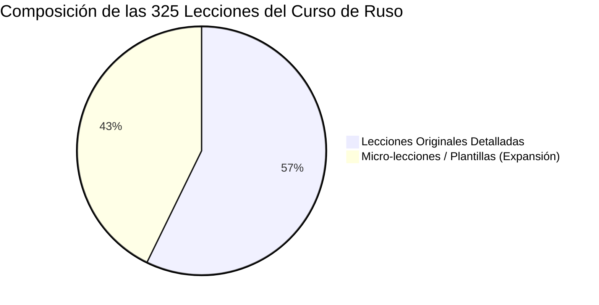
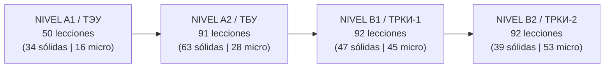
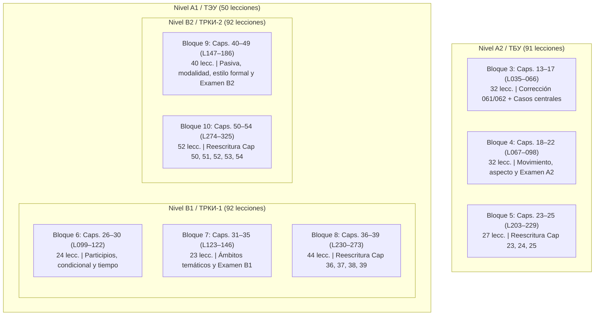

# Auditoría Curricular Integral A1–B2 / TRKI: Curso de Ruso (`ru`)

**Fecha de emisión:** 16 de octubre de 2026  
**Especialidad:** Lingüística Eslava Aplicada, Diseño Curricular MCER / TRKI y Desarrollo de Contenidos Paglot  
**Ámbito de aplicación:** Curso completo de ruso (`_herramientas/cursos/ru/01.txt` a `10.txt`, `capitulos.txt`, y `Idiomas/cursos/ru/lessons/001.json` a `325.json`)  
**Marcos de referencia evaluados:**
- **MCER:** Marco Común Europeo de Referencia para las Lenguas (niveles A1, A2, B1, B2).
- **TRKI / TORFL:** Тест по русскому языку как иностранному (ТРКИ):
  * **Nivel A1:** ТЭУ (Элементарный уровень — TEU).
  * **Nivel A2:** ТБУ (Базовый уровень — TBU).
  * **Nivel B1:** ТРКИ-1 / TORFL-1 (Первый сертификационный уровень).
  * **Nivel B2:** ТРКИ-2 / TORFL-2 (Второй сертификационный уровень).
- **Documentos internos de control:** `Notas_archivos_noafectaalcodigo/informe_ruso.txt`, `_herramientas/cursos/ru/capitulos.txt`, `Idiomas/cursos/ru/lessons/capitulos.json`.

---

## 1. Resumen Ejecutivo y Diagnóstico Global

El curso de ruso de Paglot consta formalmente de **325 lecciones distribuidas en 54 capítulos** y un archivo de metadatos general (`capitulos.json`), abarcando desde la alfabetización cirílica hasta la lectura crítica y argumentativa de nivel B2.

Tras una auditoría minuciosa, archivo por archivo, bloque por bloque y ejercicio por ejercicio, se ha obtenido un diagnóstico exhaustivo de la situación arquitectónica y curricular del curso:

### 1.1. Principales Hallazgos Estructurales

1. **Doble estratificación del catálogo:**
   - **Núcleo original de desarrollo completo (186 lecciones | 57,2% del curso):** Abarca las lecciones `001.json` a `186.json` distribuidas en 40 capítulos (Cap. 01–10 en A1, 13–22 en A2, 26–35 en B1, y 40–49 en B2). Estas lecciones presentan una arquitectura didáctica rica: tablas morfológicas, diálogos situacionales, análisis lingüístico línea a línea, glosarios con acento tónico y pronunciación aproximada, y baterías variadas de ejercicios (test, traducción, huecos, audio y ordenación).
   - **Cuerpo de expansión / micro-lecciones plantilla (139 lecciones | 42,8% del curso):** Abarca las lecciones `187.json` a `325.json` agrupadas en 14 capítulos interpolados (Cap. 11–12 en A1, 23–25 en A2, 36–39 en B1, y 50–54 en B2).
2. **Deficiencias críticas de las 139 lecciones de expansión:**
   - **0 palabras catalogadas:** El 100% de estas 139 lecciones tiene el diccionario de vocabulario vacío (`"palabras": {}`).
   - **0 diálogos y 0 tablas:** Ausencia total de interacciones comunicativas (`dialogo: 0`) y esquemas flexivos (`tabla: 0`).
   - **Estructura clónica repetitiva:** 128 lecciones poseen exactamente 3 ejercicios (`test`, `traduccion`, `ordenar`) sobre un bloque de texto mínimo titulado *"Dos ejemplos en contexto"* que contiene solo 2 oraciones o 2 palabras aisladas.
   - **Anomalía en ejercicios de ordenación (`ordenar`):** En 7 lecciones (187, 188, 189, 190, 191, 192 y 193) el ejercicio de ordenación de palabras pide ordenar **una única palabra** (ej.: `'хорошо'`, `'мяч'`, `'юг'`, `'словарь'`, `'объявление'`, `'праздник'`, `'ещё'`), y en la 194 pide ordenar una frase de solo 2 palabras (`'синяя сумка'`).
3. **5 Errores de sintaxis JSON detectados y aislados:**
   - Se confirmaron 5 archivos bloqueados por comas sobrantes (*trailing commas*) que impiden el parseo estricto con `JSON.parse`: `017.json` (línea 310), `027.json` (línea 446), `030.json` (línea 147), `061.json` (línea 130) y `062.json` (línea 126).
4. **26 Lecciones con preguntas duplicadas identificadas:**
   - En los capítulos 1 al 10 se detectaron 26 lecciones donde el campo `"pregunta"` utiliza cadenas genéricas duplicadas dentro de la misma lección (`"Completa la frase."`, `"¿Qué significa?"`, `"Escucha. ¿Qué palabra es?"`), lo que dispara alertas en validadores automáticos y compromete la accesibilidad.
5. **Estado de las herramientas de compilación (`_herramientas/cursos/ru/`):**
   - El directorio `_herramientas/cursos/ru/` contiene únicamente los archivos fuente de los capítulos 1 al 10 (`01.txt` a `10.txt`) y un `capitulos.txt` de 10 capítulos. Los capítulos 11 al 54 residen exclusivamente como archivos JSON en `Idiomas/cursos/ru/lessons/`.

---

## 2. Diagnóstico Técnico: Errores de Sintaxis y Duplicidades

### 2.1. Causa Raíz y Solución de los 5 Errores de Sintaxis JSON

El estándar JSON (RFC 8259) prohíbe taxativamente las comas finales antes del cierre de objetos (`}`) o arreglos (`]`). Las discrepancias se originaron en ediciones manuales previas donde se añadieron propiedades o alternativas sin eliminar la coma del elemento precedente:

| Archivo | Línea | Fragmento Afectado | Causa Técnica | Solución Inmediata |
|:---|:---:|:---|:---|:---|
| [017.json](file:///c:/Users/javie/Downloads/Learning_language_app-main/Learning_language_app-main/Idiomas/cursos/ru/lessons/017.json#L308-L312) | 310 | `"explicacion": "...«Мне чай, пожалуйста».",` seguido de `}` | Coma sobrante tras el último campo del objeto opción | Suprimir la coma al final de la línea 310 |
| [027.json](file:///c:/Users/javie/Downloads/Learning_language_app-main/Learning_language_app-main/Idiomas/cursos/ru/lessons/027.json#L444-L448) | 446 | `"explicacion": "...pediría una forma pasada.",` seguido de `}` | Coma sobrante tras el último campo del objeto opción | Suprimir la coma al final de la línea 446 |
| [030.json](file:///c:/Users/javie/Downloads/Learning_language_app-main/Learning_language_app-main/Idiomas/cursos/ru/lessons/030.json#L145-L149) | 147 | `"**Выздоравливай!**... ¡que se mejoren!",` seguido de `]` | Coma sobrante tras el último elemento del array `texto` | Suprimir la coma al final de la línea 147 |
| [061.json](file:///c:/Users/javie/Downloads/Learning_language_app-main/Learning_language_app-main/Idiomas/cursos/ru/lessons/061.json#L126-L131) | 130 | `},` seguido de `},` que cierra el diccionario `palabras` | Coma sobrante tras la última entrada del mapa `palabras` | Suprimir la coma de la línea 130 |
| [062.json](file:///c:/Users/javie/Downloads/Learning_language_app-main/Learning_language_app-main/Idiomas/cursos/ru/lessons/062.json#L122-L127) | 126 | `},` seguido de `},` que cierra el diccionario `palabras` | Coma sobrante tras la última entrada del mapa `palabras` | Suprimir la coma de la línea 126 |

### 2.2. Diagnóstico de las Preguntas Duplicadas (26 Lecciones)

En el escaneo de accesibilidad y unicidad de ítems se contabilizaron 26 lecciones en los primeros 10 capítulos donde se repite la propiedad `"pregunta"`:
- **Enunciados idénticos en huecos:** En las lecciones `004, 005, 006, 007, 008, 009, 010, 011, 013, 014, 015, 016, 017, 018, 019, 020, 021, 022, 023, 024, 025, 027, 028, 030` coexisten dos ejercicios de tipo `huecos` cuyo texto es indistinguible: `"pregunta": "Completa la frase."`.
- **Enunciados idénticos en traducción/test:** En `001, 002, 003` se repite `"pregunta": "¿Qué significa?"` y `"pregunta": "Escucha. ¿Qué palabra es?"`.
- **Impacto pedagógico:** Los lectores de pantalla y sistemas de ayuda no contextualizan qué elemento se está ejercitando. La solución en la Fase 4 consiste en individualizar el enunciado integrando la referencia directa: p. ej., `"pregunta": "Elige la palabra que completa la oración:"`, `"pregunta": "¿Qué palabra falta en la frase?"`, o `"pregunta": "¿Qué expresa esta afirmación?"`.

---

## 3. Diagnóstico Curricular Nivel a Nivel (MCER / TRKI)

### 3.1. Nivel A1 (ТЭУ — Nivel Elemental | Capítulos 01 al 12 | 50 lecciones)
- **Lecciones sólidas:** 34 lecciones (`001` a `034`).
- **Lecciones micro-plantilla:** 16 lecciones (`187` a `202`, Capítulos 11 y 12).
- **Inventario léxico:** 707 palabras catalogadas con acento y pronunciación adaptada.
- **Evaluación curricular según los estándares del ТЭУ (TORFL-A1):**
  - *Fonética y grafía cirílica (Cap. 01 y 11):*
    * Las lecciones 001–003 cubren de forma ejemplar las 33 letras cirílicas, distinguiendo «letras amigas» (А, К, М, О, Т), «falsas amigas» (В, Н, Р, С, У, Х) y letras nuevas (Б, Г, Д, Ж, З, И, Л, П, Ф, Ц, Ч, Ш, Щ, Э, Ю, Я).
    * *Reglas de reducción vocálica:* Se enseña adecuadamente el **akanie** (/а/ tras consonante dura en sílabas átonas: *она* [a-NA], *окно* [ak-NO]). Sin embargo, la asimilación regresiva de sonoridad (оглушение/озвончение: *друг* [druk], *ложка* [loshka]) y el **ikanie** (/и/ en sílabas átonas tras consonantes blandas: *еда* [yidá], *театр* [ti-ATR]) quedaron delegados al capítulo 11, donde se presentan como micro-lecciones sin audio ni interactividad.
    * *Signos ь y ъ:* Las lecciones 190 y 191 son micro-plantillas donde el estudiante solo debe ordenar la palabra suelta `'словарь'` y `'объявление'`. Requiere enriquecerse con contrastes de pronunciación de pares mínimos (*угол / уголь*, *брат / брать*).
  - *Morfosintaxis nominal y pronominal (Cap. 02, 03, 04, 07):*
    * Género de sustantivos claro: masculinos en consonante y -й; femeninos en -а/-я/-ь; neutros en -о/-е. Excepciones masculinas en -а/-я (*папа, дедушка*) adecuadamente señaladas en las correcciones previas de `informe_ruso.txt`.
    * Posesivos concordados: *мой/моя/моё/мои*, *твой*, *наш*, *ваш*, y los posesivos invariables de 3ª persona: *его, её, их*.
    * Plural regular (*-ы/-и, -а/-я*) y alternancias ortográficas básicas (regla de las 7 consonantes: tras г, к, х, ж, ч, ш, щ se escribe и, nunca ы).
  - *Sistema de casos en A1:*
    * **Nominativo:** Sujeto y predicado nominal sin cópula en presente (*Он студент*, *Вот метро*).
    * **Preposicional de lugar con в y на:** Bien introducido en la lección 011 y 012 (*в Москве, в комнате, на кухне, на столе*), incluyendo formas en *-ии* (*в России, в Испании*) y el locativo especial tónico en *-у* (*в шкафу*).
  - *Morfología verbal (Cap. 02, 05, 06, 08):*
    * Presente de verbos regulares de 1ª conjugación (*читать, делать, работать: -ю, -ешь, -ет, -ем, -ете, -ют*) y 2ª conjugación (*говорить, смотреть: -ю/-у, -ишь, -ит, -им, -ите, -ят/-ат*).
    * Verbos irregulares fundamentales: *жить (живу, живёшь...)*, *пить (пью, пьёшь...)*, *хотеть (хочу, хочешь, хочет, хотим, хотите, хотят)*.
  - *Expresión del tiempo y números (Cap. 03, 05, 07):*
    * Cardinales de 0 a 100.
    * Regla de concordancia con edades (*год / года / лет*) y horas (*час / часа / часов*), incluyendo la corrección para números compuestos (21 год, 22-24 года, 25 лет).
  - *Pasado y consolidación (Cap. 10):*
    * Morfología regular de pasado (*-л, -ла, -ло, -ли*) y formas de *быть* (*был, была, было, были*).
    * Evaluaciones finales completas: lecciones 033 y 034 (27 ejercicios de examen A1).

---

### 3.2. Nivel A2 (ТБУ — Nivel Básico | Capítulos 13 al 25 | 91 lecciones)
- **Lecciones sólidas:** 63 lecciones (`035` a `098`, culminando en el examen final `098`).
- **Lecciones micro-plantilla:** 28 lecciones (Capítulo 22 lección 098 parcial de repaso, y Capítulos 23, 24 y 25: lecciones `203` a `229`).
- **Inventario léxico:** 1.710 palabras catalogadas en glosarios.
- **Evaluación curricular según los estándares del ТБУ (TORFL-A2):**
  - *Expansión y dominio de la flexión casual:*
    * **Caso Genitivo (Cap. 13):**
      - Procedencia y origen con *из / с* (*из Москвы, из Испании, с работы*).
      - Ausencia y negación existencial con *нет*, *не было*, *не будет* + genitivo (*У меня нет брата*, *Здесь нет интернета*).
      - Cuantificación numérica: genitivo singular tras *два, три, четыре* (*два брата, три книги*) y genitivo plural tras *пять... двадцать* y adverbios de cantidad *много, мало, сколько* (*пять братьев, много людей*).
    * **Caso Preposicional de argumento (Cap. 14):**
      - Uso de la preposición *о / об / обо* para expresar tema de pensamiento, habla y estudio (*думать о работе, говорить о музыке*).
      - Distinción fundamental entre verbos de estudio: *учиться* (intransitivo: lugar o nivel), *учить* (+ acusativo: memorizar/estudiar una materia) e *изучать* (+ acusativo: cursar formalmente una disciplina).
    * **Caso Instrumental (Cap. 15):**
      - Expresión de compañía con *с / со* + instrumental (*с другом, с сестрой*).
      - Complemento predicativo de profesión o dedicación con verbos *быть* (en pasado/futuro), *работать* y *становиться* (*Он работает врачом*, *Она будет учительницей*).
      - Verbos de interés y afición: *заниматься спортом*, *увлекаться музыкой*.
      - Preposiciones espaciales que rigen instrumental: *над* (sobre), *под* (bajo), *перед* (delante de), *за* (detrás de), *между* (entre).
    * **Caso Dativo (Cap. 16):**
      - Complemento indirecto (*звонить маме, писать другу*).
      - Construcciones de agrado con *нравиться / понравиться* (el sujeto gramatical es la cosa que gusta: *Мне нравится эта книга*, *Нам нравятся эти города*).
      - Oraciones impersonales de estado y necesidad: predicativos modales *нужно / надо* (es necesario), *можно* (se puede/está permitido), *нельзя* (está prohibido/no se puede).
      - Expresión de la edad: sujeto en dativo (*Мне двадцать пять лет*).
    * **Caso Acusativo (Cap. 17):**
      - Contraste sistemático de **animacidad**:
        * Inanimados masculinos y neutros = forma del Nominativo (*Я вижу стол, город, окно*).
        * Animados masculinos = forma del Genitivo (*Я вижу брата, студента, преподавателя*).
        * Femeninos singulares = desinencias *-у / -ю* (*Я люблю музыку, читаю книгу, вижу Анну*).
        * Acusativo plural: inanimados = nominativo plural (*вижу книги, дома*); animados = genitivo plural (*люблю детей, вижу студентов*).
      - Acusativo de dirección con preposiciones *в / на* respondiendo a la pregunta *Куда?* (*Я иду в театр, еду на работу*) frente al Preposicional de ubicación (*Где? в театре, на работе*).
  - *Sistema verbal ruso en A2: Movimiento y Aspecto:*
    * **Verbos de movimiento sin prefijo (Cap. 18):**
      - Oposición unidireccional / multidireccional: *идти — ходить* (a pie) y *ехать — ездить* (en vehículo).
      - Distinción entre desplazamiento en curso hacia una meta (*Я сейчас иду на работу*) y desplazamiento habitual, de ida y vuelta o sin rumbo (*Я каждый день хожу пешком*, *Вчера я ходил в кино* [fui y volví]).
      - Verbos especializados: *бежать/бегать*, *лететь/летать*, *плыть/плавать*.
    * **Aspecto verbal básico (НСВ vs. СВ) (Cap. 19):**
      - Distinción entre proceso/duración/hábito (imperfectivo — НСВ: *читал весь вечер*, *всегда делаю*) y resultado puntual/acción completada (perfectivo — СВ: *прочитал книгу*, *сделал упражнение*).
      - Formación del futuro: futuro compuesto para НСВ (*буду читать*) frente a futuro simple para СВ (*прочитаю*).
      - Verbos reflexivos y recíprocos en *-ся / -сь* (*одеваться, встречаться, учиться*).
  - *Sintaxis compleja inicial (Cap. 21) y destrezas prácticas (Cap. 22):*
    * Conectores de causa, tiempo y condición: *когда*, *если*, *потому что*, *поэтому*.
    * Subordinadas de relativo con *который* e introductorias con *что*.
    * Lectura práctica auténtica: carteles de estación, avisos médicos, horarios bancarios y examen general A2 (lección 098 con 29 ejercicios interactivos).
  - *Déficit de los Capítulos 23, 24 y 25:*
    * Sus 27 lecciones son micro-plantillas vacías de glosario. Al ser temas de refuerzo cruciales (repaso de casos, consolidación de aspecto/movimiento y partículas de enlace), deben convertirse en lecciones completas con diálogos contextuales.

---

### 3.3. Nivel B1 (ТРКИ-1 / TORFL-1 — Primer Nivel de Certificación | Capítulos 26 al 39 | 92 lecciones)
- **Lecciones sólidas:** 47 lecciones (`099` a `146`, culminando en el examen final B1 `146`).
- **Lecciones micro-plantilla:** 45 lecciones (`230` a `273`, Capítulos 36 a 39).
- **Inventario léxico:** 751 palabras catalogadas en glosarios detallados.
- **Evaluación curricular según los estándares del ТРКИ-1:**
  - *Formas no personales del verbo (Cap. 26 y 37):*
    * **Participios activos (Действительные причастия):**
      - Presente con sufijos *-ущ-/-ющ-* (1ª conj.) y *-ащ-/-ящ-* (2ª conj.): *читающий, говорящий*.
      - Pasado con sufijos *-вш-* (raíz vocálica) y *-ш-* (raíz consonántica): *прочитавший, пришедший*.
    * **Participios pasivos (Страдательные причастия):**
      - Pasado con sufijos *-нн-, -енн-, -т-*: *написанный, открытый*.
      - Formas breves de predicado pasivo: *Книга написана*, *Дверь открыта*.
    * **Gerundios (Деепричастия):**
      - Imperfectivo en *-а / -я* para acciones simultáneas: *Читая книгу, я пью чай*.
      - Perfectivo en *-в / -вши / -вшись* para acciones anteriores: *Прочитав письмо, он ответил*.
      - Regla sintáctica de correferencialidad: el sujeto del gerundio debe coincidir obligatoriamente con el sujeto de la oración principal.
  - *Subordinación compleja y conectores argumentativos (Cap. 27 y 39):*
    * Expresión de causa: *из-за* (+ genitivo para causa desfavorable: *из-за пробки*), *благодаря* (+ dativo para causa favorable: *благодаря помощи*), *так как* (causa formal al inicio de frase).
    * Concesión: *хотя* (+ verbo), *несмотря на* (+ acusativo: *несмотря на плохую погоду*), *однако*.
    * Interrogativas indirectas con la partícula enclítica *ли* (*Он спросил, пойдём ли мы в кино*).
  - *Modo condicional e hipótesis (Cap. 28):*
    * Construcciones con la partícula *бы* + verbo en pasado:
      - Deseos y cortesía atenuada: *Я хотел бы*, *Я был бы рад*.
      - Condicional irreal: *Если бы у меня было время, я бы поехал*.
      - Pronombres indefinidos con sufijos *-то* (específico desconocido por el emisor: *кто-то звонил*) y *-нибудь* (indefinido/cualquiera en contextos de futuro, imperativo o duda: *купи что-нибудь*).
  - *Expresiones temporales y aspectuales avanzadas (Cap. 29):*
    * Plazos y duraciones: *через* (+ acusativo: al cabo de), *за* (+ acusativo: en el lapso de / tardar en), *до* (+ genitivo: antes de), *в течение* (+ genitivo: a lo largo de).
    * Correlaciones aspectuales: *пока* (+ imperfectivo: mientras) frente a *пока не* (+ perfectivo: hasta que no ocurra el límite).
  - *Gradación y comparación (Cap. 30):*
    * Comparativo sintético (*выше, красивее, быстрее, дороже*) rigiendo segundo término en caso Genitivo sin preposición (*Он выше меня*) o con conjunción *чем* (*Он выше, чем я*).
    * Superlativo absoluto con *самый* (*самый красивый*) y comparativos correlativos (*Чем больше..., тем лучше...*).
  - *Verbos de movimiento con prefijos espaciales (Cap. 34):*
    * *входить / войти* (entrar), *выходить / выйти* (salir), *подходить / подойти* (acercarse a + dativo), *отходить / отойти* (alejarse de + genitivo), *переходить / перейти* (cruzar), *доходить / дойти* (llegar hasta + genitivo).
  - *Ámbitos temáticos funcionales B1 (Cap. 31, 32, 33, 35):*
    * Redacción de currículum vitae, entrevistas de trabajo, reuniones y vocabulario de contratos.
    * Medios de comunicación, fuentes fiables y entorno digital.
    * Ecología, salud, estilo de vida y argumentación discursiva.
    * Examen final de certificación B1 (lección 146 con 30 ítems).
  - *Déficit de los Capítulos 36 a 39:*
    * 44 micro-lecciones clónicas de 3 ejercicios. Estos capítulos abordan núcleos de alta exigencia (el aspecto verbal en narraciones de varios párrafos, el participio frente a la subordinada con *который*, y la estructura del texto formal). Deben transformarse en lecciones ricas con lecturas extensas.

---

### 3.4. Nivel B2 (ТРКИ-2 / TORFL-2 — Segundo Nivel de Certificación | Capítulos 40 al 54 | 92 lecciones)
- **Lecciones sólidas:** 39 lecciones (`147` a `186`, culminando en el examen B2 `186`).
- **Lecciones micro-plantilla:** 53 lecciones (Capítulo 49 lección 186 parcial de repaso, y Capítulos 50 al 54: lecciones `274` a `325`).
- **Inventario léxico:** 396 palabras catalogadas en las lecciones originales (en contraste con 0 palabras en las 52 lecciones de los capítulos 50–54).
- **Evaluación curricular según los estándares del ТРКИ-2:**
  - *Voz pasiva y desagentivación (Cap. 40 y 50):*
    * Pasiva refleja con verbos transitivos imperfectivos en *-ся* (*Дом строится рабочими*, *Закон принимается парламентом*).
    * Pasiva resultativa con participios pasivos breves (*Книга написана автором*, *Договор подписан директором*).
    * Construcciones impersonales con verbo en 3ª persona plural sin sujeto para indicar agente colectivo o desconocido (*Меня пригласили на конференцию*, *В городе строят новый мост*).
  - *Estilo indirecto complejo y régimen verbal culto (Cap. 41 y 42):*
    * Transformación de enunciados directos al estilo indirecto con *что*, *будто*, *чтобы* e interrogativas con *ли*.
    * Régimen preposicional estricto: *зависеть от* (+ genitivo), *участвовать в* (+ preposicional), *отвечать на* (+ acusativo), *влиять на* (+ acusativo), *способствовать* (+ dativo).
    * Nominalización estilística (sustantivos deverbales en *-ение / -ание*): *строительство, развитие, исследование, достижение* y su uso con preposiciones compuestas (*в целях, в связи с, по мере, во избежание*).
  - *Sintaxis de período complejo y conectores dobles (Cap. 43 y 50):*
    * Conectores correlativos y distributivos: *не только..., но и...*; *как..., так и...*; *не столько..., сколько...*; *то..., то...*; *чем..., тем...*.
    * Expresiones de condición restrictiva: *при условии что*, *в случае если*, *даже если*.
  - *Modalidad epistémica y partículas del discurso (Cap. 44 y 45):*
    * Gradación de certeza y valoración subjetiva: *наверняка* (seguro), *вряд ли* (difícilmente), *по всей видимости* (con toda probabilidad), *очевидно* (obvio).
    * Partículas modales de matiz comunicativo: *ведь* (apelación al conocimiento compartido: «pero si ya sabes»), *разве* (duda o incredulidad), *неужели* (asombro negativo: «¿es posible que...?»), *же* (énfasis o insistencia), *вот*.
  - *Numerales complejos, colectivos y aproximativos (Cap. 46):*
    * Numerales colectivos (*двое, трое, четверо, пятеро*) con sustantivos masculinos animados de personas, sustantivos *pluralia tantum* (*двое часов, трое суток*) y crías de animales.
    * Pronombres y determinantes duales: *оба* (masc./neutro) y *обе* (femenino), con sus respectivas declinaciones oblicuas (*обоих / обеих*).
    * Fraccionarios: *полтора* (masc./neutro), *полторы* (fem.), *полутора* en casos oblicuos; porcentajes (*двадцать три процента*).
  - *Registros formales, correspondencia oficial y ensayo (Cap. 47 y 48):*
    * Fórmulas de saludo y cierre protocolario: *Уважаемый господин...*, *С уважением...*.
    * Redacción de cartas de reclamación (*жалоба*), solicitudes formales (*заявление*) e instancias institucionales.
    * Textos periodísticos y de divulgación científica: análisis de titulares, distinción entre hecho y opinión valorativa, inferencia de intenciones discursivas.
    * Examen final integral de B2: lección 186 con 32 ejercicios interactivos de comprensión y gramática avanzada.
  - *Déficit de los Capítulos 50 al 54:*
    * Representan el **57,6% del nivel B2** (52 lecciones de las 92 del nivel).
    * Estos 5 capítulos pretenden abordar la cúspide del nivel B2 (análisis de papers científicos, economía aplicada, lectura crítica de desinformación, ensayo cultural y síntesis de fuentes contradictorias).
    * Sin embargo, están constituidas exclusivamente por micro-lecciones clónicas de 3 ejercicios sin vocabulario ni textos extensos. Su reescritura es prioritaria para que el curso otorgue una preparación auténtica para el certificado oficial TRKI-2.

---

## 4. Inventario Completo de Capítulos (01 al 54)

| Cap | Nivel TRKI | Título Ruso / Español | Rango Lecc. | Total | Sólidas | Micro / Plant. | % Micro | Diagnóstico y Acción Curricular |
|:---:|:---:|:---|:---:|:---:|:---:|:---:|:---:|:---|
| **01** | A1 (ТЭУ) | Алфавит / El alfabeto | 001–003 | 3 | 3 | 0 | 0.0% | Sólido. Requiere desambiguar prompts repetidos en 001–003. |
| **02** | A1 (ТЭУ) | Знакомство / Saludos y presentaciones | 004–006 | 3 | 3 | 0 | 0.0% | Sólido. Individualizar prompts de huecos en 004, 005, 006. |
| **03** | A1 (ТЭУ) | Числа и семья / Números y familia | 007–009 | 3 | 3 | 0 | 0.0% | Sólido. Individualizar prompts en 007, 008, 009. |
| **04** | A1 (ТЭУ) | Дом и вещи / La casa y las cosas | 010–012 | 3 | 3 | 0 | 0.0% | Sólido. Individualizar prompts en 010 y 011. |
| **05** | A1 (ТЭУ) | Мой день / Mi día | 013–015 | 3 | 3 | 0 | 0.0% | Sólido. Individualizar prompts en 013, 014, 015. |
| **06** | A1 (ТЭУ) | Еда / La comida | 016–018 | 3 | 3 | 0 | 0.0% | **Corregir coma en 017:310**. Individualizar prompts. |
| **07** | A1 (ТЭУ) | Покупки / Compras y ropa | 019–021 | 3 | 3 | 0 | 0.0% | Sólido. Individualizar prompts en 019, 020, 021. |
| **08** | A1 (ТЭУ) | В городе / Por la ciudad | 022–024 | 3 | 3 | 0 | 0.0% | Sólido. Individualizar prompts en 022, 023, 024. |
| **09** | A1 (ТЭУ) | Свободное время / Tiempo libre | 025–027 | 3 | 3 | 0 | 0.0% | **Corregir coma en 027:446**. Individualizar prompts. |
| **10** | A1 (ТЭУ) | Прошлое и путешествия / Pasado y viajes | 028–034 | 7 | 7 | 0 | 0.0% | **Corregir coma en 030:147**. Exámenes A1 excelentes (033, 034). |
| **11** | A1 (ТЭУ) | Звуки и письмо / Sonidos y escritura | 187–194 | 8 | 0 | 8 | 100% | **Reescribir 187–194**. Suprimir ejercicios de 1 palabra. Añadir audio. |
| **12** | A1 (ТЭУ) | Основы общения / Fundamentos | 195–202 | 8 | 0 | 8 | 100% | **Reescribir 195–202**. Crear diálogos, tablas y vocabulario activo. |
| **13** | A2 (ТБУ) | Откуда ты? / De dónde eres (Genitivo) | 035–040 | 6 | 6 | 0 | 0.0% | Sólido. Revisar ejercicio ordenar duplicado en 035. |
| **14** | A2 (ТБУ) | Работа и учёба / Trabajo y estudios (Preposicional) | 041–046 | 6 | 6 | 0 | 0.0% | Sólido. Distinción учиться/учить/изучать bien tratada. |
| **15** | A2 (ТБУ) | С кем и кем? / Con quién y de qué (Instrumental) | 047–052 | 6 | 6 | 0 | 0.0% | Sólido. Profesiones, compañía y preposiciones espaciales. |
| **16** | A2 (ТБУ) | Что тебе нравится? / Qué te gusta (Dativo) | 053–060 | 8 | 8 | 0 | 0.0% | Sólido. Нравится, impersonales, edad y partes del cuerpo. |
| **17** | A2 (ТБУ) | Что ты видишь? / Acusativo y destino | 061–066 | 6 | 6 | 0 | 0.0% | **Corregir comas en 061:130 y 062:126**. Animacidad bien explicada. |
| **18** | A2 (ТБУ) | Я хожу в спортзал / Movimiento | 067–072 | 6 | 6 | 0 | 0.0% | Sólido. Ir a pie/vehículo, pasado y prefijos iniciales. |
| **19** | A2 (ТБУ) | Что ты сделаешь? / Aspecto y futuro | 073–078 | 6 | 6 | 0 | 0.0% | Sólido. Oposición НСВ/СВ, futuro simple/compuesto, imperativo. |
| **20** | A2 (ТБУ) | Какой он? / Adjetivos y fechas | 079–085 | 7 | 7 | 0 | 0.0% | Sólido. Formas cortas, ordinales en genitivo y comparativos. |
| **21** | A2 (ТБУ) | Если и когда / Subordinadas básicas | 086–091 | 6 | 6 | 0 | 0.0% | Sólido. Si, cuando, porque, para que, relativo который. |
| **22** | A2 (ТБУ) | En la oficina, banco y médico | 092–098 | 7 | 7 | 0 | 0.0% | Sólido. Situaciones reales y examen final A2 (098 con 29 ítems). |
| **23** | A2 (ТБУ) | Падежи без догадок / Casos paso a paso | 203–211 | 9 | 0 | 9 | 100% | **Reescribir 203–211**. Repaso exhaustivo de declinaciones con diálogos. |
| **24** | A2 (ТБУ) | Вид и движение / Aspecto y movimiento | 212–220 | 9 | 0 | 9 | 100% | **Reescribir 212–220**. Contraste aspectual y prefijos con tablas. |
| **25** | A2 (ТБУ) | Связный русский / Conectar ideas | 221–229 | 9 | 0 | 9 | 100% | **Reescribir 221–229**. Carteles, avisos, fórmulas de cortesía. |
| **26** | B1 (ТРКИ-1) | Participios y gerundios | 099–103 | 5 | 5 | 0 | 0.0% | Sólido. Introducción formal a participios activos/pasivos y gerundio. |
| **27** | B1 (ТРКИ-1) | Subordinadas complejas | 104–108 | 5 | 5 | 0 | 0.0% | Sólido. Из-за, благодаря, так как, хотя, несмотря на, косвенные. |
| **28** | B1 (ТРКИ-1) | El condicional con бы | 109–113 | 5 | 5 | 0 | 0.0% | Sólido. Hipótesis irreales, cortesía y sufijos -то/-нибудь. |
| **29** | B1 (ТРКИ-1) | Expresiones de tiempo y duración | 114–118 | 5 | 5 | 0 | 0.0% | Sólido. Через, за, до, в течение, пока / пока не. |
| **30** | B1 (ТРКИ-1) | Comparar y correlativos | 119–122 | 4 | 4 | 0 | 0.0% | Sólido. Comparativo con genitivo, superlativos, чем... тем. |
| **31** | B1 (ТРКИ-1) | El trabajo y la oficina | 123–126 | 4 | 4 | 0 | 0.0% | Sólido. CV, entrevistas laborales, plazos y reuniones. |
| **32** | B1 (ТРКИ-1) | Medios de comunicación y opinión | 127–131 | 5 | 5 | 0 | 0.0% | Sólido. Noticias, internet, universidad, argumentación básica. |
| **33** | B1 (ТРКИ-1) | Salud y ecología | 132–136 | 5 | 5 | 0 | 0.0% | Sólido. Enfermedades, hábitos saludables, medio ambiente. |
| **34** | B1 (ТРКИ-1) | Viajes, cultura y prefijos de movimiento | 137–141 | 5 | 5 | 0 | 0.0% | Sólido. Verbos prefijados con casos regidos, tradiciones, cine. |
| **35** | B1 (ТРКИ-1) | Planes y examen final B1 | 142–146 | 5 | 5 | 0 | 0.0% | Sólido. Examen final B1 (lección 146 con 30 ejercicios). |
| **36** | B1 (ТРКИ-1) | El aspecto en contexto | 230–240 | 11 | 0 | 11 | 100% | **Reescribir 230–240**. Narraciones extensas con contraste НСВ/СВ. |
| **37** | B1 (ТРКИ-1) | Formas no personales en uso | 241–251 | 11 | 0 | 11 | 100% | **Reescribir 241–251**. Sintaxis de participios y gerundios en prosa. |
| **38** | B1 (ТРКИ-1) | Textos y vida social | 252–262 | 11 | 0 | 11 | 100% | **Reescribir 252–262**. Ofertas de empleo, alquiler, seguridad digital. |
| **39** | B1 (ТРКИ-1) | Conectar y argumentar | 263–273 | 11 | 0 | 11 | 100% | **Reescribir 263–273**. Discurso referido, tesis, argumentos y registro. |
| **40** | B2 (ТРКИ-2) | La voz pasiva | 147–149, 177–179 | 6 | 6 | 0 | 0.0% | Sólido. Pasiva con -ся, participios breves e impersonales. |
| **41** | B2 (ТРКИ-2) | Estilo indirecto | 150–152 | 3 | 3 | 0 | 0.0% | Sólido. Declarativas, interrogativas con ли y peticiones con чтобы. |
| **42** | B2 (ТРКИ-2) | Régimen verbal y nominalización | 153–155 | 3 | 3 | 0 | 0.0% | Sólido. Preposiciones fijas y sustantivos deverbales en -ение. |
| **43** | B2 (ТРКИ-2) | Oraciones complejas | 156–158, 180–181 | 5 | 5 | 0 | 0.0% | Sólido. Conectores dobles, condiciones restrictivas, orden temático. |
| **44** | B2 (ТРКИ-2) | Certeza, duda y probabilidad | 159–161 | 3 | 3 | 0 | 0.0% | Sólido. Operadores epistémicos: наверняка, вряд ли, очевидно. |
| **45** | B2 (ТРКИ-2) | Partículas y modalidad | 162–164 | 3 | 3 | 0 | 0.0% | Sólido. Ведь, разве, неужели, же; modalidades con должен/стоит. |
| **46** | B2 (ТРКИ-2) | Numerales y cantidades | 165–167, 182 | 4 | 4 | 0 | 0.0% | Sólido. Colectivos (двое), fracciones (полтора), porcentajes. |
| **47** | B2 (ТРКИ-2) | Estilo formal y cartas | 168–170, 185 | 4 | 4 | 0 | 0.0% | Sólido. Cartas formales, instancias (заявление, жалоба). |
| **48** | B2 (ТРКИ-2) | Economía, ciencia y sociedad | 171–173, 183–184 | 5 | 5 | 0 | 0.0% | Sólido. Artículos divulgativos, análisis económico, sociología. |
| **49** | B2 (ТРКИ-2) | Arte, expresiones y examen B2 | 174–176, 186 | 4 | 4 | 0 | 0.0% | Sólido. Modismos rusos y examen general B2 (186 con 32 ítems). |
| **50** | B2 (ТРКИ-2) | Ciencia e ideas complejas | 274–283 | 10 | 0 | 10 | 100% | **Reescribir 274–283**. Textos científicos, metodología, hipótesis. |
| **51** | B2 (ТРКИ-2) | Trabajo y economía avanzada | 284–293 | 10 | 0 | 10 | 100% | **Reescribir 284–293**. Contratos laborales, presupuestos, inflación. |
| **52** | B2 (ТРКИ-2) | Medios y lectura crítica | 294–303 | 10 | 0 | 10 | 100% | **Reescribir 294–303**. Detección de sesgos, falacias y citas de fuentes. |
| **53** | B2 (ТРКИ-2) | Cultura y sociedad contemporánea | 304–314 | 11 | 0 | 11 | 100% | **Reescribir 304–314**. Ensayos sobre arte, historia, dilemas éticos. |
| **54** | B2 (ТРКИ-2) | Lectura integrada B2 | 315–325 | 11 | 0 | 11 | 100% | **Reescribir 315–325**. Síntesis de textos extensos y examen final TRKI-2. |

---

## 5. Metodología de Remediación Pedagógica

Para transformar las 139 micro-lecciones y resolver las irregularidades sin romper la continuidad del curso ni alterar la experiencia de usuario en la aplicación móvil, se aplicará el siguiente estándar pedagógico en la Fase 4:

1. **Corrección inmediata de sintaxis JSON (5 archivos):**
   - Retirar las comas sobrantes en `017.json`, `027.json`, `030.json`, `061.json` y `062.json`.
   - Validar con comprobación estricta de parseo en Node.js y Python.
2. **Desambiguación de enunciados (26 lecciones de Cap. 01–10):**
   - Sustituir `"Completa la frase."` por enunciados individualizados que hagan referencia al contexto o a la función gramatical ejercitada.
3. **Reescritura de las 139 lecciones de expansión:**
   - **Glosario activo (`palabras`):** Cada lección incorporará entre 8 y 15 palabras nuevas con acento tónico explícito en mayúsculas (ej.: *молоКО*, *гороДА*) y pronunciación fonética fonológica adaptada.
   - **Situación discursiva o texto auténtico (`dialogo` o `texto`):** De 6 a 12 réplicas o líneas de contenido real en registro coloquial o formal según el nivel.
   - **Esquema de sistematización (`tabla` o `explicacion`):** Cuadros de declinación completa, prefijos pareados o fórmulas de enlace discursivo.
   - **Batería diversificada de 8 a 10 ejercicios interactivos:**
     * Supresión de ejercicios `ordenar` con 1 palabra.
     * Incorporación equilibrada de opciones múltiples (`test`), traducción inversa (`traduccion`), discriminación auditiva (`audio`), ordenación de oraciones compuestas (`ordenar`) y rellenado de desinencias casuales (`huecos`).

---

## 6. Plan Operativo de Ejecución (Fase 4: División en 10 Bloques)

Para garantizar un flujo de trabajo controlado, verificable y con compilaciones continuas sin regresiones, la **Fase 4** se organizará en **10 Bloques homogéneos de trabajo**:

### Detalle de los 10 Bloques de Trabajo:

1. **Bloque 1 (A1: Capítulos 01 al 06 | Lecciones 001 a 018 | 18 lecciones):**
   - Reparación de sintaxis en `017.json` (línea 310).
   - Desambiguación de enunciados duplicados en huecos y traducciones en `001–018`.
   - Revisión del alfabeto, reducción vocálica, saludos, números iniciales y comida.
2. **Bloque 2 (A1: Capítulos 07 al 12 | Lecciones 019 a 034 y 187 a 202 | 32 lecciones):**
   - Reparación de sintaxis en `027.json` (línea 446) y `030.json` (línea 147).
   - Desambiguación de prompts en `019–030`.
   - Reescritura pedagógica completa de las 16 micro-lecciones de Cap. 11 (*Sonidos y escritura*) y Cap. 12 (*Consolidar fundamentos*): supresión de ordenaciones de 1 palabra, inserción de glosarios y audios.
   - Validación de los exámenes de A1 (033 y 034).
3. **Bloque 3 (A2: Capítulos 13 al 17 | Lecciones 035 a 066 | 32 lecciones):**
   - Reparación de sintaxis en `061.json` (línea 130) y `062.json` (línea 126).
   - Consolidación del Genitivo (035–040), Preposicional de tema (041–046), Instrumental (047–052), Dativo (053–060) y Acusativo con animacidad (061–066).
4. **Bloque 4 (A2: Capítulos 18 al 22 | Lecciones 067 a 098 | 32 lecciones):**
   - Revisión de verbos de movimiento (067–072), aspecto verbal y futuro (073–078), adjetivos cortos y fechas (079–085), subordinadas compuestas (086–091) y situaciones reales (092–097).
   - Verificación del examen final A2 (098 con 29 ejercicios).
5. **Bloque 5 (A2: Capítulos 23 al 25 | Lecciones 203 a 229 | 27 lecciones):**
   - Reescritura pedagógica profunda de las 27 micro-lecciones de refuerzo:
     * Cap. 23 (203–211): Declinaciones paso a paso con tablas completas.
     * Cap. 24 (212–220): Pares aspectuales y prefijos de movimiento con oraciones de contexto.
     * Cap. 25 (221–229): Conectores, fórmulas de cortesía y carteles auténticos.
6. **Bloque 6 (B1: Capítulos 26 al 30 | Lecciones 099 a 122 | 24 lecciones):**
   - Consolidación de participios y gerundios iniciales (099–103).
   - Subordinadas causales/concesivas (104–108), condicional con *бы* (109–113), expresiones de tiempo y plazos (114–118) y comparativos sintéticos (119–122).
7. **Bloque 7 (B1: Capítulos 31 al 35 | Lecciones 123 a 146 | 23 lecciones):**
   - Revisión del ámbito laboral (123–126), medios y universidad (127–131), salud y ecología (132–136), viajes y prefijos de movimiento (137–141), vida urbana y argumentación (142–145).
   - Validación integral del examen final B1 (146 con 30 ejercicios).
8. **Bloque 8 (B1: Capítulos 36 al 39 | Lecciones 230 a 273 | 44 lecciones):**
   - Reescritura pedagógica de las 44 micro-lecciones de consolidación B1:
     * Cap. 36 (230–240): El aspecto verbal en narraciones complejas y crónicas.
     * Cap. 37 (241–251): Participios y gerundios en textos descriptivos extensos.
     * Cap. 38 (252–262): Lecturas factuales de empleo, alquiler, salud y encuestas.
     * Cap. 39 (263–273): Conectores de discurso, citas referidas y registro formal.
9. **Bloque 9 (B2: Capítulos 40 al 49 | Lecciones 147 a 186 | 40 lecciones):**
   - Consolidación de voz pasiva (147–149, 177–179), estilo indirecto (150–152), régimen verbal y nominalización (153–155), conectores correlativos (156–158, 180–181).
   - Operadores epistémicos (159–161), partículas discursivas (162–164), numerales complejos y colectivos (165–167, 182).
   - Cartas formales (168–170, 185), economía y sociedad (171–173, 183–184), arte y modismos (174–176).
   - Verificación del examen final B2 (186 con 32 ejercicios).
10. **Bloque 10 (B2: Capítulos 50 al 54 | Lecciones 274 a 325 | 52 lecciones):**
    - Reescritura pedagógica profunda de las 52 micro-lecciones del tramo superior B2:
      * Cap. 50 (274–283): Sintaxis científica, nominalización y puntuación compleja.
      * Cap. 51 (284–293): Textos económicos, contratos laborales y negociación.
      * Cap. 52 (294–303): Lectura crítica de medios, contraste de fuentes y detección de sesgos.
      * Cap. 53 (304–314): Reseñas culturales, ensayos históricos y dilemas éticos.
      * Cap. 54 (315–325): Síntesis de textos multidominio y simulacro de examen TRKI-2.

---

## 7. Conclusión y Recomendación

El curso de ruso de Paglot posee un **núcleo original de 186 lecciones de extraordinaria solvencia lingüística**, que cubre de forma impecable las complejidades morfológicas del ruso (declinación completa en los seis casos, animacidad, prefijos de movimiento, oposición aspectual НСВ/СВ, participios y gerundios) y cuenta con **4 exámenes de certificación robustos** (033/034 en A1, 098 en A2, 146 en B1 y 186 en B2).

No obstante, la inserción de **139 micro-lecciones clónicas sin vocabulario** genera una disparidad cualitativa que afecta especialmente a los niveles B1 y B2. La resolución de los 5 errores sintácticos de trailing commas, la desambiguación de prompts repetidos en A1 y la posterior reescritura pedagógica por bloques en la Fase 4 consolidarán al curso de ruso de Paglot como uno de los currículos interactivos más rigurosos y completos disponibles en lengua hispana.
