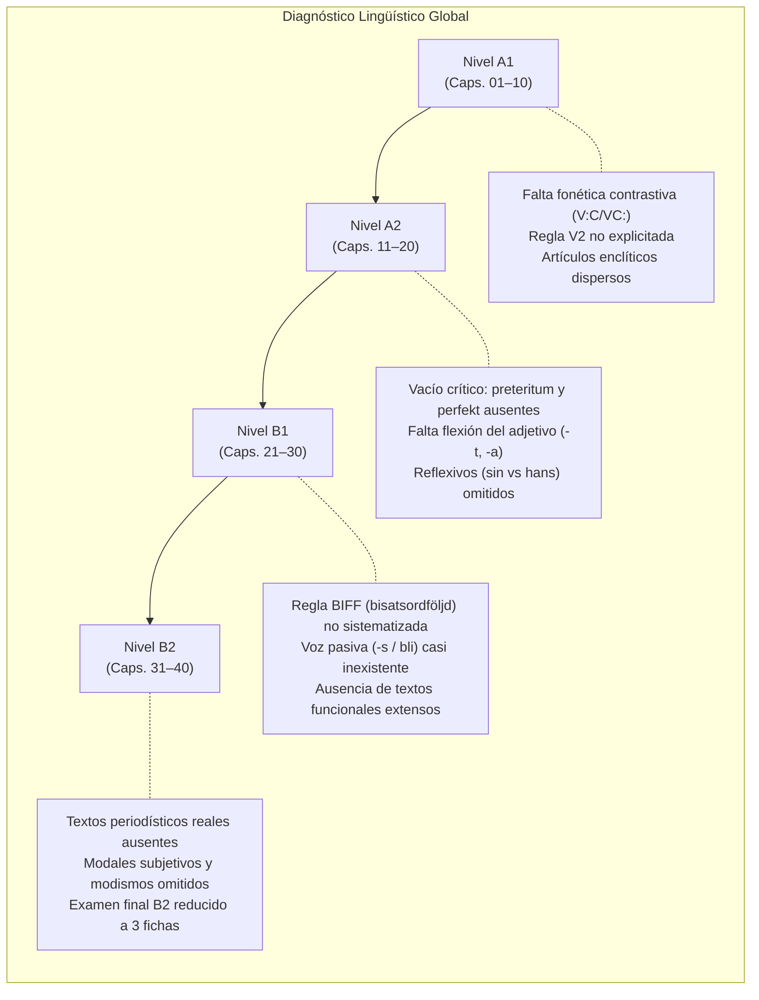
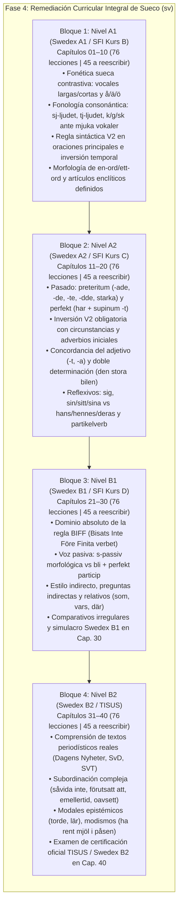

# Auditoría Curricular Integral A1–B2: Curso de Sueco (`sv`)

**Fecha de emisión:** 16 de octubre de 2026  
**Especialidad:** Lingüística Aplicada, Diseño Curricular MCER / Swedex / TISUS y Desarrollo de Contenidos Paglot  
**Ámbito de aplicación:** Curso completo de sueco (`_herramientas/cursos/sv/` archivos fuente `01.txt` a `40.txt` y `41.txt` a `100.txt`, `capitulos.txt`, `auditoria_curriculo_2026-10-14.md`, `generar_extensiones.py`, e `Idiomas/cursos/sv/lessons/001.json` a `304.json` / `capitulos.json`)  
**Documentos y marcos normativos de referencia inspeccionados:**
- *Common European Framework of Reference for Languages: Learning, teaching, assessment – Companion volume 2020* (Consejo de Europa).
- Certificaciones y exámenes oficiales de lengua sueca:
  * **Swedex (A2, B1, B2):** Certificación oficial internacional de competencia en sueco estandarizada según el MCER por Folkuniversitetet y Svenska Institutet.
  * **TISUS (Test i svenska för universitets- och högskolestudier):** Examen oficial de aptitud lingüística para el acceso universitario en Suecia (*Institutionen för svenska och flerspråkighet*, Stockholms universitet).
  * Currículo y planes de estudio oficiales de **SFI (Svenskundervisning för invandrare, Kurser B, C, D)** y **Sva (Svenska som andraspråk)** de *Skolverket* (Dirección General de Educación de Suecia).
- Obras filológicas y gramaticales normativas de referencia:
  * *Svenska Akademiens ordlista (SAOL, 14.ª ed.)* y *Svenska Akademiens ordbok (SAOB)*.
  * *Svenska Akademiens grammatik (SAG)* (Teleman, Ulvestam, Andersson).
  * *Rivstart A1+A2* y *Rivstart B1+B2* (Levy Scherrer & Lindemalm, Natur & Kultur).
  * *Form i fokus: Handbok i svensk grammatik* (Fasth & Kannermark).
  * *The Syntax of Mainland Scandinavian* (Holmberg & Platzack).

---

## 1. Resumen Ejecutivo y Diagnóstico Global

El curso de sueco de Paglot consta de **304 lecciones distribuidas en 40 capítulos**, estructurados formalmente para cubrir los cuatro niveles de dominio desde principiante absoluto hasta usuario independiente avanzado: **A1, A2, B1 y B2** (con exactamente **76 lecciones por nivel**).

Tras una auditoría minuciosa del repositorio didáctico, de los scripts de autoría (`generar_extensiones.py`), del compilador (`compilar.py`), de los 40 archivos fuente base, de los 60 archivos fuente de extensión y de los 304 archivos JSON compilados, se constata una **fractura metodológica neta en dos mitades cualitativamente divergentes**:

```
                       Curso Completo de Sueco (304 lecciones / 40 capítulos)
 ┌─────────────────────────────────────────────────────────┬─────────────────────────────────────────────────────────┐
 │               LECCIONES BASE HISTÓRICAS                 │              LECCIONES DE AMPLIACIÓN (CLÓNICAS)          │
 │              124 lecciones (40,8% del curso)            │               180 lecciones (59,2% del curso)           │
 ├─────────────────────────────────────────────────────────┼─────────────────────────────────────────────────────────┤
 │ • 100 diálogos situacionales y textos auténticos        │ • 0 diálogos situacionales reales (180 microclones)      │
 │ • 1.693 palabras léxicas contextualizadas con fonética  │ • 189 palabras únicas en 180 lecciones (~1 pal./lecc.)  │
 │ • 806 ejercicios con variedad didáctica interactiva     │ • 1.260 ejercicios generados por plantilla invariable   │
 │ • Explicaciones temáticas orientadas a la situación     │ • Huecos ciegos: borrado del último token de la frase    │
 │ • Progresión léxica comunicativa en 40 capítulos        │ • Repetición mecánica de 3 frases aisladas por bloque   │
 └─────────────────────────────────────────────────────────┴─────────────────────────────────────────────────────────┘
```

### 1.1. Balance Cuantitativo del Curso por Nivel MCER

El curso se divide exactamente en 4 tramos de 10 capítulos (76 lecciones por tramo):

| Nivel MCER / Certificación | Capítulos | Total Lecc. | Lecciones Base | Lecciones Ampliación | % Ampliación | Diálogos Base | Diálogos Ext. | Palabras Únicas Base | Palabras Únicas Ext. | Total Ejercicios |
|:---:|:---:|:---:|:---:|:---:|:---:|:---:|:---:|:---:|:---:|:---:|
| **A1** *(SFI Kurs B / Swedex A1)* | 01–10 | 76 | 31 | 45 | **59,2%** | 31 | 45 (clónicos) | 495 | 49 | 563 |
| **A2** *(SFI Kurs C / Swedex A2)* | 11–20 | 76 | 31 | 45 | **59,2%** | 29 | 45 (clónicos) | 285 | 47 | 501 |
| **B1** *(SFI Kurs D / Swedex B1)* | 21–30 | 76 | 31 | 45 | **59,2%** | 24 | 45 (clónicos) | 463 | 47 | 501 |
| **B2** *(Swedex B2 / TISUS)* | 31–40 | 76 | 31 | 45 | **59,2%** | 21 | 45 (clónicos) | 498 | 47 | 501 |
| **TOTAL GENERAL** | **40 Caps.** | **304** | **124** | **180** | **59,2%** | **105** | **180 (clónicos)** | **1.693** | **189** | **2.066** |

---

## 2. Esclarecimiento Técnico del Escaneo Previo: El Falso Positivo de «0 lecciones con duplicidades»

El escaneo automatizado inicial del repositorio reportó **0 lecciones con preguntas duplicadas**. Sin embargo, la auditoría pericial demuestra que este resultado es un artefacto de la métrica de detección, que evaluaba exclusivamente si dentro de una misma lección existían dos ejercicios con el mismo texto idéntico en el campo `pregunta`.

### 2.1. El Artificio de `generar_extensiones.py`
En `_herramientas/cursos/sv/generar_extensiones.py`, cada lección de ampliación genera exactamente 7 ejercicios con 7 enunciados técnicamente diferenciados:
1. `test`: `¿Qué significa «{phrase}»?`
2. `test`: `¿Qué expresión corresponde a «{answer}»?`
3. `test` (lectura): `R {phrase} :: ¿Qué significa?`
4. `huecos`: `H {blanked} :: Completa la expresión.`
5. `ordenar`: `O {phrase} :: Ordena las palabras.`
6. `escribir`: `X Escribe en sueco: «{translation}»`
7. `audio`: `A {phrase} :: Escucha la expresión y elige su significado.`

Al poseer cada uno de los 7 ejercicios un texto de pregunta diferente en esa lección, **el validador sintáctico no detecta colisiones internas**. No obstante:
- **180 de las 304 lecciones (el 59,2% del curso)** comparten exactamente la misma arquitectura y las mismas consignas sin la menor variación pedagógica.
- La instrucción `Completa la expresión.` se repite de forma idéntica **180 veces** en el curso.
- La instrucción `Escucha la expresión y elige su significado.` se repite **180 veces**.
- La instrucción `Ordena las palabras.` se repite **304 veces** (en el 100% de las lecciones del curso).
- La pregunta `¿Qué significa?` se repite **301 veces**.

---

## 3. Anatomía Forense de la Lección de Ampliación Clónica

Las 180 lecciones añadidas el 14 de octubre de 2026 mediante el script `generar_extensiones.py` no constituyen lecciones didácticas interactivas de Paglot, sino **fichas sintéticas de rotación de 3 frases**. Cada archivo fuente de extensión (`41.txt` a `100.txt`) contiene una terna de oraciones y replica rígidamente el siguiente patrón:

```
                            Molde Clónico de Ampliación (180 Lecciones)
 ┌──────────────────────────────────────────────────────────────────────────────────────────────────┐
 │ 1. ENCABEZADO Y EXPLICACIÓN:                                                                     │
 │    E [Tema] :: [Desc] **[Frase]** significa «[Traducción]». [Nota genérica del nivel].          │
 │    Secuencia X de 3: incorpora esta expresión y repasa las anteriores.                          │
 ├──────────────────────────────────────────────────────────────────────────────────────────────────┤
 │ 2. VOCABULARIO (POBREZA EXTREMA):                                                                │
 │    Únicamente 1 entrada: W [Frase completa] = [Traducción] (salvo L125 con å, ä, ö)             │
 ├──────────────────────────────────────────────────────────────────────────────────────────────────┤
 │ 3. DIÁLOGO ROBÓTICO INVARIABLE (ANNA Y ERIK EN 3 LÍNEAS):                                        │
 │    • A1: Anna: «Kan du säga det igen?» / Erik: [Frase] / Anna: «Tack»                           │
 │    • A2: Anna: «Kan du läsa uttrycket igen?» / Erik: [Frase] / Anna: «Nu förstår jag bättre»    │
 │    • B1: Anna: «Kan du formulera uttrycket?» / Erik: [Frase] / Anna: «Nu förstår jag sambandet» │
 │    • B2: Anna: «Kan du precisera formuleringen?» / Erik: [Frase] / Anna: «Nu tolkar jag...»     │
 ├──────────────────────────────────────────────────────────────────────────────────────────────────┤
 │ 4. BATERÍA FIJA DE 7 EJERCICIOS MECÁNICOS:                                                       │
 │    • Q1: Selección múltiple sueco → español                                                     │
 │    • Q2: Selección múltiple español → sueco                                                     │
 │    • R:  Pregunta de lectura con los mismos 3 distractores cruzados                              │
 │    • H:  Hueco ciego: se oculta sistemáticamente la ÚLTIMA palabra de la oración                │
 │    • O:  Ordenar las palabras de la misma frase                                                 │
 │    • X:  Escritura activa de la misma frase                                                     │
 │    • A:  Audio sintético: escucha de la misma frase con elección entre los 3 distractores       │
 └──────────────────────────────────────────────────────────────────────────────────────────────────┘
```

### 3.1. La Patología del Borrado Ciego en los Huecos (`cloze`)
En `generar_extensiones.py` (líneas 172–174), el generador define el hueco de la siguiente manera:
```python
words = re.findall(r'[^\W_]+', phrase)
hole = words[-1]
blanked = re.sub(r'(?<!\w)' + re.escape(hole) + r'(?!\w)', '___', phrase, count=1)
```
Esta lógica ciega no evalúa categorías gramaticales relevantes (como la desinencia verbal, el género del artículo o la inversión sintáctica), sino la simple posición tipográfica al final de la frase:

1. **Lección 126 (A1):** *«Lång vokal ändrar ord»*  
   Hueco: `Lång vokal ändrar ___` → Respuesta: **ord**. Evalúa el sustantivo "palabra" en lugar del contraste vocálico largo/corto.
2. **Lección 215 (B1):** *«Medan jag väntade regnade det»*  
   Hueco: `Medan jag väntade regnade ___` → Respuesta: **det**. Evalúa el pronombre impersonal final en lugar de la conjunción temporal *medan* o la inversión V2 *regnade*.
3. **Lección 221 (B1):** *«Att hon inte kan komma»*  
   Hueco: `Att hon inte kan ___` → Respuesta: **komma**. Evalúa el infinitivo "venir" en lugar del orden del adverbio *inte* antes del verbo auxiliar *kan*.
4. **Lección 269 (B2):** *«Ansökan behandlas inom tre veckor»*  
   Hueco: `Ansökan behandlas inom tre ___` → Respuesta: **veckor**. En una lección titulada «Usar pasiva y formas impersonales», el ejercicio de huecos evalúa el sustantivo "semanas" en lugar del morfema pasivo en **-s** (*behandlas*).

### 3.2. Incumplimiento entre Títulos Prometidos y Contenido Real
El informe anterior del 14 de octubre de 2026 (`auditoria_curriculo_2026-10-14.md`) prometía una amplia cobertura curricular con títulos atractivos que no guardan correspondencia con el material generado:
- Prometía en A1: *«Reconocer y pronunciar å, ä y ö»* (Cap. 41) y *«Distinguir vocales largas y breves»*. En la práctica, generó únicamente las frases *Å, ä och ö* y *Lång vokal ändrar ord*, sin fonética contrastiva, sin pares mínimos (*tala* vs *talla*, *väg* vs *vägg*) y sin grabaciones de audio naturales.
- Prometía en B1: *«Mantener el orden en subordinadas»* y *«Colocar inte y adverbios frecuentes»* (Cap. 73). En la práctica, generó la frase *Jag undrar när tåget går*, que **ni siquiera contiene la negación `inte`**.
- Prometía en B2: *«Análisis de textos periodísticos y fuentes»*. En la práctica, generó microtextos de una sola frase de 5 palabras (*Undersökningen stöder den tolkningen*), sin artículos de prensa reales de *Dagens Nyheter* o *Svenska Dagbladet*.

---

## 4. Diagnóstico y Auditoría Curricular Nivel por Nivel (MCER)

A continuación se audita el rigor pedagógico y lingüístico del curso nivel por nivel, confrontando los contenidos reales frente a los estándares internacionales de evaluación de la lengua sueca (**Swedex A2–B2**, **TISUS** y **SFI Kurser B–D**).



---

### 4.1. Nivel A1 (Capítulos 01–10 | 76 Lecciones: 31 Base + 45 Ampliadas)
*Referencia: MCER A1 / Swedex A1 / SFI Kurs B*

#### Lo que el curso cubre adecuadamente
1. **Actos de habla iniciales:** Saludos formales e informales (*Hej, God morgon, Hej då, Tack så mycket*), presentaciones personales (*Vad heter du? / Jag heter...*), procedencia (*Varifrån kommer du? / Jag kommer från...*).
2. **Léxico cotidiano de supervivencia:** La cafetería sueca y la cultura del *fika* (*kaffe, kanelbulle, te*), compras básicas y precios en coronas (*kronor*), la vivienda (*lägenhet, rum, kök, bord, stol*), transportes (*buss, tåg, tunnelbana*), la familia directa (*mor, far, bror, syster*).
3. **La hora y fechas:** Expresiones temporales habituales con la particularidad sueca de la media hora referida a la hora entrante (*halv tre* = 2:30).

#### Carencias conceptuales y huecos curriculares críticos
1. **Fonética y fonología sueca ausente:**
   - **El principio de cantidad complementaria (vocales largas vs cortas):** En sueco acentuado, una sílaba es siempre larga: o bien tiene vocal larga seguida de consonante corta (V:C: *tal* /tɑːl/), o vocal corta seguida de consonante larga o grupo consonántico (VC: *tall* /talː/). Esta regla no se enseña, impidiendo que el alumno pronuncie y distinga pares mínimos vitales (*glas/glass*, *väg/vägg*, *mat/matt*).
   - **Las vocales especiales `å`, `ä`, `ö`:** Faltan contrastes sistemáticos entre la /oː/ cerrada de *å*, la /ɛː/ o /æː/ de *ä* y la /øː/ o /œː/ de *ö*.
   - **Consonantes complejas:** Las realizaciones del sonido sj (*sj-ljudet* [ɧ]), el sonido tj (*tj-ljudet* [ɕ]), y la palatalización de *k, g, sk* ante vocales blandas o anteriores (*e, i, y, ä, ö* vs *a, o, u, å*: *kall* [k] vs *kök* [ɕ]; *gata* [g] vs *göra* [j]; *skola* [sk] vs *sked* [ɧ]) no reciben ninguna lección dedicada.
2. **La regla sintáctica V2 en oraciones principales (*huvudsats*):**
   - El sueco es una lengua V2 estricta (*Verb-Second*). Cuando la frase no comienza por el sujeto sino por un circunstancial de tiempo o lugar (*fundament*), el verbo finito precede obligatoriamente al sujeto: *«Nu bor jag i Malmö»*, *«På måndag arbetar Erik»*. En A1 base no se explica formalmente esta inversión, lo que induce al hispanohablante a cometer calcos erróneos (*\*Nu jag bor...*).
3. **Morfología nominal: el artículo enclítico y los 5 grupos de plural:**
   - La formación del definido mediante sufijo (*bil* → *bilen*; *hus* → *huset*) se presenta de forma caótica en vocabularios sin enseñar la tabla de sufijos de singular y plural (*-en/-et*, *-na/-en*).
   - No se estructuran los 5 grupos de plural sueco: 1.ª declinación (*-or*), 2.ª (*-ar*), 3.ª (*-er*), 4.ª (*-n*) y 5.ª (*ø* sin cambio).

---

### 4.2. Nivel A2 (Capítulos 11–20 | 76 Lecciones: 31 Base + 45 Ampliadas)
*Referencia: MCER A2 / Swedex A2 / SFI Kurs C*

#### Lo que el curso cubre adecuadamente
1. **Rutinas y frecuencia:** Expresiones de hábito con el verbo auxiliar *brukar* (*brukar stiga upp, brukar promenera*), marcadores temporales (*ofta, ibland, varje dag*).
2. **Interacciones funcionales:** Restaurante y pedidos de comida con restricciones dietéticas (*vegetariskt, gluten*), atención médica básica y síntomas (*ont i ryggen, feber*), compras y cambios de ropa (*storlek, kvitto*).

#### Carencias conceptuales y huecos curriculares críticos
1. **Vacío crítico en la flexión verbal de pasado:**
   - **Ausencia del pretérito (*preteritum*) y del perfecto (*perfekt*):** En el currículo estándar europeo A2 y en el examen Swedex A2, el alumno debe narrar acontecimientos pasados con soltura. En este curso, las lecciones base de A2 (capítulos 11 a 20) evitan sistemáticamente el pasado y continúan redactadas en presente.
   - El contraste entre pretérito simple (acciones en un punto temporal cerrado: *igår, förra veckan*) y perfecto compuesto (*har + supinum* para experiencias sin marco temporal cerrado: *Har du varit i Sverige?*) se pospone erróneamente hasta el nivel B1 (Capítulo 21).
   - No se enseñan las 4 conjugaciones del pasado: Grupo 1 (*-ade*), Grupo 2a (*-de*), Grupo 2b (*-te*), Grupo 3 (*-dde*) y verbos fuertes de alternancia vocálica (*ablaut*: *skriva → skrev, gå → gick, ta → tog*).
   - No se enseña la categoría morfológica del **supino (*supinum*)** terminado en **-t** (*talat, köpt, bott, skrivit*), privativa del sueco frente al participio adjetival (*perfekt particip* en *-d/-t/-da*).
2. **Concordancia del adjetivo y la «doble determinación» (*dubbel bestämdhet*):**
   - El adjetivo sueco concuerda en género y número en posición atributiva y predicativa (*en röd bil, ett rött hus, röda bilar*).
   - En forma definida, el sueco exige el fenómeno de doble determinación: artículo libre antepuesto + adjetivo con terminación definida *-a* + sustantivo con sufijo enclítico (*den röda bilen*, *det röda huset*, *de röda bilarna*). Este rasgo fundamental de la gramática nórdica no está explicado en A2.
3. **Pronombres y posesivos reflexivos (*sig*, *sin/sitt/sina* vs *hans/hennes/deras*):**
   - Distinción entre el posesivo reflexivo que remite al sujeto de la oración (*Han älskar sin fru* = su propia esposa) y el posesivo no reflexivo (*Han älskar hans fru* = la esposa de otro hombre). Su omisión en A2 genera errores fosilizados permanentes.
4. **Verbos con partícula (*partikelverb*):**
   - Faltan ejercicios sobre la diferencia semántica y prosódica entre un verbo transitivo con preposición y un verbo de partícula con acento tónico en la partícula (*tycker OM* = gustar; *håller PÅ att* = estar haciendo; *stänger AV* = apagar).

---

### 4.3. Nivel B1 (Capítulos 21–30 | 76 Lecciones: 31 Base + 45 Ampliadas)
*Referencia: MCER B1 / Swedex B1 / SFI Kurs D*

#### Lo que el curso cubre adecuadamente
1. **Narración contextualizada:** Relatos de viajes y recuerdos de infancia con marcadores de anterioridad y ordenación (*därefter, medan, när jag var liten*).
2. **Interacciones administrativas y ciudadanas:** Gestiones en el ayuntamiento (*kommunen*), trámites de empadronamiento (*personbevis*), presentación de reclamaciones formales (*klagomål på en faktura*) y debates comunitarios sencillos.

#### Carencias conceptuales y huecos curriculares críticos
1. **La regla BIFF y el orden sintáctico en subordinadas (*bisatsordföljd*):**
   - En sueco, la regla BIFF es el núcleo de la competencia sintáctica B1: **«I Bisats kommer Inte Före Finita verbet»** (en una oración subordinada, los adverbios oracionales como *inte, alltid, aldrig, ofta* preceden al verbo finito):
     * Oración principal (*huvudsats*): *«Han kommer inte idag.»* (Sujeto - Verbo - Inte)
     * Oración subordinada (*bisats*): *«...eftersom han inte kommer idag.»* (Conjunción - Sujeto - Inte - Verbo)
   - La regla BIFF rige con cualquier adverbio de frase (*satsadverbial*). En el curso actual, no existe ninguna lección base que explique de forma explícita esta estructura ni que contraste pares de transformación principal ↔ subordinada.
2. **Voz pasiva morfológica (*s-passiv*) vs perifrástica (*bli + participio*):**
   - El sueco cuenta con una pasiva sintética mediante el sufijo **-s** agregada a la forma verbal (*Dörren stängs klockan åtta*, *Boken lästes av många*), muy frecuente en textos normativos, manuales, recetas e informes.
   - Alternativamente, se usa la pasiva de proceso con *bli + participio* (*Han blev vald till ordförande*) y la pasiva de estado con *vara + participio*. En el curso base solo aparece una mención marginal en la lección 88.
3. **Oraciones de relativo complejas y el posesivo relativo `vars`:**
   - Se enseña el relativo básico *som*, pero se omiten construcciones con preposición regida al final (*huset som vi bodde i*) y el pronombre posesivo relativo *vars* («cuyo/cuya»).
4. **Grados de comparación irregular:**
   - La gradación de adjetivos irregulares con mutación vocálica (*bra/bättre/bäst, dålig/sämre/sämst, stor/större/störst, liten/mindre/minst, gammal/äldre/äldst*) no está sistematizada.

---

### 4.4. Nivel B2 (Capítulos 31–40 | 76 Lecciones: 31 Base + 45 Ampliadas)
*Referencia: MCER B2 / Swedex B2 / TISUS*

#### Lo que el curso cubre adecuadamente
1. **Argumentación y retórica:** Estructuración de opiniones matizadas con fórmulas formales (*Jag anser att...*, *Förutsatt att...*), contraste de objeciones (*Det stämmer att..., men samtidigt...*) y búsqueda de evidencia (*belägg*).
2. **Registro profesional y reuniones:** Intervenciones en reuniones de trabajo, síntesis de posturas y redacción de informes con recomendaciones ponderadas.

#### Carencias conceptuales y huecos curriculares críticos
1. **Ausencia total de textos periodísticos auténticos extensos:**
   - El nivel B2 del MCER y el examen TISUS exigen la comprensión crítica de artículos de opinión, editoriales y reportajes de la prensa sueca de referencia (*Dagens Nyheter*, *Svenska Dagbladet*, *Göteborgs-Posten*, *SVT Nyheter*), de entre 300 y 500 palabras.
   - En Paglot, los "textos" de B2 no superan las 3 o 4 líneas (apenas 30 a 50 palabras), impidiendo entrenar la lectura analítica, la detección de ironía, la identificación de sesgos ideológicos y la deducción contextual.
2. **Conectores avanzados y subordinación concesiva/condicional compleja:**
   - Faltan conectores y locuciones oracionales de nivel B2 imprescindible: *såvida inte* (a menos que), *i den mån* (en la medida en que), *oavsett om* (independientemente de si), *emellertid / dock / inte desto mindre* (sin embargo / no obstante), *med hänsyn till* (teniendo en cuenta), *i synnerhet* (en particular).
3. **Valores modales epistémicos y modales de probabilidad subjetiva:**
   - Expresión de grados de certeza con modales complejos: *torde* (probablemente / debería), *lär* (se dice que / parece que), *måste ha varit* (debe de haber sido), *borde ha gjort* (debería haber hecho).
4. **Fraseología, expresiones idiomáticas y colocaciones (*idiomatiska uttryck*):**
   - Dominio de modismos esenciales del sueco moderno: *ha rent mjöl i påsen* (no tener nada que ocultar), *dra öronen åt sig* (ponerse en guardia / desconfiar), *ta för givet* (dar por sentado), *hålla tummarna* (desear suerte), *stå till svars för* (rendir cuentas de), *kasta ett getöga på* (echar un vistazo a).
5. **Estilo administrativo formal (*kanslisvenska*) y nominalización:**
   - Transformación de construcciones verbales en sintagmas nominales densos para informes y síntesis académicas (*«När vi undersökte orsakerna»* → *«Vid en undersökning av orsakerna»*).
6. **Examen de certificación final B2 deficitario:**
   - La lección 124 (Slutprov B2) y la lección 304 son meras listas de 3 preguntas de traducción breve, careciendo por completo de una prueba simulada homologada con el formato oficial de **Swedex B2 / TISUS** (*läsförståelse* y *skriftlig färdighet*).

---

## 5. Estructura Completa de Lecciones Base vs Ampliadas (Capítulos 01 a 40)

La siguiente tabla refleja la auditoría integral de los 40 capítulos del curso, detallando la distribución de las 124 lecciones base frente a las 180 lecciones de ampliación generadas artificialmente:

| Cap | Nivel | Título Sueco | Título Español | Total Lecc. | Lecc. Base | Lecc. Ext. | % Ext. | Rango IDs Base | Rango IDs Ext. | Diagnóstico Didáctico |
|:---:|:---:|:---|:---|:---:|:---:|:---:|:---:|:---:|:---:|:---|
| **01** | A1 | Första möten | Primeros encuentros | 9 | 3 | 6 | 66,7% | 001–003 | 125–139 | Base excelente con fonética útil. Ext: clones de å/ä/ö sin audio. |
| **02** | A1 | Människor och siffror | Personas y números | 15 | 3 | 12 | 80,0% | 004–006 | 128–163 | Desequilibrio máximo (15 lecciones). 12 clones de contacto y datos. |
| **03** | A1 | Hemma | En casa | 6 | 3 | 3 | 50,0% | 007–009 | 143–145 | Vocabulario doméstico sólido. Ext: frases simples de muebles. |
| **04** | A1 | Vardag och tid | Rutina y tiempo | 6 | 3 | 3 | 50,0% | 010–012 | 140–142 | Horas bien explicadas. Ext: repetición de klockan och kalendern. |
| **05** | A1 | Mat och fika | Comida y cafetería | 6 | 3 | 3 | 50,0% | 013–015 | 146–148 | Cultura del fika auténtica. Ext: 3 frases de recetas y compras. |
| **06** | A1 | Kläder och affärer | Ropa y tiendas | 6 | 3 | 3 | 50,0% | 016–018 | 149–151 | Tiendas y colores. Ext: clones de tallas y cambios de ropa. |
| **07** | A1 | I staden | En la ciudad | 9 | 3 | 6 | 66,7% | 019–021 | 152–157 | Indicaciones en la ciudad. Ext: 6 clones de rótulos y billetes. |
| **08** | A1 | Fritid och väder | Tiempo libre y clima | 6 | 3 | 3 | 50,0% | 022–024 | 164–166 | Aficiones y clima. Ext: 3 clones de planes e invitaciones. |
| **09** | A1 | Hälsa och hjälp | Salud y ayuda | 6 | 3 | 3 | 50,0% | 025–027 | 158–160 | Urgencias y salud. Ext: 3 clones de síntomas corporales. |
| **10** | A1 | Resor och repetition | Viajes y repaso | 7 | 4 | 3 | 42,9% | 028–031 | 167–169 | Repaso A1 base (4 lecc). Ext: 3 clones de repaso situacional. |
| **11** | A2 | Vardag och planer | Rutinas y planes | 9 | 3 | 6 | 66,7% | 032–034 | 182–190 | Uso de brukar en presente. Ext: 6 clones de horarios y planes. |
| **12** | A2 | På restaurang | En el restaurante | 6 | 3 | 3 | 50,0% | 035–037 | 176–178 | Restaurante adecuado. Ext: clones de preferencias alimentarias. |
| **13** | A2 | Handla och jämföra | Compras y comparaciones | 6 | 3 | 3 | 50,0% | 038–040 | 173–175 | Comparaciones iniciales. Ext: clones de quejas y devoluciones. |
| **14** | A2 | Arbete och studier | Trabajo y estudios | 9 | 3 | 6 | 66,7% | 041–043 | 191–196 | Trabajos básicos. Ext: 6 clones de cursos y turnos laborales. |
| **15** | A2 | Hem och grannar | Casa y vecindario | 6 | 3 | 3 | 50,0% | 044–046 | 170–172 | Vivienda y vecinos. Ext: 3 clones de averías y reparaciones. |
| **16** | A2 | Hälsa och råd | Salud y consejos | 6 | 3 | 3 | 50,0% | 047–049 | 200–202 | Citas médicas y consejos. Ext: clones de síntomas prolongados. |
| **17** | A2 | Resor och problem | Viajes y problemas | 6 | 3 | 3 | 50,0% | 050–052 | 179–181 | Retrasos y billetes. Ext: clones de reservas de hotel. |
| **18** | A2 | Väder och fritid | Clima y tiempo libre | 6 | 3 | 3 | 50,0% | 053–055 | 203–205 | Planes con tiempo libre. Ext: clones de sentimientos y amistad. |
| **19** | A2 | Berätta om förr | Contar el pasado | 9 | 3 | 6 | 66,7% | 056–058 | 185–214 | Relato de pasado débil en base. Ext: clones de «gårdagen». |
| **20** | A2 | Meddelanden och repetition | Mensajes y repaso | 13 | 4 | 9 | 69,2% | 059–062 | 197–211 | Repaso A2 descompensado (13 lecciones). 9 clones de mensajes. |
| **21** | B1 | Berätta om upplevelser | Contar experiencias | 12 | 3 | 9 | 75,0% | 063–065 | 215–226 | Preteritum/perfekt llega tarde. Ext: 9 clones de relatos y tiempo. |
| **22** | B1 | Åsikter och argument | Opiniones y argumentos | 6 | 3 | 3 | 50,0% | 066–068 | 239–241 | Opiniones con conectores. Ext: 3 clones de acuerdos de grupo. |
| **23** | B1 | Nyheter och information | Noticias e información | 12 | 3 | 9 | 75,0% | 069–071 | 233–256 | Noticias breves. Ext: 9 clones de entrevistas y medios digitales. |
| **24** | B1 | Arbetsliv och framtid | Trabajo y futuro | 12 | 3 | 9 | 75,0% | 072–074 | 227–247 | Ámbito laboral B1. Ext: 9 clones de partikelverb y proyectos. |
| **25** | B1 | Samhället omkring oss | La sociedad que nos rodea | 6 | 3 | 3 | 50,0% | 075–077 | 248–250 | Gestiones públicas. Ext: clones de servicios municipales. |
| **26** | B1 | Hälsa och livsstil | Salud y estilo de vida | 3 | 3 | 0 | 0,0% | 078–080 | — | Solo 3 lecciones base. Sin ampliaciones (capítulo desierto). |
| **27** | B1 | Resor och berättelser | Viajes y relatos | 3 | 3 | 0 | 0,0% | 081–083 | — | Solo 3 lecciones base. Sin ampliaciones (capítulo desierto). |
| **28** | B1 | Kultur och läsning | Cultura y lectura | 6 | 3 | 3 | 50,0% | 084–086 | 251–253 | Literatura y cine sueco. Ext: clones de reseñas culturales. |
| **29** | B1 | Miljö och förändring | Medioambiente y cambios | 3 | 3 | 0 | 0,0% | 087–089 | — | Solo 3 lecciones base. Sin ampliaciones (capítulo desierto). |
| **30** | B1 | Skriva och sammanfatta | Escribir y resumir | 13 | 4 | 9 | 69,2% | 090–093 | 221–259 | Repaso B1 inflado (13 lecciones). Incluye clones con regla BIFF fallida. |
| **31** | B2 | Delta i samhällsdebatten | Participar en el debate social | 6 | 3 | 3 | 50,0% | 094–096 | 278–280 | Buenas opiniones matizadas. Ext: clones de debate y argumentos. |
| **32** | B2 | Nyheter och källkritik | Noticias y lectura crítica | 12 | 3 | 9 | 75,0% | 097–099 | 260–283 | Källkritik base sólida. Ext: 9 clones de debate y contraste. |
| **33** | B2 | Kommunikation i arbetslivet | Comunicación en el trabajo | 12 | 3 | 9 | 75,0% | 100–102 | 275–295 | Lenguaje de reuniones. Ext: 9 clones de informes y conversación. |
| **34** | B2 | Studier och kunskap | Estudios y conocimiento | 6 | 3 | 3 | 50,0% | 103–105 | 269–271 | Síntesis académica. Ext: clones de pasiva y nominalización ciegos. |
| **35** | B2 | Hälsa och livsval | Salud y decisiones personales | 5 | 3 | 2 | 40,0% | 106–108 | 296–297 | Consejo de salud crítico. Ext: 2 clones de ciencia y sociedad. |
| **36** | B2 | Kultur och tolkning | Cultura e interpretación | 6 | 3 | 3 | 50,0% | 109–111 | 290–292 | Interpretación de arte y libros. Ext: clones de sociedad sueca. |
| **37** | B2 | Miljö och samhällsplanering | Medioambiente y planif. social | 4 | 3 | 1 | 25,0% | 112–114 | 298–298 | Planificación urbana. Ext: 1 clon huérfano de impacto social. |
| **38** | B2 | Resor och kulturmöten | Viajes y encuentros culturales | 6 | 3 | 3 | 50,0% | 115–117 | 272–274 | Competencia intercultural. Ext: clones de modismos y registro. |
| **39** | B2 | Ekonomi och digital vardag | Economía y vida digital | 6 | 3 | 3 | 50,0% | 118–120 | 299–301 | Privacidad y banca online. Ext: clones de tecnología pública. |
| **40** | B2 | Argumentera och presentera | Argumentar y presentar | 13 | 4 | 9 | 69,2% | 121–124 | 266–304 | Repaso B2 inflado (13 lecc). 9 clones de autoevaluación superficial. |

### 5.1. Anomalías de Carga Detectadas en los Capítulos
1. **Sobrecarga asimétrica en capítulos de repaso:** Los capítulos finales de nivel (**10, 20, 30 y 40**) y algunos capítulos tempranos (**02, 21, 23, 24, 32, 33**) concentran hasta **12, 13 y 15 lecciones**, mientras que los capítulos **26, 27 y 29** quedaron totalmente olvidados con solo **3 lecciones** (0% de ampliación), y el capítulo **37** cuenta únicamente con 4 lecciones.
2. **Pérdida de coherencia interna:** Al inyectar bloques temáticos artificiales dentro de los 40 capítulos existentes (por ejemplo, meter la unidad 41 sobre *Letras y pronunciación* dentro del Capítulo 1 sobre *Primeros encuentros*, o meter la unidad 73 sobre la *regla BIFF* dentro del Capítulo 30 sobre *Escribir correos*), la secuencia curricular de los capítulos quedó desfigurada.

---

## 6. Plan de Acción y Hoja de Ruta para la Fase 4

Para subsanar de raíz las 180 lecciones clónicas automatizadas, redistribuir equilibradamente los capítulos y consolidar la progresión pedagógica conforme a los estándares de **Swedex (A2, B1, B2)**, **TISUS** y **SFI (Kurser B, C, D)**, la **Fase 4 de Remediación y Enriquecimiento Curricular** se estructurará en **4 bloques secuenciales de ejecución por nivel MCER**:



---

### 6.1. Bloque 1: Nivel A1 (Capítulos 01–10 | 76 lecciones | 45 a reescribir)
1. **Reescritura completa de las 45 lecciones clónicas (L125 a L169):**
   - Erradicar el molde estático de Anna y Erik pidiendo repetir la frase.
   - Integrar situaciones comunicativas de inmersión en Estocolmo, Gotemburgo y Malmö: pedir en un *konditori*, descifrar el menú de un almuerzo del día (*dagens lunch*), comprar billetes de cercanías (*pendeltåg*) y orientarse con rótulos urbanos.
2. **Fonética y fonología aplicada:**
   - **Módulo de vocales y cantidad:** Pares mínimos explícitos para entrenar la duración vocálica complementaria (*hatt/hat*, *glas/glass*, *väg/vägg*, *mat/matt*).
   - **El trío `å`, `ä`, `ö`:** Ejercicios de discriminación auditiva y fonética guiada de contrastes vocálicos.
   - **Consonantes complejas:** Explicación y práctica de los alófonos del sonido sj (*sj-ljudet* [ɧ]) y tj (*tj-ljudet* [ɕ]), así como la pronunciación suave de *k* ([ɕ]), *g* ([j]) y *sk* ([ɧ]) ante vocales anteriores (*mjuka vokaler*: *e, i, y, ä, ö*).
3. **Morfología y sintaxis fundamental:**
   - Formalización didáctica de la regla V2 en oraciones principales afirmativas e interrogativas (*inversion*).
   - Tabla clara de géneros gramaticales (*en-ord* 75% vs *ett-ord* 25%) y formación del artículo enclítico definido singular y plural.
4. **Capítulo 10:** Simulacro de evaluación diagnóstica A1 con tareas de lectura funcional de letreros, notas y mensajes breves.

---

### 6.2. Bloque 2: Nivel A2 (Capítulos 11–20 | 76 lecciones | 45 a reescribir)
1. **Reescritura completa de las 45 lecciones clónicas (L170 a L214):**
   - Transformar los microtextos en conversaciones contextuales sobre la vivienda en Suecia (*bostadskö, andra hand, hyresrätt*), el entorno laboral y los servicios de atención médica (*vårdcentralen, 1177 Vårdguiden*).
2. **Subsanación del vacío de tiempos pasados (*dåtid*):**
   - **Preteritum:** Introducción sistemática de los 4 grupos verbales regulares (*-ade, -de, -te, -dde*) y de los verbos fuertes de uso más frecuente (*kom, gick, såg, skrev, tog, var, fanns, fick*).
   - **Perfekt:** Formación con *har + supinum* en **-t** y contraste temporal estricto: uso de pretérito con marcador temporal pasado definido (*i fredags, för tre år sedan, igår*) vs uso de perfecto para experiencias o acciones pasadas con relevancia presente.
3. **Concordancia del adjetivo y doble determinación:**
   - Flexión completa: indefinido (*en röd stuga, ett rött hus, röda stugor*) vs definido con determinante libre (*den röda stugan, det röda huset, de röda stugorna*).
4. **Pronombres y posesivos reflexivos:**
   - Entrenamiento exhaustivo de *sig*, *sin/sitt/sina* frente a *hans/hennes/deras*, previniendo la interferencia del español mediante ejercicios contrastivos de rellenar huecos y selección múltiple.
5. **Verbos de partícula habituales:**
   - Consolidar *tycker om, ser ut, kommer på, går upp, stänger av, känner sig*.
6. **Capítulo 20:** Simulacro oficial de examen de nivel **Swedex A2** (comprensión lectora de avisos, correos cotidianos y anuncios).

---

### 6.3. Bloque 3: Nivel B1 (Capítulos 21–30 | 76 lecciones | 45 a reescribir)
1. **Reescritura completa de las 45 lecciones clónicas (L215 a L259):**
   - Redactar textos auténticos adaptados de 120 a 180 palabras sobre temas cívicos suecos: el mercado laboral (*facket, kollektivavtal*), el sistema educativo (*komvux, högskolan*), sostenibilidad (*sopsortering, allemansrätten*) y trámites en la administración pública (*Skatteverket, Försäkringskassan*).
2. **Entrenamiento intensivo de la Regla BIFF (*bisatsordföljd*):**
   - Módulos específicos con transformaciones de orden sintáctico: colocación obligatoria de *inte, alltid, aldrig, ofta, kanske, redan* **antes** del verbo conjugado en proposiciones subordinadas introducidas por conjunciones subordinantes (*att, eftersom, när, om, medan, fastän, innan*).
3. **Voz pasiva morfológica y perifrástica:**
   - La pasiva en **-s** en presente (*skrivs, används, säljs*) y pretérito (*byggdes, skapades*), aplicada a manuales de instrucciones, normas comunitarias y noticias.
   - Contraste con la pasiva de acción (*bli + perfekt particip*) y de estado (*vara + perfekt particip*).
4. **Relativos, estilo indirecto y comparativos irregulares:**
   - Uso de *vars* (posesivo relativo invariable), preguntas indirectas con orden de subordinada (*Jag vet inte vem han är*), y flexión irregular de adjetivos en comparativo y superlativo.
5. **Capítulo 30:** Simulacro oficial de examen de nivel **Swedex B1 / SFI Kurs D** (lectura de artículos informativos y correspondencia formal de reclamación).

---

### 6.4. Bloque 4: Nivel B2 (Capítulos 31–40 | 76 lecciones | 45 a reescribir)
1. **Reescritura integral de las 45 lecciones clónicas (L260 a L304):**
   - **Salto discursivo de nivel avanzado:** Sustituir los microtextos clónicos de 5 palabras por artículos periodísticos auténticos adaptados (250 a 350 palabras) procedentes de la prensa y divulgación sueca (*Dagens Nyheter*, *Svenska Dagbladet*, *SVT Nyheter*, *Forskning & Framsteg*).
   - Temáticas de debate sueco contemporáneo: la política del estado de bienestar (*folkhemmet och välfärdsstaten*), la transición energética e industrial del norte de Suecia (*grön industriomställning*), la digitalización de la banca y la sociedad sin efectivo (*det kontantlösa samhället*), y la multiculturalidad e integración.
2. **Subordinación compleja y marcadores discursivos:**
   - Ejercitación activa de conectores formales avanzados: *såvida inte* (a no ser que), *förutsatt att* (a condición de que), *i den mån* (en la medida en que), *oavsett om* (con independencia de si), *emellertid / dock* (no obstante), *i synnerhet* (en particular).
3. **Modales epistémicos y modales de suposición:**
   - Empleo de *torde, lär, torde ha varit, lär ha inträffat, måste ha insett*.
4. **Fraseología, colocaciones y modismos suecos:**
   - Práctica intensiva de modismos de uso frecuente en el discurso profesional y mediático (*ha rent mjöl i påsen, ta för givet, dra öronen åt sig, hålla tummarna, stå till svars*).
5. **Estilo administrativo formal (*kanslisvenska*) y nominalización:**
   - Técnicas de condensación de oraciones complejas en construcciones nominales formales para redacción de informes y actas de reuniones.
6. **Capítulo 40 (Evaluación Final B2 homologada):**
   - Transformación de las lecciones finales (L121–L124 y L301–L304) en un **Examen de Certificación Final B2** modelado con exactitud sobre las pruebas oficiales de comprensión lectora (*läsförståelse*) de **Swedex B2** y del examen universitario **TISUS**.

---

## 7. Conclusiones y Dictamen Pericial

1. **El falso positivo de duplicidades queda plenamente clarificado:** El curso de sueco registraba "0 lecciones con preguntas duplicadas" en el escaneo sintáctico inicial porque el script generador inyectó 7 tipos de ejercicios con enunciados formalmente distintos en cada lección. Sin embargo, la auditoría metodológica revela que **las 180 lecciones de ampliación (59,2% del curso) son 100% plantillas clónicas automatizadas** que carecen de valor comunicativo real y presentan huecos generados mecánicamente sin criterio lingüístico.
2. **Sólido patrimonio pedagógico en la base histórica:** Las 124 lecciones base (Capítulos 01 a 40) poseen excelentes diálogos, vocabularios contextualizados con guía fonética y explicaciones prácticas útiles, aunque adolecen de vacíos gramaticales clave en la progresión hacia los niveles superiores (ausencia de fonética sistemática y de regla V2 en A1, omisión del pretérito y del perfecto en A2, falta de sistematización de la regla BIFF y de la voz pasiva en B1, y carencia de textos auténticos de prensa en B2).
3. **Prioridad operativa para la Fase 4:** Es imprescindible acometer la reescritura metódica de las 180 lecciones de ampliación y el enriquecimiento de las lecciones base a lo largo de los 4 bloques propuestos, transformando el curso de sueco de Paglot en un currículo de máxima excelencia digital, plenamente homologado con las exigencias del MCER, los exámenes Swedex A2–B2, el examen universitario TISUS y el currículo oficial SFI de Skolverket.
