# Auditoría Curricular Integral A1–B2: Curso de Vietnamita (`vi`)

**Fecha de emisión:** 16 de octubre de 2026  
**Especialidad:** Lingüística Aplicada, Diseño Curricular MCER / VSL (*Khung năng lực tiếng Việt*) y Desarrollo de Contenidos Paglot  
**Ámbito de aplicación:** Curso completo de vietnamita (`Idiomas/cursos/vi/lessons/001.json` a `300.json`, `capitulos.json`, `_herramientas/vi_b1b2/`, `fuente/` [144.txt a 263.txt], `capitulos.txt`, `temario.txt`, `conocidas.json` y `vi_silabas.json`)  
**Documentos y marcos pedagógicos de referencia inspeccionados:**
- **Marco Común Europeo de Referencia para las Lenguas (MCER / Consejo de Europa)**: Niveles A1 (Acceso), A2 (Plataforma), B1 (Umbral) y B2 (Avanzado).
- **Marco Oficial de Competencia en Lengua Vietnamita para Extranjeros (*Khung năng lực tiếng Việt dùng cho người nước ngoài*)**: Establecido por el Ministerio de Educación y Formación de Vietnam (Bộ Giáo dục và Đào tạo - Thông tư số 17/2015/TT-BGDĐT):
  * **Bậc 1 (Sơ cấp 1 / A1)**: Fonética tonal completa (6 tonos), estructura silábica, orden SVO estricto, pronombres y términos de parentesco honorífico, có/không, números y transacciones básicas.
  * **Bậc 2 (Sơ cấp 2 / A2)**: Marcadores de tiempo y aspecto (*đã, đang, sẽ, vừa, mới, sắp*), verbos direccionales (*đi, đến, về, ra, vào, lên, xuống, sang*), clasificadores nominales ampliados (*bức, tấm, đôi, bộ...*), comparativos (*hơn, nhất, bằng*), expresiones modales de necesidad y prohibición (*phải, được, có thể, đừng, chớ, cấm*).
  * **Bậc 3 (Trung cấp 1 / B1)**: Pasiva dual semántica (*được* favorable vs *bị* perjudicial), causativos (*làm cho, khiến*), conectores coordinados correlativos de causa y condición (*vì... nên, do... nên, nếu... thì, hễ... thì, tuy... nhưng, dù... cũng*), subordinadas temporales, discurso indirecto (*rằng, là*), relativo (*mà*) y cambio de estado (*trở thành, trở nên; adj + ra/lên/đi/lại*).
  * **Bậc 4 (Trung cấp 2 / B2)**: Nominalización formal (*sự, việc, cái, nỗi, niềm*), perspectiva y argumentación (*đối với, về mặt, xét về*), conectores formales de discurso periodístico (*trước hết, do đó, tuy nhiên, nói cách khác, tóm lại*), hipótesis y contrafactuales (*lẽ ra, đáng lẽ, may mà, lỡ... thì, giả sử, miễn là*), correlativos eco (*ai... nấy, gì... nấy, đâu... đấy*), cuantificación distributiva (*từng, mỗi, mọi, toàn bộ*), partículas modales vivas (*cơ, mà, chứ, đấy, nhỉ*), modismos y colocaciones fijas de 4 sílabas (*thành ngữ*), léxico sino-vietnamita (*từ Hán-Việt*) y reduplicación atenuante (*từ láy*).
- **Manuales y currículos universitarios de referencia:**
  * Trường Đại học Khoa học Xã hội và Nhân văn – ĐHQG Hà Nội: *Giáo trình Tiếng Việt cho người nước ngoài* (NXB Đại học Quốc gia Hà Nội).
  * Khoa Việt Nam học – Trường Đại học Sư phạm Hà Nội: *Tiếng Việt nâng cao B1-B2*.
  * Nguyen, B. T. & Trinh, D. H.: *Vietnamese as a Second Language (VSL)*.
  * Thompson, Laurence C. (1991): *A Vietnamese Reference Grammar*. University of Hawaii Press.
  * Nguyễn Hưng Quốc (2013): *A Grammar of Vietnamese*.
  * Nguyễn Minh Thuyết & Nguyễn Văn Hiệp (1998): *Thành phần câu tiếng Việt*. NXB Đại học Quốc gia Hà Nội.

---

## 1. Resumen Ejecutivo y Diagnóstico Global

El curso de vietnamita de Paglot consta de **300 lecciones distribuidas en 49 capítulos**, estructurado para conducir al estudiante hispanohablante desde el nivel inicial absoluto (A1 / Bậc 1) hasta un nivel avanzado operativo y comunicativo (B2 / Bậc 4).

Tras una auditoría forense integral de los 300 archivos JSON publicados, el compilador `_herramientas/vi_b1b2/compilar.py`, las 120 fuentes originales de B1-B2 (`fuente/144.txt` a `263.txt`), la tabla de capítulos y los registros de ejecución, se concluye que **el curso de vietnamita es cualitativa y lingüísticamente uno de los más sobresalientes de la plataforma Paglot**, pero arrastra **dos vicios técnicos específicos que requieren intervención inmediata**:

1. **Un núcleo lingüístico de excepcional autenticidad y rigor (Lecciones 001 a 263 | 87,7% del curso):**
   - A diferencia de otros idiomas donde se generaron cientos de lecciones automáticas clónicas sin gramática real, en vietnamita **las 263 lecciones base fueron redactadas por especialistas de forma artesanal**:
     * **A1-A2 (001–143 | 143 lecciones):** Contiene explicaciones fonéticas contrastivas detalladas para los 6 tonos, guías de tono con flechas diacríticas (`↗`, `↘`, `↘↗`, `~↗`, `↓`), desglose de consonantes complejas iniciales (*ph, th, kh, ch, nh, ng/ngh, gi, tr, đ*) y finales (*-c, -ch, -m, -n, -ng, -nh, -p, -t*), sistema honorífico de parentesco en Hanói (*tôi, bạn, anh, chị, em, ông, bà, cô, chú, bác*), diálogos situacionales verosímiles y notas culturales esenciales (mercado Đồng Xuân, calendarios lunares, etnias, geografía).
     * **B1-B2 (144–263 | 120 lecciones):** Elaborado en `_herramientas/vi_b1b2/fuente/` con un nivel de madurez gramatical impecable. Introduce distinciones sutiles imposibles en cursos plantilla: la pasiva asimétrica de beneficio/perjuicio (*được* vs *bị*), causativos (*làm cho, khiến*), correlativos (*càng… càng, không những… mà còn, hễ… là, thà… chứ*), verbos de orientación espacial (*ra Bắc vào Nam* con punto de referencia en la capital), nominalizadores abstractos (*sự, việc, cái, nỗi, niềm*), estilo periodístico formal y un examen final de certificación B2 completo de 31 actividades en la lección 263.
2. **El enigma técnico de las 122 lecciones con preguntas duplicadas (Esclarecido al 100%):**
   - El escaneo preliminar reportó una alarma crítica de 122 lecciones con duplicidades.
   - **Diagnóstico pericial:** No existe ninguna colisión de identificadores. Los **2.852 identificadores de ejercicio (`id`) del curso son 100% únicos**.
   - La causa matemática exacta radica en la **duplicación interna de la consigna textual (`pregunta`) dentro de una misma lección**. Al compilar sin especificar una pregunta personalizada, el código y las lecciones base asignaron por omisión cadenas genéricas: `'¿Qué significa?'` (repetida en 67 lecciones), consignas auditivas como `'¿Qué has oído?'` o `'Escucha. ¿Qué has oído?'` (repetidas en 69 lecciones) y `'Ordena las palabras.'` (repetida en 22 lecciones). Esto activa la alarma del linter pedagógico.
3. **El bloque de 37 lecciones de lectura complementaria (Lecciones 264 a 300 | 12,3% del curso):**
   - Añadidas para consolidar la destreza de comprensión lectora en los finales de nivel (Cap. 15 = A1, Cap. 25 = A2, Cap. 37 = B1, Cap. 49 = B2).
   - Los textos y el vocabulario en vietnamita son auténticos y pertinentes. Sin embargo, adolecen de un **vicio de molde o plantilla mecánica**:
     * **Explicación idéntica e invariable en las 37 lecciones:** Todas sin excepción muestran exactamente la misma frase: *"Lee primero el documento para identificar su propósito. Después busca nombres, fechas, lugares, condiciones y cifras para justificar cada respuesta."*
     * **Feedback de error clónico y perezoso:** Todos los distractores incorrectos repiten mecánicamente: *"Vuelve al detalle del documento para comprobarlo."*
     * **Ruptura de la navegación secuencial:** Un alumno que finaliza el curso recorriendo linealmente las lecciones 1 a 300 supera el examen final B2 en la lección 263, y al avanzar a la lección 264 es retrotraído bruscamente al Capítulo 15 para leer carteles elementales de nivel A1.

```
Estructura Real del Curso de Vietnamita (vi): 300 Lecciones
┌─────────────────────────────────────────────────────────────┬───────────────────────────┐
│              Núcleo Artesanal Sólido: 263                   │  Lecturas Monótonas: 37   │
│                          (87,7%)                            │          (12,3%)          │
├──────────────────────────────┬──────────────────────────────┼───────────────────────────┤
│    A1-A2 Base: 143 lecc.     │     B1-B2 Fuente: 120 lecc.  │   L264 a L300 (4 caps.)   │
│  (001–143 | Caps. 01–25)     │   (144–263 | Caps. 26–49)    │  • Explicación idéntica   │
│ • Fonética tonal exhaustiva  │ • Pasiva được/bị semántica   │  • Feedback de error fijo │
│ • 174 diálogos reales        │ • Nominalizadores sự/việc    │  • Ruptura de orden lineal│
│ • Parentesco honorífico      │ • Partículas cơ/mà/chứ/đấy   │  • Asignadas a caps.      │
│ • Defecto: 77 leccs con      │ • Defecto: 45 leccs con      │    finales 15, 25, 37 y 49│
│   prompts genéricos repetidos│   prompts genéricos repetidos│                           │
└──────────────────────────────┴──────────────────────────────┴───────────────────────────┘
```

---

### 1.1. Balance Cuantitativo Global

| Componente | Lecciones | % Curso | Palabras Visibles (V) | Palabras Dict. | Diálogos | Turnos Diálogo | Promedio Pal/Turno | Textos Lectura | Palabras Lectura | Promedio Pal/Texto | Ejercicios | IDs Únicos |
|:---|:---:|:---:|:---:|:---:|:---:|:---:|:---:|:---:|:---:|:---:|:---:|:---:|
| **A1-A2 Base (001–143)** | 143 | 47,7% | 1.178 | 8.391 | 246 | 1.982 | 8,7 | 41 | 1.353 | 33,0 | 1.397 | 1.397 |
| **B1-B2 Fuente (144–263)** | 120 | 40,0% | 2.580 | 2.580 | 48 | 506 | 17,2 | 54 | 10.367 | 192,0 | 1.344 | 1.344 |
| **Lecturas Añadidas (264–300)** | 37 | 12,3% | 185 | 185 | 0 | 0 | 0,0 | 37 | 2.305 | 62,3 | 111 | 111 |
| **TOTAL GENERAL** | **300** | **100%** | **3.943** | **11.156\*** | **294** | **2.488** | **9,9** | **132** | **14.025** | **106,3** | **2.852** | **2.852** |

*\*Nota de recuento:* El campo de diccionario `palabras` de la base antigua (001–143) indexaba acumulativamente lemas y variantes léxicas por lección, mientras que en B1-B2 se introducen 2.580 vocablos nuevos estrictamente catalogados ficha por ficha mediante `_herramientas/vi_b1b2/compilar.py`.

---

### 1.2. Distribución de Recursos por Nivel MCER / VSL (*Khung năng lực tiếng Việt*)

| Nivel MCER / VSL | Capítulos | Total Lecc. | Base / Fuente | Lecturas Añadidas | Lecc. con Prompts Duplicados | % Duplicados Nivel | Palabras Visibles | Diálogos | Textos Lectura | Ejercicios Totales | Promedio Pal/Turno | Promedio Pal/Texto |
|:---:|:---:|:---:|:---:|:---:|:---:|:---:|:---:|:---:|:---:|:---:|:---:|:---:|
| **A1** *(Bậc 1)* | Caps. 01–15 | 105 | 101 | 4 | 62 | **59,0%** | 978 | 174 | 40 | 944 | 7,6 pal. | 28,6 pal. |
| **A2** *(Bậc 2)* | Caps. 16–25 | 55 | 42 | 13 | 15 | **27,3%** | 285 | 72 | 18 | 504 | 11,8 pal. | 41,4 pal. |
| **B1** *(Bậc 3)* | Caps. 26–37 | 70 | 60 | 10 | 27 | **38,6%** | 1.277 | 31 | 28 | 682 | 15,7 pal. | 134,1 pal. |
| **B2** *(Bậc 4)* | Caps. 38–49 | 70 | 60 | 10 | 18 | **25,7%** | 1.403 | 17 | 43 | 722 | 19,8 pal. | 197,1 pal. |
| **TOTAL** | **49 Caps.** | **300** | **263** | **37** | **122** | **40,7%** | **3.943** | **294** | **129** | **2.852** | **9,9 pal.** | **106,3 pal.** |

---

## 2. Esclarecimiento Técnico y Forense: Las 122 Lecciones con Preguntas Duplicadas

### 2.1. Desmitificación: Los identificadores son 100% únicos

A diferencia de los cursos de turco, alemán, griego o ruso, donde los ejercicios reutilizaban identificadores como `tr001-1` o `el001-1` en varios niveles, en el curso de vietnamita **no hay ni un solo ID duplicado**:
- Lecciones 001 a 143: Utilizan identificadores canónicos con prefijo de curso (`vi001-1`, `vi001-2`, etc.).
- Lecciones 144 a 263: Compiladas mediante `compilar.py` con el esquema `vb{numero}-{k}` (`vb144-1` a `vb263-31`).
- Lecciones 264 a 300: Numeradas como `vi264-1` a `vi300-3`.
- **Resultado:** 2.852 ejercicios creados = **2.852 identificadores únicos**.

### 2.2. Causa Raíz: Duplicación interna de la consigna (`pregunta`) en la lección

El escaneo preliminar alertó de **122 lecciones con preguntas duplicadas**. La causa matemática estriba en que el atributo `'pregunta'` contiene cadenas de texto genéricas repetidas dentro del mismo archivo JSON. 

El compilador `_herramientas/vi_b1b2/compilar.py` revela exactamente cómo se originó este fenómeno en el código fuente:
```python
# compilar.py - líneas 165, 170, 174 y 179:
ejercicio('traduccion', pregunta=q or '¿Qué significa?', frase=f)
ejercicio('huecos', pregunta=q or 'Completa la frase.', frase=f)
ejercicio('test', pregunta=q or 'Escucha. ¿Qué has oído?', audio=f)
leccion['bloques'].append({'tipo': 'ordenar', 'pregunta': 'Ordena las palabras.', ...})
```
Cuando el redactor de las lecciones escribió ejercicios sin añadir una consigna explícita tras `::`, el compilador asignó el texto por defecto. Si una lección incluía dos ejercicios de traducción `R`, ambos recibían la pregunta `'¿Qué significa?'`. Si contenía dos ejercicios de ordenar `O`, ambos recibían `'Ordena las palabras.'`.

En la base antigua (001–143), los redactores copiaron sistemáticamente los prompts genéricos `'¿Qué has oído?'`, `'¿Qué significa?'` y `'Escucha y elige lo que oyes.'` en varios bloques interactivos consecutivos.

### 2.3. Taxonomía de las 122 Duplicidades por Tipo de Prompt

```
Desglose Forense de Prompts Repetidos en las 122 Lecciones Afectadas
┌────────────────────────────────────────────────────────┬──────────────┬────────────────────────┐
│ Causa y Cadena de Prompt Duplicada                     │ Frecuencia   │ Tipo de Ejercicio      │
├────────────────────────────────────────────────────────┼──────────────┼────────────────────────┤
│ 1. Consignas auditivas: «¿Qué has oído?» / «Escucha...»│ 69 lecciones │ test (auditivo), audio │
│ 2. Consignas de traducción: «¿Qué significa?»          │ 67 lecciones │ traduccion, test       │
│ 3. Consignas de sintaxis: «Ordena las palabras.»       │ 22 lecciones │ ordenar (B1-B2)        │
│ 4. Traducción explícita: «¿Qué significa esta frase?»  │ 12 lecciones │ traduccion             │
│ 5. Huecos genéricos: «Elige la palabra que falta.»     │  3 lecciones │ huecos                 │
│ 6. Enlace de oraciones: «La segunda mitad»             │  1 lección   │ test                   │
└────────────────────────────────────────────────────────┴──────────────┴────────────────────────┘
```

### 2.4. Inventario Completo de las 122 Lecciones Afectadas por Nivel

- **Nivel A1 (62 lecciones):**
  `001, 002, 003, 004, 005, 006, 008, 009, 011, 012, 013, 014, 016, 017, 018, 020, 021, 022, 024, 025, 027, 028, 029, 031, 033, 034, 036, 037, 038, 040, 041, 042, 043, 044, 046, 050, 051, 057, 058, 062, 063, 064, 068, 070, 071, 073, 076, 078, 080, 081, 082, 084, 086, 088, 089, 090, 093, 095, 096, 097, 100, 101`.
- **Nivel A2 (15 lecciones):**
  `102, 106, 107, 110, 114, 115, 117, 122, 124, 125, 130, 132, 135, 140, 143`.
- **Nivel B1 (27 lecciones):**
  `145, 148, 153, 157, 158, 163, 168, 170, 172, 173, 174, 175, 176, 178, 179, 182, 183, 186, 187, 188, 189, 192, 193, 195, 197, 198, 203`.
- **Nivel B2 (18 lecciones):**
  `208, 209, 210, 211, 212, 213, 215, 218, 223, 226, 228, 233, 238, 243, 248, 253, 254, 258`.
- **Lecturas Complementarias (L264–L300):** **0 lecciones** (las 3 preguntas de cada lectura poseen enunciados individualizados según el contenido del texto).

---

## 3. Diagnóstico de las 37 Lecciones de Lectura (L264 a L300) y su Vicio Metodológico

Las lecciones 264 a 300 se concibieron para dotar al curso de material de lectura auténtico (carteles, avisos de transporte, perfiles, cartas, noticias didácticas y propuestas ambientales). Sin embargo, su implementación presenta deficiencias metodológicas y estructurales:

### 3.1. Explicación Invariable Tautológica (37 de 37 lecciones)
En las 37 lecciones, el bloque de explicación gramatical (`tipo: "explicacion"`) contiene exactamente el mismo texto de 22 palabras:
> *"Lee primero el documento para identificar su propósito. Después busca nombres, fechas, lugares, condiciones y cifras para justificar cada respuesta."*

Esta fórmula, válida como consejo introductorio en una única lección de orientación, anula la función pedagógica del bloque en 36 lecciones. En lugar de ofrecer claves lingüísticas sobre el género discursivo (titulares comprimidos, fórmulas de cortesía epistolar, abreviaturas en horarios o lenguaje de opinión periodística), repite una consigna genérica.

### 3.2. Retroalimentación de Error Clónica
En los 111 ejercicios de comprensión correspondientes a estas 37 lecciones, **todos los distractores incorrectos presentan el mismo texto de justificación**:
> *"Vuelve al detalle del documento para comprobarlo."*

El estudiante que erra la respuesta no recibe retroalimentación formativa ni explicación de por qué su opción es incorrecta (p. ej., si confunde una fecha límite con una fecha de inicio, o si atribuye una declaración al interlocutor equivocado).

### 3.3. Fractura de la Secuenciación Curricular Lineal
Las 37 lecciones de lectura se compilaron con números correlativos 264 al 300, pero se asignaron a los capítulos finales de nivel en `capitulos.json`:
- **Capítulo 15 (A1):** Lecciones 264 a 267.
- **Capítulo 25 (A2):** Lecciones 268 a 280.
- **Capítulo 37 (B1):** Lecciones 281 a 290.
- **Capítulo 49 (B2):** Lecciones 291 a 300.

**Consecuencia práctica en la aplicación:** Si la interfaz del usuario ofrece un modo lineal de avance (por número de lección: 1 → 300), un estudiante que concluye exitosamente la lección 263 (el examen final integrador del nivel B2, con 31 ejercicios complejos de nivel C1/B2) salta en la lección 264 a interpretar carteles elementales de una biblioteca de nivel A1 (*Thư viện mở cửa lúc 8 giờ*).

---

## 4. Auditoría Curricular Exhaustiva Nivel a Nivel (MCER / VSL)

### 4.1. Nivel A1 — Acceso (*Bậc 1: Sơ cấp 1*)
**Capítulos 01 al 15 | Lecciones 001 a 101 y 264 a 267 | 105 lecciones**

#### A. Fonética, Fonología y Sistema Tonal
- **Sistema tonal completo (6 tonos):** Se enseña de forma ejemplar en las lecciones 001, 011 y 020:
  * *Thanh ngang* (tono medio llano, sin diacrítico: *ba*).
  * *Thanh huyền* (tono bajo descendente, acento grave: *bà* `↘`).
  * *Thanh sắc* (tono alto ascendente, acento agudo: *bá* `↗`).
  * *Thanh hỏi* (tono descendente-ascendente, gancho superior: *bả* `↘↗`).
  * *Thanh ngã* (tono quebrado con glotalización, virgulilla: *bã* `~↗`).
  * *Thanh nặng* (tono corto descendente cortado, punto suscrito: *bạ* `↓`).
- **Consonantes complejas y contrastivas:** Diferenciación sistemática entre iniciales difíciles para hispanohablantes: *ph* [f], *th* [tʰ] aspirada frente a *t* [t], *kh* [x], *nh* [ɲ], *ng/ngh* [ŋ], *ch* [c] vs *tr* [tʂ], y consonantes finales oclusivas no liberadas (*-p, -t, -c, -ch*) y nasales (*-m, -n, -ng, -nh*).
- **Vocales y diptongos:** Oposición entre *a/ă/â*, *o/ô/ơ*, *u/ư* y diptongos centrales *ia/iê, ưa/ươ, ua/uô*.

#### B. Morfosintaxis y Estructuras Oracionales
- **Orden oracional SVO estricto y ausencia de flexión:** Bien explicado; la función gramatical se rige por la posición y las palabras gramaticales.
- **Pronombres personales y el sistema honorífico de parentesco:** La lección 002 inicia con *tôi* y *bạn*, pero rápidamente introduce en L003 y L015 el uso pragmático real basado en la jerarquía familiar y social: *ông* (abuelo/señor respetable), *bà* (abuela/señora), *anh* (hermano mayor/varón joven), *chị* (hermana mayor/mujer joven), *em* (menor, indistinto de género), *cô* (tía/profesora), *bác* (tío mayor).
- **Interrogación y negación básica:** Estructuras bipolares *có... không* para preguntas cerradas; partículas interrogativas *gì* (qué), *nào* (cuál), *ai* (quién), *ở đâu* (dónde), *mấy / bao nhiêu* (cuánto), *bao giờ* (cuándo). Negación con *không* y *chưa* (aún no).
- **Clasificadores nominales (*Từ chỉ loại*):** Introducción de *cái* (objetos inanimados), *con* (animales), *người* (personas), *cuốn / quyển* (libros/cuadernos), *quả / trái* (frutas), *cốc* (vasos), *bát / đĩa* (cuencos/platos).
- **Posesión:** Partícula *của* (de) y elisiones coloquiales.
- **Números y medidas:** Cardinales del 0 al 99 (L008) con las irregularidades obligatorias (*mười một, mười lăm, hai mươi mốt*), números grandes hasta el millón (*trăm, nghìn, triệu*) y números ordinales con *thứ + número* (L009).

#### C. Competencia Comunicativa y Situacional
Saludos formales (*thưa ông, chào chị*), presentaciones, compras cotidianas, pedir comida y bebida en restaurantes y puestos callejeros (*cho tôi một bát phở bò*), tomar taxis y preguntar direcciones (*đi đâu, ở đâu*), la hora y rutinas simples.

#### D. Dictamen y Valoración A1
- **Veredicto: EXCELENTE Y ROBUSTO.** Cubre con máxima fidelidad los estándares del Bậc 1 del Ministerio de Educación de Vietnam.
- **Puntos de mejora:** Modificar las consignas de ejercicios de traducción y escucha en 62 lecciones para erradicar las repeticiones mecánicas de `'¿Qué has oído?'` y `'¿Qué significa?'`.

---

### 4.2. Nivel A2 — Plataforma (*Bậc 2: Sơ cấp 2*)
**Capítulos 16 al 25 | Lecciones 102 a 143 y 268 a 280 | 55 lecciones**

#### A. Morfosintaxis y Operadores Temporales
- **Marcadores de aspecto y tiempo relativo:** En lugar de tiempos verbales morfológicos, se domina la colocación de partículas aspectuales:
  * *Đã* (acción completada / pasado).
  * *Đang* (acción en desarrollo / progresivo).
  * *Sẽ* (intención o certeza futura).
  * *Vừa / mới* (acción recién acontecida).
  * *Sắp* (inminencia / a punto de).
- **Verbos direccionales y complementos de resultado:** Combinación de verbos de acción con verbos direccionales gramaticalizados: *đi* (alejamiento), *đến / lại* (acercamiento), *về* (regreso al origen), *ra* (salida / hacia el norte / hacia el exterior), *vào* (entrada / hacia el sur), *lên* (subida / hacia tierras altas), *xuống* (bajada / hacia el llano), *sang* (cruce horizontal / al extranjero).
- **Clasificadores ampliados:** *Bức* (fotos, cuadros, cartas), *tấm* (telas, postales, billetes), *đôi* (pares), *bộ* (conjuntos, trajes), *chiếc / tờ* (vehículos / hojas de papel).
- **Estructuras de comparación:** Igualdad con *bằng, như*; superioridad con *hơn*; superlativo con *nhất*; desigualdad con *không... bằng*.
- **Modales de necesidad, deber y prohibición:** *Phải* (deber/tener que), *được* (estar permitido/lograr), *có thể* (poder), *đừng / chớ* (prohibición atenuada), *cấm* (prohibición estricta).
- **Negación enfática y matizaciones:** Uso de *có... đâu* para negar suposiciones ajenas (*Tôi có mệt đâu!* = ¡No estoy nada cansado!); *xong* para denotar término (*ăn xong, làm xong*).
- **Números avanzados y expresiones de frecuencia:** Cifras coloquiales (*hăm mốt* por *hai mươi mốt*), fracciones (*phần*), porcentajes (*phần trăm*), aproximaciones (*khoảng, độ, chừng*), y frecuencia (*hằng ngày, thỉnh thoảng, bao giờ cũng*).

#### B. Dimensión Cultural y Lectura Funcional
Costumbres del pueblo natal (*quê*), familia política y denominaciones duales (*hai vợ chồng, hai anh em*), los 12 signos del zodíaco vietnamita lunar (*tuổi con trâu, con mèo...*), compras en el mercado Đồng Xuân de Hanói regateando cortesmente, alquiler de pisos y descripción de materiales (*gỗ, nhựa, kim loại*), visitas al médico y dentista, geografía y etnias de Vietnam.

#### C. Dictamen y Valoración A2
- **Veredicto: MUY SÓLIDO Y COHERENTE.** 
- **Carencias estructurales detectadas:**
  * **Asimetría de capítulos:** Mientras que los Capítulos 16, 20, 22, 23 y 24 contienen 5 lecciones, los Capítulos 17 y 18 tienen 4 lecciones, y los Capítulos 19 y 21 tienen apenas 3 lecciones.
  * 15 lecciones con prompts repetidos en la base antigua.
  * 13 lecciones de lectura (L268–L280) que requieren explicaciones de estrategia lectora individualizadas.

---

### 4.3. Nivel B1 — Umbral (*Bậc 3: Trung cấp 1*)
**Capítulos 26 al 37 | Lecciones 144 a 203 y 281 a 290 | 70 lecciones**

#### A. Morfosintaxis Avanzada y Conectores de Discurso
- **La pasiva asimétrica (*Câu bị động cảm xúc*):** Es uno de los rasgos más característicos del vietnamita que Paglot enseña con rigor impecable:
  * *Được + V*: Pasiva de beneficio o experiencia favorable para el sujeto (*Minh được thăng chức* = Minh fue ascendido).
  * *Bị + V*: Pasiva de perjuicio, daño o experiencia desagradable (*Chuyến bay bị hoãn* = El vuelo fue retrasado; *Anh ấy bị phạt* = Fue multado).
  * *Do*: Indicación neutra del agente causal (*Bức tranh do một họa sĩ trẻ vẽ*).
- **Causativos y relaciones de consecuencia:** *Làm cho* y *khiến* (hacer que alguien sienta/piense algo: *Thời tiết xấu làm cho mọi người mệt mỏi*); pares correlativos causales: *vì… nên…*, *do… nên…*, *nhờ… mà…* (gracias a... se logró), *tại… nên…* (por culpa de... ocurrió algo malo), *sở dĩ… là vì…* (si ocurre X es precisamente porque Y).
- **Concesión, contraste y correlativos proporcionales:**
  * *Tuy… nhưng…*, *mặc dù… pero…*, *dù… cũng/vẫn…* (por mucho que... igual/sigue).
  * *Không phải… mà là…* (no es X sino Y).
  * *Càng… càng…* (cuanto más... más...: *Càng học càng thấy thú vị*).
  * *Không những… mà còn…* (no solo... sino además...).
- **Condicionales complejas y alternativas extremas:**
  * *Nếu… thì…* (condición real).
  * *Hễ… là/thì…* (cada vez que / siempre que: relación causa-efecto inmediata).
  * *Giá (mà)… thì…* (ojalá / si tan solo: condición hipotética o contrafactual de deseo).
  * *Thà… chứ (không)…* (prefiero antes X que Y).
- **Estilo indirecto y discurso referido:** Verbos de comunicación *nói, bảo, hỏi, kể* combinados con *rằng* (registro formal/escrito) y *là* (registro oral coloquial); partículas de cita *nghe nói* (he oído que), *theo* (según).
- **Relativo y subordinación adjetiva:** Empleo del conector polivalente *mà* para focalizar el relativo y expresar contraste causal.
- **Cambio de estado y modificación adjetival direccional:** Evolución física y anímica expresada mediante *adjetivo + ra* (apertura/expansión/mejoría), *lên* (aumento/intensificación), *đi* (pérdida/deterioro/disminución) y *lại* (recogimiento/retroceso).
- **Experiencia vital:** Oposición entre *đã từng* (haber experimentado alguna vez en la vida) y *chưa từng* (nunca hasta ahora).
- **Modales de restricción:** *Đành phải* (no quedar más remedio que), *làm sao mà… được* (¡cómo va a ser posible que...!), *đến mức / đến nỗi* (hasta tal punto que...).

#### B. Temas y Géneros Textuales B1
El mundo del trabajo (entrevistas de empleo, relaciones laborales, pedir favores a colegas), la vida universitaria y exámenes, viajes por todo el país (diferencias léxicas y culturales Norte-Sur), hábitos de salud y estrés en la consulta médica, compras por internet y reclamaciones en el banco, búsqueda de vivienda y convivencia familiar intergeneracional, cine, música y fiestas tradicionales (Tết Trung thu, culto a los antepasados), previsión meteorológica y planes de futuro.

#### C. Dictamen y Valoración B1
- **Veredicto: EXCELENTE.** Un currículo ejemplar, con una progresión lógica impecable y diálogos que reflejan el habla cotidiana contemporánea de Hanói con naturalidad.
- **Carencias detectadas:** 27 lecciones con consignas genéricas duplicadas (especialmente en los ejercicios de traducción `R` y en las consignas de ordenar palabras `O`).

---

### 4.4. Nivel B2 — Avanzado (*Bậc 4: Trung cấp 2*)
**Capítulos 38 al 49 | Lecciones 204 a 263 y 291 a 300 | 70 lecciones**

#### A. Morfosintaxis Abstracta y Estilo Escrito Formal
- **Morfología derivativa y nominalizadores conceptuales:**
  * *Sự + V / Adj*: Crea sustantivos abstractos de acción o cualidad (*phát triển → sự phát triển* [desarrollo], *thay đổi → sự thay đổi*).
  * *Việc + V*: Crea sustantivos de hecho o asunto concreto (*học tập → việc học tập* [el hecho de estudiar]).
  * *Cái + Adj*: Sustantiva cualidades con matiz concreto o expresivo (*cái khó, cái đẹp*).
  * *Nỗi + emoción negativa*: Clasificador de sentimientos aflictivos (*nỗi buồn, nỗi lo, nỗi cô đơn, nỗi sợ*).
  * *Niềm + emoción positiva*: Clasificador de sentimientos luminosos (*niềm vui, niềm tự hào, niềm tin, niềm hy vọng*).
- **Conectores discursivos de argumentación y estructuración de ensayos:**
  * Ordenación: *Trước hết, thứ nhất, thứ hai, ngoài ra, hơn nữa, cuối cùng*.
  * Causa-efecto formal: *Do đó, vì vậy, dẫn đến, gây ra, kết quả là, từ đó, nhờ đó*.
  * Reformulación y ejemplificación: *Nói cách khác, thay vào đó, chẳng hạn, tức là*.
  * Conclusión y síntesis: *Tóm lại, nhìn chung, có thể nói rằng, xét cho cùng*.
- **Marcadores de perspectiva y punto de vista:** *Đối với* (hacia/para), *về mặt* (en cuanto a/en el plano de), *xét về* (a juzgar por), *theo quan điểm của tôi* (desde mi punto de vista), *tôi cho rằng* (sostengo que), *dường như / có vẻ như* (parece ser que).
- **Modalidad hipotética, contrafactual y de contingencia:**
  * *Lẽ ra / đáng lẽ / đáng ra*: Debería haber sucedido (pero no sucedió).
  * *May mà… không thì…*: Menos mal que... si no...
  * *Suýt (nữa)*: Por poco / casi ocurre.
  * *Lỡ… thì… / phòng khi*: Por si acaso / si por desgracia llega a...
  * *Giả sử, miễn là, trừ khi, với điều kiện*: Hipótesis formuladas, siempre que, a menos que, con la condición de.
- **Estructuras de correlación simétrica (Preguntas-eco correlacionadas):**
  * *Ai… nấy…*: Cada cual lo suyo (*Ai làm nấy chịu* = Quien la hace, la paga).
  * *Gì… nấy…*: Lo que sea, eso mismo.
  * *Đâu… đấy…*: Donde sea, allí mismo (*Ngồi đâu ngồi đấy*).
  * *Bao nhiêu… bấy nhiêu…*: Cuanto... tanto (*Biết bao nhiêu nói bấy nhiêu*).
- **Cuantificación exhaustiva y distributiva:** *Từng* (uno a uno en serie), *mỗi* (cada uno individual), *mọi* (todos y cada uno); *cả, tất cả, toàn bộ, toàn thể*. Negación absoluta: *không ai… cả, không gì… cả, chẳng… đâu cả*.
- **Atenuación, retórica y cortesía en el entorno profesional:** *Chẳng lẽ, lẽ nào* (¿acaso...?), *dù sao thì* (de todos modos), *thế nào cũng / kiểu gì cũng* (seguro que sí), *huống chi / nói gì đến* (cuánto más... no digamos ya...); fórmulas de registro formal administrativo y epistolar: *kính đề nghị, trân trọng cảm ơn, xin vui lòng, căn cứ vào*.
- **Expresiones fijas de cuatro sílabas (*Thành ngữ*):** Tratamiento de la paremiología y modismos tetrasilábicos vietnamitas (*học đi đôi với hành, một nắng hai sương, tiền nào của nấy, lời nói chẳng mất tiền mua*).
- **Léxico sino-vietnamita (*Từ Hán-Việt*) y reduplicación adjetival (*Từ láy*):** Explicación sistemática del léxico culto de raíz china (comparable al léxico grecolatino en español) frente al vocabulario patrimonial; reduplicaciones atenuantes o expresivas (*đèm đẹp, nho nhỏ, xanh xanh, thăm thẳm*).
- **Partículas modales discursivas del habla viva:** Uso sutil de las partículas de final de enunciado que modulan la actitud del hablante: *cơ* (énfasis o reproche infantil/afectuoso), *mà* (obviedad o insistencia), *chứ* (confirmación esperada o exhortación), *đấy* (advertencia o constatación), *nhỉ* (búsqueda de complicidad o asentimiento).

#### B. Comprensión Lectora y Temas Avanzados
El debate sobre el sistema educativo y la eliminación de calificaciones cuantitativas, el auge del teletrabajo y el emprendimiento, la inteligencia artificial y la desconexión digital, la contaminación atmosférica de Hanói y el cambio climático en el delta del Mekong, la salud mental y el envejecimiento poblacional (*chữ hiếu ngày nay*), el éxodo rural y la igualdad de género, el patrimonio histórico de Hội An y las creencias sincréticas, el lenguaje comprimido de los titulares de prensa, crónicas económicas y entrevistas periodísticas, y técnicas de argumentación y debate diplomático.

#### C. Examen Final de Nivel B2 (Lección 263)
La lección 263 es una prueba de evaluación integral compuesta por **31 actividades** organizadas en módulos de comprensión de textos largos, discriminación léxica de matices, detección de conectores de causa/efecto, ejercicios de huecos y traducción analítica, garantizando un cierre curricular riguroso antes de las lecturas adicionales.

#### D. Dictamen y Valoración B2
- **Veredicto: SOBRESALIENTE.** Posee una profundidad estilística, léxica y sociolingüística equiparable a los mejores cursos de vietnamita para extranjeros de las universidades de Hanói.
- **Carencias detectadas:** 18 lecciones con prompts repetidos en ejercicios de ordenar y traducción, y la necesidad de sustituir las explicaciones plantilla en las 10 lecturas L291–L300 por guías de análisis de discurso periodístico y ensayístico.

---

## 5. Plan de Acción y División en 8 Bloques para la Fase 4

Para remediar las 122 lecciones con preguntas duplicadas, enriquecer las 37 lecciones de lectura y resolver las disimetrías curriculares, se establece una división estratégica en **8 bloques ejecutivos de trabajo**:

```mermaid
flowchart TD
    subgraph NIVEL_A1 ["NIVEL A1 (Caps. 01–15 | 105 lecciones)"]
        B1["Bloque 1: A1 Fonética y Fundamentos<br/>Caps. 01–08 (L001–L063 | 63 lecc.)<br/>• 31 leccs con prompts duplicados<br/>• Fonética 6 tonos y clasificadores"]
        B2["Bloque 2: A1 Consolidación y Lecturas<br/>Caps. 09–15 (L064–L101 + L264–L267 | 42 lecc.)<br/>• 17 leccs con prompts duplicados<br/>• Personalizar 4 lecturas A1 (L264–L267)"]
    end

    subgraph NIVEL_A2 ["NIVEL A2 (Caps. 16–25 | 55 lecciones)"]
        B3["Bloque 3: A2 Tiempo, Dirección y Vida Diaria<br/>Caps. 16–20 (L102–L122 | 21 lecc.)<br/>• 8 leccs con prompts duplicados<br/>• Equilibrar Cap. 19 (3 lecc.)"]
        B4["Bloque 4: A2 Consolidación y Lecturas Funcionales<br/>Caps. 21–25 (L123–L143 + L268–L280 | 34 lecc.)<br/>• 7 leccs con prompts duplicados<br/>• Personalizar 13 lecturas A2 (L268–L280)"]
    end

    subgraph NIVEL_B1 ["NIVEL B1 (Caps. 26–37 | 70 lecciones)"]
        B5["Bloque 5: B1 Relaciones, Pasiva y Causativos<br/>Caps. 26–31 (L144–L173 | 30 lecc.)<br/>• 15 leccs con prompts duplicados<br/>• Pasiva được/bị y causa/consecuencia"]
        B6["Bloque 6: B1 Discurso, Cultura y Lecturas<br/>Caps. 32–37 (L174–L203 + L281–L290 | 40 lecc.)<br/>• 12 leccs con prompts duplicados<br/>• Personalizar 10 lecturas B1 (L281–L290)"]
    end

    subgraph NIVEL_B2 ["NIVEL B2 (Caps. 38–49 | 70 lecciones)"]
        B7["Bloque 7: B2 Nominalización, Debate y Sociedad<br/>Caps. 38–43 (L204–L233 | 30 lecc.)<br/>• 11 leccs con prompts duplicados<br/>• Sự/việc y conectores formales"]
        B8["Bloque 8: B2 Prensa, Literatura y Examen Final<br/>Caps. 44–49 (L234–L263 + L291–L300 | 40 lecc.)<br/>• 7 leccs con prompts duplicados<br/>• Personalizar 10 lecturas B2 (L291–L300)<br/>• Validación integral del examen final L263"]
    end

    B1 --> B2 --> B3 --> B4 --> B5 --> B6 --> B7 --> B8
```



---

### 5.1. Especificación Detallada de los 8 Bloques de Remediación

#### Bloque 1: A1 Fonética y Fundamentos
- **Alcance:** Capítulos 01 al 08 (Lecciones 001 a 063 | **63 lecciones**).
- **Temáticas:** Alfabeto, 6 tonos con diacríticos, saludos formales y familiares, pronombres *tôi, bạn, ông, bà, cô*, preguntas con *không*, números 0–99, clasificadores elementales (*cái, con*), compras y transporte básico.
- **Acciones prioritarias:**
  1. Subsanar las **31 lecciones con prompts genéricos repetidos** (`001, 002, 003, 004, 005, 006, 008, 009, 011, 012, 013, 014, 016, 017, 018, 020, 021, 022, 024, 025, 027, 028, 029, 031, 033, 034, 036, 037, 038, 040, 041, 042, 043, 044, 046, 050, 051, 057, 058, 062, 063`).
  2. Sustituir consignas auditivas repetidas (`'¿Qué has oído?'`) por enunciados discriminativos contextuales: *"Escucha e identifica el tono de la palabra", "Elige la vocal con tono hỏi que se pronuncia"*.
  3. Reemplazar prompts de traducción idénticos (`'¿Qué significa?'`) por preguntas de situación comunicativa.

#### Bloque 2: A1 Consolidación y Lecturas Iniciales
- **Alcance:** Capítulos 09 al 15 (Lecciones 064 a 101 y lecturas 264 a 267 | **42 lecciones**).
- **Temáticas:** Familia extensa, edades y profesiones, visitas a hogares vietnamitas, tiempo libre, clima, fiestas tradicionales (Tết), viajes y primeras lecturas de carteles y perfiles.
- **Acciones prioritarias:**
  1. Subsanar las **17 lecciones con prompts repetidos** (`064, 068, 070, 071, 073, 076, 078, 080, 081, 082, 084, 086, 088, 089, 090, 093, 095, 096, 097, 100, 101`).
  2. **Intervención en las 4 lecturas de A1 (L264 a L267):**
     - Desmantelar la explicación plantilla invariable; sustituirla por guías específicas para leer letreros callejeros, fichas personales, postales turísticas y cartas de restaurantes en Vietnam.
     - Remplazar los distractores con feedback monótono (`"Vuelve al detalle del documento..."`) por explicaciones pedagógicas que aclaren la confusión de datos o vocabulario.

#### Bloque 3: A2 Tiempo, Dirección y Vida Diaria
- **Alcance:** Capítulos 16 al 20 (Lecciones 102 a 122 | **21 lecciones**).
- **Temáticas:** Origen familiar (*quê*), familia política, el horóscopo lunar, la hora con *kém*, aspecto *đã, đang, sẽ, sắp, vừa*, mercado Đồng Xuân, clasificadores *bức, tấm, đôi, bộ*, indicaciones callejeras y órdenes con *đừng, chớ, hãy*.
- **Acciones prioritarias:**
  1. Subsanar las **8 lecciones con prompts repetidos** (`102, 106, 107, 110, 114, 115, 117, 122`).
  2. Enriquecer los ejercicios de la lección 115 (llegar tarde y *xong*) y 116 (fracciones y porcentajes) para equilibrar el contenido del Capítulo 19.

#### Bloque 4: A2 Consolidación y Lecturas Funcionales
- **Alcance:** Capítulos 21 al 25 (Lecciones 123 a 143 y lecturas 268 a 280 | **34 lecciones**).
- **Temáticas:** Consulta médica, pedir bebidas y comida tradicional, comunicación telefónica, tiempo libre y música, geografía y minorías étnicas de Vietnam, revisión final de A2 y lecturas funcionales cotidianas.
- **Acciones prioritarias:**
  1. Subsanar las **7 lecciones con prompts repetidos** (`124, 125, 130, 132, 135, 140, 143`).
  2. **Intervención en las 13 lecturas de A2 (L268 a L280):**
     - Dotar a cada una de las 13 lecturas de una explicación diferenciada centrada en el tipo de texto funcional: anuncios de horarios, avisos comunitarios, notas de agradecimiento, carteles de ofertas y rutas de autobús.
     - Redactar explicaciones razonadas para los 39 distractores de las preguntas de comprensión.

#### Bloque 5: B1 Relaciones, Pasiva y Causativos
- **Alcance:** Capítulos 26 al 31 (Lecciones 144 a 173 | **30 lecciones** de `_herramientas/vi_b1b2/fuente/`).
- **Temáticas:** Entrevistas laborales y causa *vì… nên… / sở dĩ… là vì…*; causativos *làm cho, khiến*; vida universitaria y contraste *tuy… nhưng…*; correlativo *càng… càng…*; aficiones y adición *không những… mà còn…*; condiciones complejas *nếu, hễ, giá mà, thà… chứ*; orientación geográfica *ra Bắc vào Nam*; cambios con adjetivos (*ra, lên, đi, lại*); salud y *đành phải*.
- **Acciones prioritarias:**
  1. Subsanar las **15 lecciones con prompts repetidos** (`145, 148, 153, 157, 158, 163, 168, 170, 172, 173...`).
  2. En los archivos fuente de texto (`144.txt` a `173.txt`), especificar enunciados precisos en las líneas `R` y `O` para evitar que `compilar.py` inserte `'¿Qué significa?'` u `'Ordena las palabras.'`.
  3. Recompilar mediante `compilar.py` y comprobar que se generan JSONs limpios con 0 avisos.

#### Bloque 6: B1 Discurso, Cultura y Lecturas
- **Alcance:** Capítulos 32 al 37 (Lecciones 174 a 203 y lecturas 281 a 290 | **40 lecciones**).
- **Temáticas:** Gestiones bancarias y partícula *chứ*; vivienda y comparación *bằng, như*; estilo indirecto con *rằng, là*; relativo *mà*; fiesta de Trung thu y pasiva dual *được / bị / do*; el parte del tiempo; planes con *để, nhằm, mong, hy vọng*; cartas y correos formales; lecturas B1.
- **Acciones prioritarias:**
  1. Subsanar las **12 lecciones con prompts repetidos** (`174, 175, 176, 178, 179, 182, 183, 186, 187, 188, 189, 192, 193, 195, 197, 198, 203`).
  2. **Intervención en las 10 lecturas de B1 (L281 a L290):**
     - Sustituir la explicación idéntica por estrategias de comprensión de textos narrativos y epistolares B1 (identificar la voz del autor, detectar conectores de causa y condición, y deducir léxico por contexto).
     - Individualizar la retroalimentación de los 30 distractores correspondientes.

#### Bloque 7: B2 Nominalización, Debate y Sociedad
- **Alcance:** Capítulos 38 al 43 (Lecciones 204 a 233 | **30 lecciones** de `_herramientas/vi_b1b2/fuente/`).
- **Temáticas:** El sistema educativo y nominalizadores *sự, việc, cái, nỗi, niềm*; perspectiva con *đối với, về mặt, xét về*; emprendimiento y contrafactuales *lẽ ra, đáng lẽ, may mà, lỡ… thì*; redes sociales y correlativos eco *ai… nấy, gì… nấy, đâu… đấy, bao nhiêu… bấy nhiêu*; ecología y ordenadores de discurso *trước hết, do đó, tóm lại*; sanidad pública y retórica con *chẳng lẽ, lẽ nào, dù sao*; transformaciones demográficas y negación absoluta.
- **Acciones prioritarias:**
  1. Subsanar las **11 lecciones con prompts repetidos** (`208, 209, 210, 211, 212, 213, 215, 218, 223, 226, 228, 233`).
  2. Ajustar las fuentes `204.txt` a `233.txt` personalizando los prompts de los ejercicios de huecos y ordenación de frases formales.

#### Bloque 8: B2 Prensa, Literatura y Examen Final
- **Alcance:** Capítulos 44 al 49 (Lecciones 234 a 263 y lecturas 291 a 300 | **40 lecciones**).
- **Temáticas:** Historia condensada y vocabulario sino-vietnamita (*từ Hán-Việt*); reduplicación adjetival atenuante (*từ láy*); lectura de titulares y estilo comprimido; crónica económica; entrevistas de prensa; debate formal; correspondencia de oficina (*kính, xin, vui lòng, đề nghị*); literatura y partículas modales (*cơ, mà, chứ, đấy, nhỉ*); ensayo de opinión; examen final B2 (L263); lecturas analíticas B2 (L291–L300).
- **Acciones prioritarias:**
  1. Subsanar las **7 lecciones con prompts repetidos** (`238, 243, 248, 253, 254, 258, 263`).
  2. **Intervención en las 10 lecturas B2 (L291 a L300):**
     - Proveer explicaciones lingüísticas avanzadas sobre cómo analizar noticias contrastivas, informes con datos numéricos divergentes, notas editoriales y textos de opinión formal.
     - Justificar de forma analítica los 30 distractores incorrectos.
  3. **Validación técnica y curricular del examen final de B2 (L263):** Verificar la representatividad de sus 31 ejercicios frente a la matriz de competencias del Bậc 4 del marco oficial del Ministerio de Educación de Vietnam.

---

## 6. Criterios de Aceptación Técnica y Calidad Pedagógica

Para certificar el éxito de la remediación de la Fase 4, cada lección modificada o compilada deberá cumplir estrictamente con los siguientes requisitos:

1. **Unicidad Absoluta de Prompts Internos:** Ninguna lección podrá contener dos ejercicios interactivos con el mismo texto en el campo `'pregunta'` (erradicación completa de las 122 colisiones de consignas).
2. **Cero Avisos en el Compilador:** Al ejecutar `py -X utf8 _herramientas/vi_b1b2/compilar.py`, el script no debe arrojar ninguna advertencia sobre palabras no indexadas en `vi_silabas.json`, trozos de análisis no coincidentes o desequilibrios de opciones.
3. **Erradicación de Plantillas en Lecturas (L264 a L300):**
   - El texto del bloque `'explicacion'` debe ser único y específico para cada una de las 37 lecturas.
   - Queda terminantemente prohibido el feedback genérico `"Vuelve al detalle del documento para comprobarlo."`. Cada opción errónea debe justificar por qué es incorrecta.
4. **Validación de Identificadores e Integridad JSON:**
   - Mantenimiento estricto del 100% de identificadores únicos en todo el curso (2.852 IDs sin colisión).
   - Validación sintáctica estricta mediante `json.loads` en UTF-8 sin comas finales (*trailing commas*) ni caracteres de escape corruptos.
5. **Rigor Diacrítico y Ortografía Normativa:** Todas las cadenas en vietnamita deben respetar rigurosamente la acentuación tonal oficial y las reglas tipográficas del Instituto de Lingüística de Hanói (*Viện Ngôn ngữ học*).
